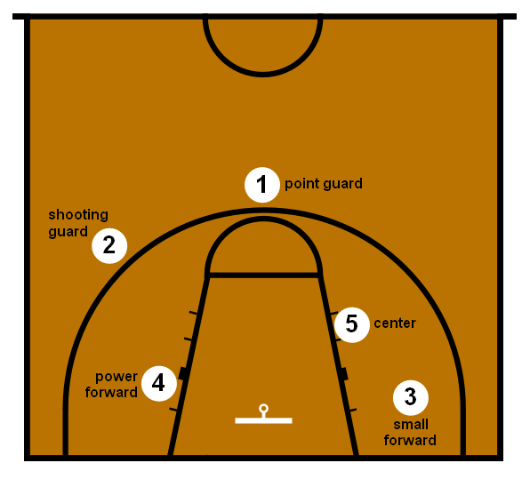

# NBA Individual performance


```{r setup, include=FALSE}
knitr::opts_chunk$set(echo = TRUE, message=F, warning=F)
library(SportsAnalytics270)
library(dplyr)
library(ggplot2)
library(VGAM)
library(zoo)
library(tidyr)
```


## NBA Individual performance

2 main stages of the game.

* Attacking
* Defending

https://www.youtube.com/watch?v=wYjp2zoqQrs

## NBA Individual performance

5 main positions on the field.

* Center - On offense, the center tries to score on close shots and rebound. But on defense, the center tries to block opponents’ shots and rebound their misses.  

* Power Forward - The power forward does many of the things a center does, playing near the basket while rebounding and defending taller players. But power forwards also take longer shots than centers.  

* Small Forward - The small forward plays against small and large players. They roam all over on the court. Small forwards can score from long shots and close ones.  

* Point Guard - The point guard runs the offense.The point guard defends the opponent’s point guard and tries to steal the ball.  

* Shooting Guard - The shooting guard can make shots from long distance and also is a good dribbler.

Let's watch a short video,  

https://www.youtube.com/watch?v=4_4CymXARWQ

## NBA Individual performance

```{r echo=F, fig.align='center', out.height="80%", out.width="60%"}

```

## NBA Individual performance

Defining attributes for each position.

* Center - The center is the tallest player on each team, playing near the basket.
* Power Forward - The power forward is very close to center player, but in this position they should also have good shooting attributes.
* Small Forward - The small forward should have good shooting efficiency in close and far distances.
* Point Guard - The point guard should have good defending characteristics.
* Shooting Guard - The shooting guard should have good dribbling attributes and shooting accuracy in long ranges.

What measures other than the height and shooting can be used to position the players on the field ?

## NBA Individual performance

In game statistics

* STEALS 
 
* TURNOVERS - Turnover occurs when a team loses possession of the ball to the opposing team before a player takes a shot at their team's basket.  
https://www.youtube.com/shorts/I4MDXOWrUmk
* REBOUNDS
  1. OFFENSIVE REBOUNDS - An offensive rebound occurs when offensive players regain possession of the ball after a missed shot.
  2. DEFENSIVE REBOUNDS -  Defensive rebounds occur when defensive players gain possession of the ball after an offensive player misses the shot.
* BLOCKS - Block occurs when a defensive player legally deflects a field goal attempt from an offensive player to prevent a score.
* FOULS
  1. PERSONAL FOULS
  2. FLAGRANT FOULS
  3. TECHINCAL FOULS


## NBA Individual performance

### Dataset

```{r, include = F}
nba_players <- read.csv("../data/Seasons_Stats.csv") %>%
  filter(Year > 2000)
```

\tiny
```{r}
str(nba_players)
```


## NBA Individual performance

Let's select the performance metrics.

```{r}
nba_players <- nba_players %>%
  select(Year, Player, Pos,
         G, MP, STL, TOV, ORB, DRB, PF, BLK, PTS, AST,
         FT, FTA, FG, FGA, X3P, X3PA, ) %>%
  arrange(Player, Year)
head(nba_players, 3)
```

## NBA Individual performance

Let's try to evaluate the player's performance based on the amount of time they spent on the field.  
We will use the players' historical data to measure their performance for each Year, by taking 5 preceding Years only in order to avoid one Year stars.
We will use success/failure approach by dividing the metrics of the players into successful and non-succesfull actions and then compare their success rate with their playing Minutes.

## NBA Individual performance

Let's start with defending attributes.

Successful actions, when defending  

* STEALS
* BLOCKS
* DEFENSIVE REBOUNDS

Non Successful actions, when defending  


* PERSONAL FOULS
* TURNOVER

## NBA Individual performance

Let's calculate the difference between the cumulative success actions and cumulative failure actions.  
\tiny
```{r}
nba_players_defense <- nba_players %>%
  arrange(Player, Year)  %>% 
  group_by(Player) %>%
  mutate(CUM_STL = rollmean(STL, k = 5, fill = NA, align="right"),
         CUM_TOV = rollmean(TOV, k = 5, fill = NA, align="right"),
         CUM_DRB = rollmean(DRB, k = 5, fill = NA, align="right"),
         CUM_PF = rollmean(PF, k = 5, fill = NA, align="right"),
         CUM_BLK = rollmean(BLK, k = 5, fill = NA, align="right"),
         CUM_MP = rollmean(MP, k = 5, fill = NA, align = "right"),
         CUM_SUCCESS_1 = CUM_STL - CUM_TOV,
         CUM_SUCCESS_2 = CUM_STL - CUM_PF,
         CUM_SUCCESS_3 = CUM_DRB - CUM_TOV,
         CUM_SUCCESS_4 = CUM_DRB - CUM_PF,
         CUM_SUCCESS_5 = CUM_BLK - CUM_TOV,
         CUM_SUCCESS_6 = CUM_BLK - CUM_PF,
         SUCCESS_1 = STL - TOV,
         SUCCESS_2 = STL - PF,
         SUCCESS_3 = DRB - TOV,
         SUCCESS_4 = DRB - PF,
         SUCCESS_5 = BLK - TOV,
         SUCCESS_6 = BLK - PF,
         ) %>%
  drop_na() %>%
  ungroup()
```

## NBA Individual performance

Let's check if the cumulative metrics are correlated to the amount of time the players spent on the field.

```{r}
cor_with_MP <- function(x){
  return(cor(x, nba_players_defense$MP))
}

nba_players_defense %>%
  select(CUM_SUCCESS_1, CUM_SUCCESS_2, CUM_SUCCESS_3,
         CUM_SUCCESS_4, CUM_SUCCESS_5, CUM_SUCCESS_6, CUM_MP) %>%
  apply(2,cor_with_MP)
```

## NBA Individual performance

Now let's do the same for Seasonal metrics.


```{r}
nba_players_defense %>%
  select(SUCCESS_1, SUCCESS_2, SUCCESS_3,
         SUCCESS_4, SUCCESS_5, SUCCESS_6) %>%
  apply(2,cor_with_MP)
```

## NBA Individual performance

The metric with the highest positive correlation rate is the Seasonal difference between
the cumulative number of defensive rebounds made and cumulative number of turnovers made.  

\tiny
```{r, out.height="60%", fig.align="center"}
ggplot(nba_players_defense, aes(x = SUCCESS_4, y = (MP))) + 
  geom_point() + 
  ggtitle("Number of Minutes played vs Seasonal defensive rating(DRB - PF)") + 
  xlab("Seasonal Defensive Rating(DRB - PF)") + 
  ylab("Minutes played")
```

## NBA Individual performance

The metric with the lowest positive correlation rate is the difference between
the cumulative number of blocks made and cumulative number of turnovers made.  

\tiny
```{r, out.height="60%",fig.align="center"}
ggplot(nba_players_defense, aes(x = SUCCESS_5, y = (MP))) + 
  geom_point() + 
  ggtitle("Number of Minutes played vs Seasonal defensive rating(BLK - TOV)") + 
  xlab("Seasonal Defensive Rating(BLK - TOV)") + 
  ylab("Minutes played")
```

## NBA Individual performance

Let's drop the difference between  number of steals made and fouls made, as it has almost 0 correlation with the number of Minutes played and then fit a model with the defensive power ratings.  

\tiny
```{r}
nba_players_defense <- nba_players_defense %>%
  select(-CUM_SUCCESS_2, SUCCESS_2)

summary(lm(MP ~ (SUCCESS_4 + CUM_SUCCESS_4 + CUM_SUCCESS_5 
                  + SUCCESS_5 + CUM_MP ), data = nba_players_defense))
```

## NBA Indvidual performance.

Dropping the cumulative average of Minutes played to understand the model's power on estimating the players' number of Minutes on the field without preceding 5 Year.

\tiny
```{r}
summary(lm(MP ~ (SUCCESS_4 + CUM_SUCCESS_4 + CUM_SUCCESS_5 
                  + SUCCESS_5 ), data = nba_players_defense))
```

## NBA Individual performance

We can see that all the cumulative metrics of the player's except the average number of Minutes played in preceeding 5 seaons, do not have as much significance as Seasonal values, so we can conclude that the number of Minutes the players will have on the field is connected to their previous Year statistics, but can change based on their Seasonal performance.


## NBA Individual performance

For the attacking attributes we will calculate the difference between the attempts made for successful actions and actual successful actions.

Successful actions, when attacking  

* FIELD GOALS
* 3 POINT GOALS
* FREE THROWS
* OFFENSIVE REBOUNDS
* POINTS SCORED
* ASSISTS MADE

Non Successful actions, when attacking  

* FIELD GOALS ATTEMPTS
* 3 POINT ATTEMPTS
* FREE THROW ATTEMPTS

## NBA Individual performance


```{r}
nba_players_offense <- nba_players %>%
  arrange(Player, Year)  %>% 
  group_by(Player) %>%
  mutate(CUM_FG = rollmean(FG, k = 5, fill = NA, align="right"),
         CUM_FGA = rollmean(FGA, k = 5, fill = NA, align="right"),
         CUM_X3P = rollmean(X3P, k = 5, fill = NA, align="right"),
         CUM_X3PA = rollmean(X3PA, k = 5, fill = NA, align="right"),
         CUM_FT = rollmean(FT, k = 5, fill = NA, align="right"),
         CUM_FTA = rollmean(FTA, k = 5, fill = NA, align="right"),
         CUM_AST = rollmean(AST, k = 5, fill = NA, align="right"),
         CUM_PTS = rollmean(PTS, k = 5, fill = NA, align="right"),
         CUM_ORB = rollmean(PTS, k = 5, fill = NA, align="right"),
         CUM_MP = rollmean(MP, k = 5, fill = NA, align="right"),
         SUCCESS_1 = FGA - FG,
         SUCCESS_2 = X3PA - X3P,
         SUCCESS_3 = FTA - FT,
         CUM_SUCCESS_1 = CUM_FGA - CUM_FG,
         CUM_SUCCESS_2 = CUM_X3PA - CUM_X3P,
         CUM_SUCCESS_3 = CUM_FTA - CUM_FT,
         ) %>%
  drop_na() %>%
  ungroup()
```
## NBA Individual performance

Let's check if the cumulative metrics are correlated to the amount of time the players spent on the field.

```{r}
cor_with_MP <- function(x){
  return(cor(x, nba_players_offense$MP))
}

nba_players_offense %>%
  select(CUM_SUCCESS_1, CUM_SUCCESS_2, CUM_SUCCESS_3, CUM_AST, CUM_MP, CUM_PTS) %>%
  apply(2,cor_with_MP)
```

## NBA Individual performance

Let's check if the Seasonal metrics are correlated to the amount of time the players spent on the field.

```{r}
cor_with_MP <- function(x){
  return(cor(x, nba_players_offense$MP))
}

nba_players_offense %>%
  select(SUCCESS_1, SUCCESS_2, SUCCESS_3, AST, PTS) %>%
  apply(2,cor_with_MP)
```

## NBA Individual performance

The Seasonal metric with the highest correlation is the difference between the number of points scored by the player.

\tiny
```{r, out.height="60%",fig.align="center"}
ggplot(nba_players_offense,aes(x = PTS, y = MP)) + 
  geom_point() +
  ggtitle("Number of Minutes played vs Seasonal offensive rating(PTS)") + 
  xlab("Points scored") + 
  ylab("Minutes played")
```
## NBA Individual performance

The cumulative metric with the highest correlation is again the number of points scored.


\tiny
```{r, out.height="60%",fig.align="center"}
ggplot(nba_players_offense,aes(x = CUM_PTS, y = MP)) + 
  geom_point() +
  ggtitle("Number of Minutes played vs Seasonal offensive rating(PTS)") + 
  xlab("Cumulative mean of Points scored") + 
  ylab("Minutes played")
```


## NBA Individual performance
\tiny
```{r}
summary(lm(MP ~ (PTS + AST + SUCCESS_1 +
                  + CUM_SUCCESS_1 + CUM_PTS + CUM_AST + CUM_MP ), data = nba_players_offense))
```

## NBA Indvidual performance.

Dropping the cumulative average of Minutes played to understand the model's power on estimating the players' number of Minutes on the field without preceding 5 Years.

\tiny
```{r}
summary(lm(MP ~ (PTS + AST + SUCCESS_1 +
                  + CUM_SUCCESS_1 + CUM_PTS + CUM_AST), data = nba_players_offense))
```


## NBA Individual performance

We can again see that the Seasonal metrics have higher contribution to the number of Minutes played, and we can conclude that the players who are making more attempts to score field goal are generally playing more.