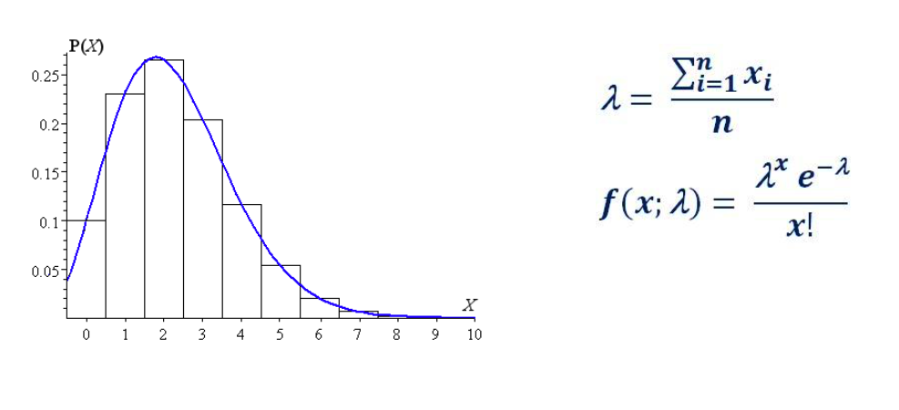
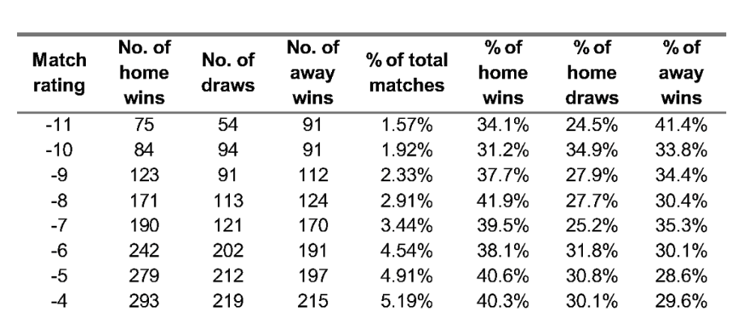

# Predicting with distributions

## Predicting with distributions

Suppose we have two variables with normal distribution,

* Home team score
* Away team score

\begin{center}
$H \sim N( \mu_H, \sigma_H ^ 2)$
\end{center}
\bcenter
$A \sim N( \mu_A, \sigma_A ^ 2)$
\ecenter


Then the difference between the home and away teams scores will also have normal
distribution with the following parameters (assuming this two are independent)

\bcenter

$\mu_d = \mu_H - m_A$\
$\sigma_D ^ 2 = \sigma_H ^ 2 + \sigma_A ^ 2$ \

\ecenter

Thus the difference will have a normal distribution with the following parameters

\bcenter

$D \sim N( \mu_H - \mu_A, \sigma_H ^ 2 + \sigma_A ^ 2 )$

\ecenter

## Predicting with distributions
* In NBA (National Basketball Association) points scored per
game by home and away teams follow normal distribution.

* Install package SportsAnalytics270 from github.

* The package contains data for Sports analytics.

```{r md_setup, include=FALSE}
knitr::opts_chunk$set(echo = TRUE, tidy = F,  collapse = TRUE, warning=F, message = F, out.width = '80%', size = 'footnotesize', fig.align = "center", size = "small", fig.height=6,fig.align='center')
library(SportsAnalytics270)
library(dplyr)
library(ggplot2)
library(reshape2)
library(zoo)
library(VGAM)
```

```{r cse_270_setup_1, eval=FALSE, warning=FALSE, message=FALSE}
install.packages("remotes")
remotes::install_github("HABET/CSE270", dependencies = TRUE)
SportsAnalytics270::install_github_course_packages(force=T)
```

## Predicting with distributions

The list of necessary packages

```{r, eval=F, echo=T}
library(SportsAnalytics270)
library(dplyr)
library(ggplot2)
library(reshape2)
library(zoo)
library(VGAM)
```

## Predicting with distributions

Dataframe nba_games contains NBA regular season games from 2009 to 2025-2026 season 

```{r}
options(width = 65)
data("nba_games")
head(nba_games, 2)
```

## Predicting with distributions

Plot the histogram for home points

```{r}
ggplot(nba_games, aes(x=home.PTS))+geom_histogram()
```

## Predicting with distributions

Exclude Boston-Celtics game

```{r, fig.height=5}
ggplot(nba_games, aes(x=home.PTS)) + geom_histogram() + xlim(c(50,155))+
  labs(x="Home Points", title="Histogram for points per game by home team")
```

## Predicting with distributions

```{r}
ggplot(nba_games, aes(x=away.PTS)) + geom_histogram() + xlim(c(50,150)) +
  labs(x="Away Points", title="Histogram for points per game by away team")
```

## Predicting with distributions

Histogram of home and away points together

```{r}
ggplot(nba_games) + geom_histogram(aes(x=away.PTS), fill='red') +
  geom_histogram(aes(x=home.PTS),fill='blue') +
  xlim(c(50,155)) + labs(x="Points", title="Home/away points")
```

## Predicting with distributions
Home points for last season only

```{r}
nba_games %>% filter(SEASON_ID=='2026') %>%
ggplot(aes(x = home.PTS)) + geom_histogram() + xlim(c(50,155))+
  labs(x="Home Points", title="Histogram for points for last season")
```

## Predicting with distributions
What about Points difference ?

```{r}
nba_games$Diff = nba_games$home.PTS-nba_games$away.PTS
ggplot(nba_games, aes(x=Diff)) + geom_histogram(bins=50) +
  labs(x="Points Difference", title="Histogram for points difference")
```


## Predicting with distributions

Test hypothesis of Normality:

\bcenter

$H_0:$ *sample came from normal distribution* \
$H_1:$ *sample did not come from normal distribution* \

\ecenter

Find the p-value of the test: if $\alpha$ is more than 0.05 then it has a normal
distribution
failed to reject $H_0$


## Predicting with distributions

```{r}
nba_games %>%
  filter(SEASON_ID=='2026') %>%
  group_by(home.TEAM_ABBREVIATION) %>%
  filter(n() >= 3) %>%  # shapiro.test needs sample size between 3 and 5000
  summarise(p_value = shapiro.test(home.PTS)$p.value)%>%
    arrange(p_value)
```

## Predicting with distributions

Away points: Normal distribution with $\alpha$ = 0.05

```{r}

nba_games %>%
  filter(SEASON_ID=='2026') %>%
  group_by(away.TEAM_ABBREVIATION) %>%
  filter(n() >= 3) %>%  # shapiro.test needs sample size between 3 and 5000
  summarise(p_value = shapiro.test(away.PTS)$p.value)%>%
  arrange(p_value)
```


## Predicting with distributions

Suppose we have two variables with normal distribution,

* Home team score
* Away team score

\bcenter

$H \sim N( \mu_H, \sigma_H ^ 2)$\
$A \sim N( \mu_A, \sigma_A ^ 2)$

\ecenter

Then the difference between the home and away teams scores will also have normal
distribution with the following parameters (assuming this two are independent)

\bcenter

$\mu_d = \mu_H - m_A$\
$\sigma_D ^ 2 = \sigma_H ^ 2 + \sigma_A ^ 2$

\ecenter

Thus the difference will have a normal distribution with the following parameters

\bcenter

$D \sim N( \mu_H - \mu_A, \sigma_H ^ 2 + \sigma_A ^ 2 )$

\ecenter

## Predicting with distributions

Create dataframes with means and standard deviations for each team, for the last season


```{r}
# Exclude All-Star / exhibition sides (too few games for stable variance)
nba_reg = nba_games %>%
  filter(SEASON_ID=='2026',
         !home.TEAM_ABBREVIATION %in% c("STARS","STRIPES","WORLD"),
         !away.TEAM_ABBREVIATION %in% c("STARS","STRIPES","WORLD"))

home = nba_reg %>%
        group_by(home.TEAM_ABBREVIATION) %>%
        summarise(mean = mean(home.PTS),
                  var  = var(home.PTS))

away = nba_reg %>%
        group_by(away.TEAM_ABBREVIATION) %>%
        summarise(mean = mean(away.PTS),
                  var  = var(away.PTS))
```

## Predicting with distributions

Dallas Mavericks playing @ Washington Wizards
Wizards are the home team, Mavericks are the away team

```{r echo=F}

```

## Predicting with distributions

Calculate the mean and standard deviation for the points difference between these two teams

\bcenter

$s_D = \sqrt{\sigma^2_H + \sigma^2_A}$

\ecenter

```{r}
(mean = home$mean[home$home.TEAM_ABBREVIATION=="WSH"]-
  away$mean[away$away.TEAM_ABBREVIATION=="DAL"])

(sd = sqrt(home$var[home$home.TEAM_ABBREVIATION=="WSH"]+
  away$var[away$away.TEAM_ABBREVIATION=="DAL"]))
```


## Predicting with distributions

Simulate 10,000 games and plot the histogram. Can you see the home team advantage ?


```{r}
set.seed(1)
diff = rnorm(10000, mean, sd)
ggplot()+geom_histogram(aes(x=diff))+
  labs(x="Points Difference", title="Histogram of Points difference")
```


## Predicting with distributions

Now let's calculate the probabilities of home and away teams to win

* Away team to win $P(x<0)$
* Home team to win $P(x>0)$

## Predicting with distributions

### Probability of away team to win

```{r}
pnorm(0, mean, sd, lower.tail = T)
```

## Predicting with distributions
### Probability of home team to win

```{r}
pnorm(0, mean, sd, lower.tail = F)
```

## Predicting with distributions

**Probability of home team to win with more than 15 points difference**

Home team will win with spread of 15 points

```{r}
pnorm(15, mean, sd, lower.tail = F)
```


## Predicting with distributions

```{r}
home_away = list(home,away)
probs = function(data, home, away, spread=0){
  home_df = data[[1]]
  away_df = data[[2]]
  mean_home = home_df$mean[home_df$home.TEAM_ABBREVIATION==home]
  mean_away = away_df$mean[away_df$away.TEAM_ABBREVIATION==away]
  mean_diff = mean_home-mean_away
  var_home = home_df$var[home_df$home.TEAM_ABBREVIATION==home]
  var_away = away_df$var[away_df$away.TEAM_ABBREVIATION==away]
  sd_diff = sqrt(var_home+var_away)
  df = data.frame(pnorm(spread, mean_diff, sd_diff, lower.tail = F),
                   pnorm(spread, mean_diff, sd_diff))
  colnames(df) = c(home, away)
  return(df)
}
```

## Predicting with distributions

```{r}
probs(home_away, home="WSH", away="DAL", 0)
```


# Predicting football games results


## Predicting football games results

Let's recall what is Poisson distribution about

```{r echo=F}

```

## Predicting football games results

### Dataset

```{r}
data(f_data_sm)
head(f_data_sm)
```

## Predicting football games results

### Full time total goals distribution for Serie A, Season 2025-2026

```{r}
f_data_sm %>%
  filter(COUNTRY=="Italy", SEASON=="2026") %>%
ggplot(aes(x=FTTG))+geom_bar()+
ggtitle("Full time goals distribution for Serie A-2026")
```


## Predicting football games results

### Distribution of home team full time goals
```{r}
f_data_sm %>%
  filter(COUNTRY=="Italy", SEASON=="2026") %>%
ggplot(aes(x=FTHG))+geom_bar()+
ggtitle("Full time home team goals distribution for Serie A- 2026")
```

## Predicting football games results

Does the total number of goals scored follows Poisson distribution?  

First find the $\lambda$ (average number of goals per game)

```{r}
f_data_sm %>%
  filter(COUNTRY=="Italy", SEASON=='2026') %>%
  summarise(mean(FTTG))
```

## Predicting football games results

We can test the hypothesis, whether the goal’s distribution is Poisson: Our hypothesis is the following:

\bcenter

$H_0:$ *The variables have Poisson distribution*

\ecenter

\bcenter

$H_1:$ *The variables do not have Poisson distribution* 

\ecenter

We will test the hypothesis with Chi-square test: thus comparing empirical probability distribution (from the data) and hypothethical Poisson distribution

## Predicting football games results

### Goal frequencies

```{r}
(seriea = f_data_sm %>%
          filter(COUNTRY=="Italy", SEASON=="2026") %>%
          group_by(FTHG) %>%
          summarise(count = n()) %>%
          as.data.frame())
```

## Predicting football games results

We will use chi-square test

First create a vector with observed relative frequencies

```{r}
(rel_fr=seriea$count/sum(seriea$count))
```

```{r}
(h_goals_mean_italy <- (f_data_sm %>%
                        filter(COUNTRY=="Italy", SEASON=="2026") %>%
                          summarize(mean(FTHG)))$`mean(FTHG)`)
```

Then create expected relative frequencies (probabilities), under the assumption that the variable follows Poisson distribution with $\lambda$=`r h_goals_mean_italy`


```{r}
(probs=dpois(c(0:6), lambda=h_goals_mean_italy))
```

## Predicting football games results

Is there a significant difference between these two ?

```{r}
chisq.test(rel_fr, p=probs, rescale.p = T, simulate.p.value = TRUE)

```
High p-value talks in favor for NULL hypothesis, meaning that the observed result is unlikely to happen by chance. We failed to reject the null hypothesis, thus we have a Poisson distribution

## Predicting football games results

Lazio (Home team) vs. Fiorentina(Away team)

```{r echo=F}

```


## Predicting football games results

* We assume that probabilities for Lazio and Fiorentina scoring are independent from each other.
* Thus: $P(L=0 \cap F=0) = P(L=0) * P(F=0) ...$
* If you want to find the probability of the draw then, \ 
$P(L=0 \cap F=0 \cup L=1 \cap F=1 \cup L=2 \cap F=2)$
* As {$L=0 \cap F=0 \cup L=1 \cap F=1 \cup L=2 \cap F=2$} events are mutually exclusive, \ the probability of the draw can be calculated as.

\bcenter

$P(L=0 \cap F=0) + P(L=1 \cap F=1) + P(L=2 \cap F=2) ... =$
$P(L=0) * P(F=0) + P(L=1) * P(F=1) ...$

\ecenter

## Predicting football games results

Means ( $\lambda$ parameters) for home and away teams

```{r}
data("f_data_sm")

home_means = f_data_sm %>%
                filter(COUNTRY=="Italy", SEASON=="2026") %>%
                group_by(HOMETEAM) %>%
                summarise(mean = mean(FTHG))

away_means = f_data_sm %>%
                filter(COUNTRY=="Italy", SEASON=="2026") %>%
                group_by(AWAYTEAM) %>%
                summarise(mean = mean(FTAG))
```


## Predicting football games results

For Lazio as a home team
and for Fiorentina as an away team

```{r tidy=F}

(Lazio = home_means$mean[home_means$HOMETEAM=="Lazio"])

(Fiorentina= away_means$mean[away_means$AWAYTEAM=="Fiorentina"])

```

## Predicting football games results

Generate vector of probabilities for number of goals scored for both teams.  

Range from 0 to 9 

```{r}
options(scipen=999)
goal_probs_lazio=dpois(c(0:9), lambda=Lazio)
goal_probs_fiorentina=dpois(c(0:9), lambda=Fiorentina)
```

```{r}
goal_probs_lazio
```

```{r}
goal_probs_fiorentina
```

## Predicting football games results

Multiplying two vectors of probabilities we will get the matrix of probabilities for a given result

```{r }
options(width = 300)
a=goal_probs_fiorentina %*% t(goal_probs_lazio)
a=round(a, digits=4)
print(a)
```

## Predicting football games results

The probability that the game will end 0-0

```{r, echo=F}
options(kableExtra.latex.load_packages = FALSE) 
library(kableExtra)

a_df <- as.data.frame(a)

library(knitr)
library(kableExtra)

# for (i in 1:(ncol(a_df))) {
#   a_df[i,i] <- cell_spec(a_df[i, i], bold=T)
# }
a_df[1,1] <- paste0("\\textcolor{red}{\\textbf{", a_df[1,1], "}}")
a_df <- cbind((0:9), a_df)
colnames(a_df) <- c("",0:9)

kable(a_df, "latex", escape=F)
```

## Predicting football games results

3 1 Lazio winning 

```{r, echo=F}
options(kableExtra.latex.load_packages = FALSE) 
library(kableExtra)

a_df <- as.data.frame(a)
colnames(a_df) <- 1:10

library(knitr)
library(kableExtra)

# 
# for(i in 1:(ncol(a_df))){
#   a_df[i, 2] <- paste0("\\textcolor{red}{\\textbf{", a_df[i,2], "}}")
#   
# }
# 
# for(i in 1:(ncol(a_df))){
#   if(i!=2){
#       a_df[4,i] <- paste0("\\textcolor{red}{\\textbf{", a_df[4,i], "}}")
#   }
# }

a_df[4,2] <- paste0("\\textcolor{red}{\\textbf{", a_df[4,2], "}}")

a_df <- cbind((0:9), a_df)
colnames(a_df) <- c("",0:9)

kable(a_df, "latex", escape=F)
```


## Predicting football games results

Probability of draw: sum all elements on the diagonal

```{r, echo=F}
options(kableExtra.latex.load_packages = FALSE) 
library(kableExtra)

a_df <- as.data.frame(a)
colnames(a_df) <- 1:10

library(knitr)
library(kableExtra)

for (i in 1:(ncol(a_df))) {
  a_df[i,i] <- paste0("\\textcolor{red}{\\textbf{", a_df[i,i], "}}")
}

a_df <- cbind((0:9), a_df)
colnames(a_df) <- c("",0:9)

kable(a_df, "latex", escape=F)
```

## Predicting football games results

Probability of Fiorentina winning: Sum of all the probabilities in the lower triangle, without diagonal

```{r, echo=F}
options(kableExtra.latex.load_packages = FALSE) 
library(kableExtra)

a_df <- as.data.frame(a)
colnames(a_df) <- 1:10

library(knitr)
library(kableExtra)

for (i in 2:(ncol(a_df))) {
  for( j in 1:i){
    if(i != j){
        a_df[i,j] <- paste0("\\textcolor{red}{\\textbf{", a_df[i,j], "}}")
    }
  }
}

a_df <- cbind((0:9), a_df)
colnames(a_df) <- c("",0:9)

kable(a_df, "latex", escape=F)
```

## Predicting football games results

Probability of Lazio winning: Sum of all the probabilities in the upper triangle, without diagonal

```{r, echo=F}
options(kableExtra.latex.load_packages = FALSE) 
library(kableExtra)

a_df <- as.data.frame(a)
colnames(a_df) <- 1:10

library(knitr)
library(kableExtra)

for (i in 2:(ncol(a_df))) {
  for( j in 1:(i-1)){
    if(i != j){
     a_df[j,i] <- paste0("\\textcolor{red}{\\textbf{", a_df[j,i], "}}")
    }
  }
}

a_df <- cbind((0:9), a_df)
colnames(a_df) <- c("",0:9)

kable(a_df, "latex", escape=F)
```

## Predicting football games results

Probability of game ending in draw
```{r}
sum(diag(a))
```

Probability of Fiorentina winning

```{r}
sum(a[lower.tri(a, diag=F)])
```

Probability of Lazio winning

```{r}
sum(a[upper.tri(a, diag=F)])
```

## Predicting football games results

* Suppose $X$ is a Poisson random variable with mean $\lambda_x$ that describes the number of the goals the home team scores on average.

* Suppose $Y$ is a Poisson random variable with mean $\lambda_y$ that describes the number of the goals the away team scores on average.

* $Z = X - Y$ random variable has a Skellam distribution and $Z$ represents the outcome of the game with respect to the Home team. If $Z > 0$, then the home team has won, if $Z = 0$, then it was a draw, and if $Z < 0$, the home team has lost.

Library for skellam distribution

```{r}
if (!requireNamespace("VGAM", quietly = TRUE)) install.packages("VGAM")
library(VGAM)
```


## Predicting football games results

Histogram for goal difference
\tiny
```{r}
set.seed(1)
k = rskellam(10000,mu1=Lazio, mu2=Fiorentina) 
ggplot()+geom_bar(aes(x=k))+
  labs(x="Goal difference", title="Skellam distribution for goal difference")
```

## Predicting football games results

Calculating probabilities

Probability of home team to win

```{r}
sum(k>0)/10000
```

Probability of draw

```{r}
sum(k==0)/10000
```
Probability of away team to win

```{r}
sum(k<0)/10000
```


# Predicting with Ratings

## Predicting with Ratings


* Every team can have some kind of rating, describing its ability to win.
* In football (soccer) the rating can be expressed as the number of points earned, number of goals scored, number of goals conceded, etc.
* One way to go with rating football teams is to calculate goal supremacy for each team.

\bcenter
**Goal supremacy = Number of scored goals- Number of conceded goals**
\ecenter

## Predicting with Ratings

* Tottenham playing Leeds United (2002).
* Looking at the goal supremacy (goal difference) for each team for their last 6 games
* Both teams will have Goal supremacy rating (we will call it Power Rating) of -3 
* What will be your best guess for probability of Tottenham to win? Draw ?

```{r echo=F}
knitr::include_graphics("./images/leeds_table.png")
```
Adapted from: [“Fixed Odds Sports Betting” – Joseph Buchdahl](https://www.goodreads.com/book/show/871922.Fixed_Odds_Sports_Betting)


## Predicting with Ratings

Steps for Power Rating calculation

* Get the Goal Supremacy Rating (Power) for each team $n$ games before the given game.
* Calculate Power Difference for home/away teams – Match rating
* Look at the relative frequencies for home team win, draw and away team win for the
given power difference.
* Those will be the probabilities

## Predicting with Ratings

Kind of table we need

```{r echo=F}

```

## Predicting with Ratings

* Subset the f_data_sm to get only the games for England
* Select columns with team names, date, season indicator and final score

```{r}
data(f_data_sm)
england = f_data_sm %>%
  filter(COUNTRY == "England") %>%
  arrange(DATE) %>%
  select("SEASON","DATE","HOMETEAM","AWAYTEAM","FTHG", "FTAG")%>%
  mutate(ID = 1:n())
```


## Predicting with Ratings

Reshape to long format: one row per team in each game

```{r}
# Vectorized last-6 power ratings (same idea as a game-by-game loop, much faster)
england_long <- reshape2::melt(
  england,
  id.vars = c("ID", "HOMETEAM", "AWAYTEAM", "SEASON", "DATE"),
  measure.vars = c("FTHG", "FTAG"),
  variable.name = "H_A"
) %>%
  arrange(ID) %>%
  mutate(
    TEAM1 = ifelse(H_A == "FTAG", AWAYTEAM, HOMETEAM),
    TEAM2 = ifelse(H_A == "FTAG", HOMETEAM, AWAYTEAM)
  ) %>%
  select(ID, SEASON, DATE, TEAM1, TEAM2, H_A, value)
```

## Predicting with Ratings

For each team, goals scored and conceded in the last 6 games of the same season

```{r}
england_long1 <- england_long %>%
  group_by(SEASON, TEAM1) %>%
  mutate(CUM_SC = dplyr::lag(
    zoo::rollapply(value, 6, sum, fill = NA, align = "right"), 1)) %>%
  ungroup() %>%
  group_by(SEASON, TEAM2) %>%
  mutate(CUM_C = dplyr::lag(
    zoo::rollapply(value, 6, sum, fill = NA, align = "right"), 1)) %>%
  ungroup() %>%
  filter(!is.na(CUM_SC), !is.na(CUM_C)) %>%
  select(ID, H_A, value, CUM_SC, CUM_C) %>%
  as.data.frame()
```

## Predicting with Ratings

Reshape back to wide format: one row per game again

```{r}
england_wide <- reshape(
  england_long1,
  direction = "wide",
  timevar = "H_A",
  idvar = "ID",
  v.names = c("value", "CUM_SC", "CUM_C")
)
```

## Predicting with Ratings

Calculate `POWERHOME`, `POWERAWAY`, `POWERDIFF` and `RESULT`

```{r}
england <- england %>%
  inner_join(england_wide, by = "ID") %>%
  mutate(
    POWERHOME = CUM_SC.FTHG - CUM_C.FTAG,
    POWERAWAY = CUM_SC.FTAG - CUM_C.FTHG,
    POWERDIFF = POWERHOME - POWERAWAY,
    RESULT = ifelse(FTHG > FTAG, "HW",
                    ifelse(FTHG < FTAG, "AW", "D"))
  ) %>%
  select(SEASON, DATE, HOMETEAM, AWAYTEAM, FTHG, FTAG,
         POWERHOME, POWERAWAY, POWERDIFF, RESULT) %>%
  filter(!is.na(POWERDIFF))
```

<!-- reshape the data into long format -->

<!-- ```{r, tidy=F} -->
<!-- england_long = england %>% reshape2::melt( -->
<!--           id.vars = c("ID","HOMETEAM","AWAYTEAM","SEASON", "DATE"),  -->
<!--           measure.vars = c("FTHG", "FTAG"), variable.name="H_A") %>%  -->
<!--           arrange(ID) -->

<!-- england_long = england_long[order(england_long$ID),] -->
<!-- rownames(england_long) = NULL -->
<!-- ``` -->

<!-- ## Predicting with Ratings -->

<!-- New dataset -->

<!-- ```{r} -->
<!-- head(england_long) -->
<!-- ``` -->

<!-- ## Predicting with Ratings -->

<!-- Make changes in H_A variable -->


<!-- ```{r, tidy=F} -->
<!-- england_long$TEAM1 = ifelse(england_long$H_A =='FTAG',  -->
<!--                              england_long$AWAYTEAM, england_long$HOMETEAM) -->

<!-- england_long$TEAM2 = ifelse(england_long$H_A =='FTAG',  -->
<!--                              england_long$HOMETEAM, england_long$AWAYTEAM) -->

<!-- england_long = england_long %>%  -->
<!--   select(ID, SEASON, DATE, TEAM1, TEAM2, H_A, value) -->
<!-- ``` -->

<!-- ## Predicting with Ratings -->
<!-- ```{r} -->
<!-- head(england_long) -->
<!-- ``` -->


<!-- ## Predicting with Ratings -->

<!-- * Calculate the scored and conceded goals for the last 6 games per season for each team -->
<!-- * rollapply from zoo and lag from dplyr are used here -->
<!-- * At the end change the class of the object back to dataframe (from tibble that is -->
<!-- default for dplyr) -->

<!-- ```{r} -->
<!-- england_long1 = england_long %>% -->
<!-- group_by(SEASON, TEAM1) %>% -->
<!-- mutate(CUM_SC = dplyr::lag(rollapply(value,6,sum, fill=NA, align='right'),1)) %>% -->
<!-- ungroup() %>% -->
<!-- group_by(SEASON, TEAM2) %>% -->
<!-- mutate(CUM_C = dplyr::lag(rollapply(value,6,sum, fill=NA, align='right'),1)) %>% -->
<!-- filter(CUM_SC != "NA") %>% as.data.frame() -->
<!-- ``` -->


<!-- ## Predicting with Ratings -->

<!-- Important: -->
<!-- Round 7 game Arsenal vs Ipswich.   -->

<!-- * In last 6 games Arsenal scored 7 goals and conceded 5   -->

<!-- * In last 6 games Ipswich scored 7 and conceded 3 -->

<!-- ```{r} -->
<!-- head(england_long1) -->
<!-- ``` -->

<!-- ## Predicting with Ratings -->

<!-- Get back to wide format -->

<!-- ```{r} -->
<!-- england = reshape(england_long1, direction="wide", -->
<!--                           timevar = "H_A", idvar = "ID",  -->
<!--                           v.names=c("value", "CUM_SC", "CUM_C")) -->
<!-- ``` -->

<!-- ```{r} -->
<!-- options(width=80) -->
<!-- head(england) -->
<!-- ``` -->

<!-- ## Predicting with Ratings -->

<!-- Calculate POWERHOME, POWERAWAY and POWERDIFF and RESULT -->

<!-- ```{r, tidy=F} -->
<!-- england$POWERHOME = england$CUM_SC.FTHG-england$CUM_C.FTAG -->
<!-- england$POWERAWAY = england$CUM_SC.FTAG-england$CUM_C.FTHG -->
<!-- england$POWERDIFF = england$POWERHOME-england$POWERAWAY -->

<!-- england$RESULT = ifelse(england$value.FTHG>england$value.FTAG,"HW", -->
<!-- ifelse(england$value.FTHG<england$value.FTAG, "AW", "D")) -->

<!-- england = england %>%  -->
<!--   select(SEASON, DATE, TEAM1, TEAM2, value.FTHG, -->
<!--                   value.FTAG, POWERHOME, POWERAWAY, POWERDIFF, RESULT) -->
<!-- ``` -->

## Predicting with Ratings

Take out remaining NA’s

```{r}
options(width=80)
england = england[! is.na(england$POWERDIFF),]
head(england)
```

## Predicting with Ratings

Now let's calculate the game result frequencies by Match rating (POWERDIFF)

```{r}
freqs = dcast(england, POWERDIFF~RESULT)
freqs[is.na(freqs)] <- 0
head(freqs)
```

## Predicting with Ratings

Add relative frequencies

```{r}
freqs = data.frame(freqs, freqs[,2:4]/rowSums(freqs[,2:4]))
head(freqs)
```

## Predicting with Ratings

Tottenham vs. Leeds United, two teams with equal Goal Supremacy, the POWERDIFF=0

```{r}
freqs[freqs$POWERDIFF==0,]
```

## Predicting with Ratings

Distribution of Home Wins by Power difference

```{r}
ggplot(freqs, aes(x=POWERDIFF, y = HW))+geom_point()+
  ggtitle("Home wins by Power Difference")
```
## Predicting with Ratings

Look at the relationship between probability of home team to win and power difference, linear with exception of some outliers

```{r}
ggplot(freqs, aes(x=POWERDIFF, y=HW.1))+geom_point()+
  geom_smooth(method="lm", se=F)+
  labs(x="Power Difference", y="Home Win %", title = "POWERDIFF vs HW %")
```
## Predicting with Ratings

Look at the model

```{r}
modelH = lm(HW.1~POWERDIFF, data=freqs)
summary(modelH)
```
## Predicting with Ratings

Away team probability

```{r}
modelA = lm(AW.1~POWERDIFF, data=freqs)
summary(modelA)
```

## Predicting with Ratings

Draw: bad model

```{r}
modelD = lm(D.1~POWERDIFF, data=freqs)
summary(modelD)
```
## Predicting with Ratings

Relationship with probability of draw is more like polynomial

```{r}
ggplot(freqs, aes(x=POWERDIFF, y=D.1))+geom_point()+
  geom_smooth(formula=y~poly(x,2), se=F)+
  labs(x="Power Difference", y="Draws %", title = "POWERDIFF vs Draws %")
  
```

## Predicting with Ratings

Draw: very hard to predict

```{r}
modelD = lm(D.1~poly(POWERDIFF,2), data=freqs)
summary(modelD)
```

# In-class assignment

## In-class assignment

\bcenter
**TIME FOR IN CLASS ACTIVITY !**
\ecenter

* Pick an arbitrary football game from last season (`SEASON == 2026` in `f_data_sm`).
  * A mid-season game is better: both teams then have previous matches in the same season.
* **Distribution approach:** using only same-season games **before** the match you picked, estimate $\lambda$ for the home and away teams. Build the Poisson score matrix (or use Skellam) and get P(home win), P(draw), P(away win).
* **Power difference approach:** compute last-6 goal supremacy for each team, then `POWERDIFF`. Read P(home win), P(draw), P(away win) from the frequency table or the fitted models.

## In-class assignment

* Compare both sets of probabilities with
  * the **actual result** of the game
  * the **pre-game odds** (`H`, `D`, `A` in `f_data_sm` are Bet365 decimal odds; convert to probabilities if you like, $p = 1/\text{odds}$, optionally normalize so they sum to 1)
* Which approach was closer to the bookmaker? Which one matched the actual result?

<!-- ## Predicting with Ratings -->
<!-- Using functions to generalize the procedure and change the country by one line. -->
<!-- \tiny -->
<!-- ```{r} -->
<!-- pick_country <- function(source = f_data_sm, country) { -->
<!--   country <- source %>% -->
<!--     filter(COUNTRY == country) %>% -->
<!--     arrange(DATE) %>% -->
<!--     select("SEASON","DATE","HOMETEAM",  "AWAYTEAM","FTHG", "FTAG")%>% -->
<!--     mutate(ID = 1:n()) -->

<!--   country_long <- reshape2::melt(country,  -->
<!--                                  id.vars = c("ID","HOMETEAM",  "AWAYTEAM",  "SEASON", "DATE"),  -->
<!--                                  measure.vars = c("FTHG", "FTAG"), variable.name="H_A") -->
<!--   country_long <- country_long %>% -->
<!--     arrange(ID) -->
<!--   return(list(wide = country, -->
<!--               long = country_long)) -->
<!-- } -->

<!-- prepare_long <- function(data){ -->
<!--   modified <- data %>% -->
<!--     mutate(TEAM1 = ifelse(H_A == "FTHG", HOMETEAM, AWAYTEAM), -->
<!--            TEAM2 = ifelse(TEAM1 == HOMETEAM, AWAYTEAM, HOMETEAM)) %>% -->
<!--     select(c("ID","SEASON","DATE", "TEAM1","TEAM2", "H_A","value")) -->
<!--   return(modified) -->
<!-- } -->
<!-- ``` -->

<!-- ## Predicting with Ratings -->
<!-- \tiny -->
<!-- ```{r} -->
<!-- goals_scored_conceded <- function(data, n) { -->
<!--   data_long <- data %>% -->
<!--     group_by(SEASON, TEAM1) %>% -->
<!--     mutate(CUM_SC = lag(rollapply(value,n,sum, fill=NA, align='right'),1)) %>% -->
<!--     ungroup() %>% -->
<!--     group_by(SEASON, TEAM2) %>% -->
<!--     mutate(CUM_C = lag(rollapply(value,n,sum, fill=NA, align='right'),1)) %>% -->
<!--     filter(CUM_SC != "NA") -->
<!--   data_long <- as.data.frame(data_long) -->

<!--   data_wide <- reshape(data_long, direction="wide", -->
<!--                           timevar = "H_A", idvar = "ID",  -->
<!--                           v.names=c("value", "CUM_SC", "CUM_C")) -->
<!--   return(list(long = data_long, -->
<!--               wide = data_wide)) -->
<!-- } -->

<!-- get_power_diff <- function(data){ -->
<!--   data$POWERHOME <- data$CUM_SC.FTHG-data$CUM_C.FTAG -->
<!--   data$POWERAWAY <- data$CUM_SC.FTAG-data$CUM_C.FTHG -->
<!--   data$POWERDIFF <- data$POWERHOME-data$POWERAWAY -->
<!--   result <- data %>% -->
<!--     mutate(RESULT = ifelse(value.FTHG > value.FTAG, "HW",  -->
<!--                            ifelse(value.FTHG < value.FTAG, "AW", "D" ) )) %>% -->
<!--     select(c("SEASON","DATE","TEAM1","TEAM2","value.FTHG", -->
<!--              "value.FTAG","POWERHOME", "POWERAWAY","POWERDIFF", "RESULT")) -->
<!--   result <- result[!is.na(result$POWERDIFF),] -->
<!--   return(result) -->
<!-- } -->
<!-- ``` -->

<!-- ## Predicting with Ratings -->

<!-- ```{r} -->
<!-- build_models <- function(freqs) { -->
<!--   modelH <- lm(HW.1 ~ POWERDIFF, data = freqs)   -->
<!--   modelA <- lm(AW.1 ~ POWERDIFF, data = freqs) -->
<!--   modelD <- lm(D.1 ~ POWERDIFF, data = freqs) -->
<!--   modelD_2 <- lm(D.1 ~ poly(POWERDIFF, 2), data = freqs) -->

<!--   return(list(H = modelH, -->
<!--               A = modelA, -->
<!--               D = modelD, -->
<!--               D_2 = modelD_2)) -->
<!-- } -->

<!-- get_final_df_by_country <- function(data, country){ -->
<!--   final_df <- pick_country(source = data, country = country)$wide -->
<!--   final_df_long <- pick_country(source = data, country = country)$long -->
<!--   final_df_long <- prepare_long(data = final_df_long) -->
<!--   final_df_long_1 <- goals_scored_conceded(data = final_df_long, n = 6)$long -->
<!--   final_df_wide <- goals_scored_conceded(data = final_df_long, n = 6)$wide -->
<!--   final_df_wide <- get_power_diff(data = final_df_wide) -->
<!-- } -->
<!-- ``` -->

<!-- ## Predicting with Ratings -->
<!-- ```{r} -->
<!-- italy_power_ratings <- get_final_df_by_country(f_data_sm, "Italy") -->
<!-- freqs <- dcast(italy_power_ratings, POWERDIFF~RESULT) -->
<!-- head(freqs) -->
<!-- ``` -->
