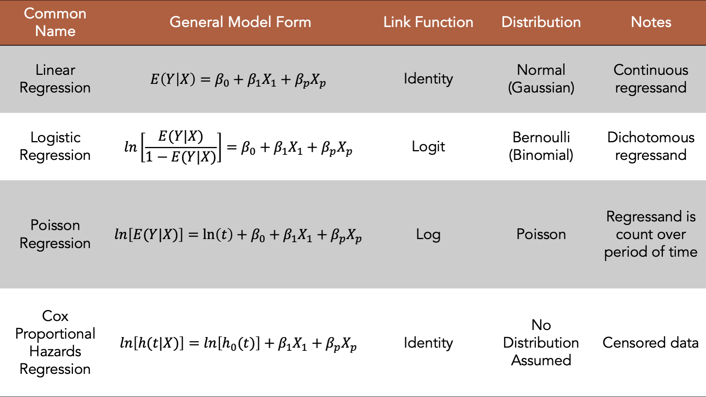

# Poisson regression

## Predicting game outcome with Poisson regression

# Poisson regression

Libraries used

```{r, echo=T, eval=F}
library(dplyr)
library(VGAM)
library(ggplot2)
library(SportsAnalytics270)
library(BradleyTerry2)
```


# Poisson regression

First we are going to test the hypothesis that Home goals and Away goals are
independent.

We will use a $\chi^2$ test of independence of two categorical variables

\bcenter

$H_0:$ Two variables are independent

\ecenter

\bcenter

$H_1:$ Two variables are NOT independent

\ecenter
 
Calculate the p-value and compare with significance level of $\alpha$, if p-value < $\alpha$ reject
the NULL hypothesis


# Poisson regression


First we are going to create categoric variables for Home and Away team goals in a way that
more than 3 goals will be combined together

```{r setup, include=FALSE}
knitr::opts_chunk$set(echo = TRUE, message=F, warning=F)
library(dplyr)
library(VGAM)
library(ggplot2)
library(SportsAnalytics270)
library(BradleyTerry2)
```


```{r}
data("f_data_sm")
df = f_data_sm %>% mutate(FTAG = ifelse(FTAG>=4, "4+", FTAG),
                           FTHG = ifelse(FTHG >=4, "4+", FTHG))
```

# Poisson regression

Recall that $\chi^2$ test is using Expected and Observed frequencies as an input. Thus we
will need to provide a table with joint frequencies of Home and away team goals

```{r}
table(Away=df$FTAG, Home = df$FTHG)
```


# Poisson regression

We do the test for the last season

* We use function chisq.test
* We specify the table with Observed Frequencies

* And specify simulate.p.values = TRUE: This will add robustness to our
test
* We do the test for each country and extract p-values of the test


# Poisson regression


```{r, tidy=F}
df %>% filter(SEASON==2026) %>% group_by(COUNTRY) %>% 
  summarise(pvalue=chisq.test(table(FTAG, FTHG),
                              simulate.p.value=T)$p.value)
```

In general, the hypothesis of independence is not
rejected, at $\alpha$ = 0.05 , Thus they are
independent

# Poisson regression

* Poisson regression is used when the dependent variable is a
count data, i.e. y=0,1,2,3…, thus we assume that the dependent
variable has Poisson distribution
* Independent variables can be both numeric and categorical
* Poisson regression is a part of Generalized Linear Regression
(GLM) models family

# Poisson regression: the general definition

```{r, out.width="80%", out.height="60%", fig.align='center', echo=F}

```


# Poisson regression: the general definition

In this chapter we are fitting the model of the following form

\bcenter
$log(\lambda) = \beta_0 + \beta_1X_1 + \beta_2X_2 + ...$
\ecenter

Where $\lambda$ is the mean of Poisson distribution and $X_1,..X_n$ are the independent
variables

With the estimate of the $\lambda$ we can generate Poisson distribution and calculate the
probabilities for the number of the goals

# Preparing data for the Poisson regression model

The initial data for England, season 2025-2026
Making Predictions for English Premier League

```{r}
data(f_data_sm)
England = f_data_sm %>%
            filter(SEASON==2026, COUNTRY=="England") %>%
            select(HOMETEAM, AWAYTEAM, FTHG, FTAG)  

head(England, n=5)
dim(England)
```

# Preparing data for the Poisson regression model

The data need to be in the following format: 2 rows for each game and the indicator showing if the team is a home team


```{r}
eng1=data.frame(England[,c("HOMETEAM", "AWAYTEAM", "FTHG")], Home=1)
eng2=data.frame(England[,c("AWAYTEAM", "HOMETEAM", "FTAG")], Home=0)
colnames(eng1)=c("Team", "Opponent", "Goal", "Home")
colnames(eng2)=c("Team", "Opponent","Goal", "Home")
England2=rbind(eng1, eng2)
head(England2)
```

# Preparing data for the Poisson regression model

Now let's have a look the game: Tottenham vs Man United

* Tottenham was the home team, and the game ended with 2-0

```{r}
(tottenham_vs_mu <- England %>% 
  filter(HOMETEAM == "Tottenham", AWAYTEAM == "Man United"))
home_team_index <- which(England$HOMETEAM == "Tottenham" & 
                           England$AWAYTEAM == "Man United")
```
# Preparing data for the Poisson regression model

* Let's look at our new dataset

```{r}
England2[home_team_index,]
England2[home_team_index + nrow(England),]
```


The number of the rows in the England2 dataset is twice of the original one

```{r}
dim(England)
dim(England2)
```

# The model 


```{r, eval=F}
model=glm(Goal~Team+Opponent+Home, data=England2, family=poisson(link=log))
coefficients(model)
```


\tiny
```{r, echo=F}
model=glm(Goal~Team+Opponent+Home, data=England2, family=poisson(link=log))
coefficients(model)
```

# The model

\bcenter
**Question.** Do you see any team missing?
\ecenter

```{r}
length(unique(England2$Team))
sum(startsWith(names(coefficients(model)), "Team"))
```

There are 20 teams, but only 19 `Team` coefficients and 19 `Opponent` coefficients.

# The model

**Arsenal** is the missing team.

`glm` turns `Team` and `Opponent` into factors and drops the first level in alphabetical order. That reference level is Arsenal, so

* `TeamArsenal` $= 0$
* `OpponentArsenal` $= 0$

Both sit inside the intercept. Every other coefficient is a comparison with Arsenal.

In 2026 Arsenal finished **1st**, so almost every attack coefficient is negative: the other teams score less than Arsenal.

# The model: season 2020

In **2020** Arsenal finished **8th**. The same model still drops Arsenal, but now the teams that finished above Arsenal have a **positive** attack coefficient.

```{r}
England_2020 <- f_data_sm %>%
  filter(SEASON == 2020, COUNTRY == "England") %>%
  select(HOMETEAM, AWAYTEAM, FTHG, FTAG)
eng1_2020 <- data.frame(England_2020[, c("HOMETEAM", "AWAYTEAM", "FTHG")], Home = 1)
eng2_2020 <- data.frame(England_2020[, c("AWAYTEAM", "HOMETEAM", "FTAG")], Home = 0)
colnames(eng1_2020) <- c("Team", "Opponent", "Goal", "Home")
colnames(eng2_2020) <- c("Team", "Opponent", "Goal", "Home")
model_2020 <- glm(Goal ~ Team + Opponent + Home,
                  data = rbind(eng1_2020, eng2_2020), family = poisson(link = log))
```

# The model: season 2020

Attack coefficients relative to Arsenal. A positive value means the team scores more than Arsenal.

\tiny
```{r}
attack_2020 <- coefficients(model_2020)
attack_2020 <- attack_2020[startsWith(names(attack_2020), "Team")]
sort(attack_2020, decreasing = TRUE)
```

Man City, Liverpool, Chelsea, Leicester, Man United and Tottenham are above zero. Arsenal is still the zero.

# Making predictions

* Tottenham is playing against Man United at home

```{r}
options(scipen=1, digits=4)
(tottenham_average <- predict(model, data.frame(Home=1, Team="Tottenham", 
                                               Opponent="Man United"), type="response"))
```

* The same for Man United
```{r}
options(scipen=1, digits=4)
(mu_average <- predict(model, data.frame(Home=0, Team="Man United", 
                                             Opponent="Tottenham"), type="response"))
```

When Tottenham is playing Man United at Home, the expected (average) number of
goals for Tottenham is `r tottenham_average` and For Man United is `r mu_average`

# Let's do the calculations by hand for Tottenham

Calculations of $\lambda$ for Tottenham

\bcenter

$log(\lambda) = \beta_0 + \beta_{TeamTottenham} + \beta_{OpponentMan United} + \beta_{Home}$

\ecenter

\tiny

```{r }
options(scipen=1, digits=4)
(intercept <- coefficients(model)["(Intercept)"])
```

```{r}
(team_tottenham <- coefficients(model)["TeamTottenham"])
```


```{r}
(opponent_mu <- coefficients(model)["OpponentMan United"])
```

```{r}
(home_coeff <- coefficients(model)["Home"])
```

```{r include = F}
result <- (intercept + team_tottenham + opponent_mu + home_coeff)  
exp_result <- exp(result)
```


$log(\lambda)$ = `r home_coeff` + `r team_tottenham` + `r opponent_mu` + `r intercept` = `r result`\  

$\lambda$ = e^(`r intercept + team_tottenham + opponent_mu + home_coeff`) = 
`r exp_result`


# Making predictions: Home advantage


The average expected goals of the home team divided by the average expected goals by the same team playing away will be equal to exponent of Home coefficient


```{r}
# lambda for Tottenham playing at home
tottenham_h=exp(intercept + team_tottenham + opponent_mu + home_coeff)
# lambda for Tottenham playing against Man United away
mu_a=exp(intercept + team_tottenham + opponent_mu)
tottenham_h/mu_a
```

```{r}
exp(home_coeff)
```

# Making predictions


As we have $\lambda$ for both teams, we can use skellam distribution to come up with the probabilities.

```{r, tidy=F}
# Lisbon's lambda
tottenham_average
# Man United's lambda
mu_average

# Simulate game results
set.seed(1)
k = rskellam(10000,mu1 = tottenham_average, mu2 = mu_average)
```

# Making predictions


```{r, fig.width=10, fig.height=4}
ggplot()+geom_bar(aes(x=k))+
  labs(x="Goal difference", title="Skellam distribution for Tottenham vs Man United")
```

# Making predictions 

Calculate the game output probabilities

```{r}
# Away team to win
sum(dskellam(c(-100:-1),tottenham_average, mu_average))
# Draw
sum(dskellam(0 ,tottenham_average, mu_average))
# Home team to win
sum(dskellam(c(1:100),tottenham_average, mu_average))
```

# Making predictions: Arsenal vs Man City

Arsenal is the reference team, so it has no coefficient of its own. Predict Arsenal at home against Man City. The actual score was 1-1.

```{r}
(arsenal_average <- predict(model, data.frame(Home=1, Team="Arsenal",
                                              Opponent="Man City"), type="response"))
(city_average <- predict(model, data.frame(Home=0, Team="Man City",
                                           Opponent="Arsenal"), type="response"))
```

# Making predictions: Arsenal vs Man City

The Arsenal terms are zero, so they drop out of the linear predictor.

\bcenter

$log(\lambda_{Arsenal}) = \beta_0 + \beta_{OpponentMan City} + \beta_{Home}$

$log(\lambda_{Man City}) = \beta_0 + \beta_{TeamMan City}$

\ecenter

```{r, include=FALSE}
opponent_city <- coefficients(model)["OpponentMan City"]
team_city <- coefficients(model)["TeamMan City"]
```

```{r}
exp(intercept + opponent_city + home_coeff)
exp(intercept + team_city)
```

# Relevel to the weakest team

The zero point is a choice. Wolves have the weakest attack in this fit.

Move the reference from Arsenal to Wolves. Predictions do not change, and neither does the home coefficient.

```{r}
England3 <- England2 %>%
  mutate(Team = relevel(factor(Team), ref = "Wolves"),
         Opponent = relevel(factor(Opponent), ref = "Wolves"))
model_wolves <- glm(Goal ~ Team + Opponent + Home, data = England3,
                    family = poisson(link = log))
predict(model_wolves, data.frame(Home=1, Team="Arsenal", Opponent="Man City"),
        type="response")
```

# Compare the coefficients

Attack coefficients under the two reference teams. The missing team is filled in as 0.

```{r}
teams <- c("Arsenal", "Man City", "Tottenham", "Wolves")
coef_or_zero <- function(mod, team) {
  val <- unname(coefficients(mod)[paste0("Team", team)])
  if (is.na(val)) 0 else val
}
vs_arsenal <- sapply(teams, coef_or_zero, mod = model)
vs_wolves <- sapply(teams, coef_or_zero, mod = model_wolves)
cbind(vs_Arsenal = vs_arsenal, vs_Wolves = vs_wolves,
      shift = vs_wolves - vs_arsenal)
```

The shift is the same for every team. Only the reference moved. The gap between two teams is unchanged.

# Team skills

Attack is the `Team` coefficient. Defense is minus the `Opponent` coefficient, so a larger number is a stronger defense. Both are measured against Wolves.

```{r}
teams <- levels(England3$Team)
attack <- sapply(teams, function(tm) {
  val <- coefficients(model_wolves)[paste0("Team", tm)]
  if (is.na(val)) 0 else unname(val)
})
defense <- sapply(teams, function(tm) {
  val <- coefficients(model_wolves)[paste0("Opponent", tm)]
  if (is.na(val)) 0 else -unname(val)
})
skills <- data.frame(team = teams,
                      attack = attack, defense = defense)
```

# Team skills

Attack relative to Wolves

```{r, fig.width=10, fig.height=5.5}
ggplot(skills, aes(x = reorder(team, attack), y = attack)) +
  geom_col() + coord_flip() +
  labs(x = NULL, y = "Attack coefficient", title = "Attack relative to Wolves")
```

# Team skills

Defense relative to Wolves. Wolves are the weakest attack, not the leakiest defense, so Burnley stays below zero.

```{r, fig.width=10, fig.height=5.5}
ggplot(skills, aes(x = reorder(team, defense), y = defense)) +
  geom_col() + coord_flip() +
  labs(x = NULL, y = "Defense coefficient", title = "Defense relative to Wolves")
```

# Making predictions 

\bcenter
**TIME FOR IN CLASS ACTIVITY !**
\ecenter

* Pick any game of your favorite team(or an arbitrary team) from last season. 
  * It is best to pick a game that happened mid season to have some data from previous games as well.
  * Calculate the average number of goals scored by the home and away teams.
  * Calculate the average using only the games before the one you selected and in the same season.
  * Calculate the average using only the games before the one you selected and in the same season.
* Calculate the probabilities and odds of the home team winning, away team winning and draw using the distributions approach.
  * Use the matrix method.  
* Calculate the expected score for the game using the Poisson Regression approach.  
* Check the probability of that score according to the distributions approach.  
* Compare the results with the actual game result.


# Predicting with models

## Bradley-Terry model

# Bradley-Terry model

The Bradley-Terry model (Bradley and Terry 1952) assumes that in a ‘contest’
between any two ‘players’, say player $i$ and player $j$ ( $i$, $j$ $\in$ {1, ... . , $K$}) the odds
that $i$ beats $j$ are $\alpha_i / \alpha_j$ , where $\alpha_i$ and $\alpha_j$ are positive-valued parameters which represent the “ability” of each player/team. \ 

The general model definition 

\bcenter

$P(\text{i beats j}) = \frac{\alpha_i}{\alpha_i + \alpha_j}$

\ecenter

Sometimes the modification with exponential score function \ 

\bcenter

$P(\text{i beats j}) = \frac{e^{\alpha_i}}{e^{\alpha_i} + e^{\alpha_j}}$

\ecenter


# Bradley-Terry model


\bcenter

$P(\text{i beats j}) = \frac{\alpha_i}{\alpha_i + \alpha_j}$


$logit(x) = \log(\frac{x}{1-x})$

$$logit^{-1}(x) = \frac{1}{1+e^{(-x)}}$$

Log rules recap:

$log(a*b) = log(a) + log(b)$

$log(a/b) = log(a) - log(b)$


$logit(P(\text{i beats j})) =  \log(\frac{P(\text{i beats j})}{1 - P(\text{i beats j})}) =\log(\frac{P(\text{i beats j})}{P(\text{j beats i})})  = log( \frac{\alpha_i}{\alpha_i + \alpha_j} * \frac{1}{\frac{\alpha_j}{\alpha_i + \alpha_j}}) = log( \frac{\alpha_i}{\alpha_i + \alpha_j} * \frac{\alpha_i + \alpha_j}{\alpha_j}) = log( \frac{\alpha_i}{\alpha_i + \alpha_j}) + log( \frac{\alpha_i + \alpha_j}{ \alpha_j}) = log(\alpha_i) - log({\alpha_i + \alpha_j}) + log(\alpha_i + \alpha_j) - log(\alpha_j)  =  log(\alpha_i) - log(\alpha_j) = \lambda_i - \lambda_j$

The goal of the modeling is to find the best estimate for $\lambda_i, \lambda_j$ 

\ecenter


# Bradley-Terry model

The modification with exponential score function

\bcenter
$P(\text{i beats j}) = \frac{e^{\alpha_i}}{e^{\alpha_i} + e^{\alpha_j}}$
\ecenter

$logit(P(\text{i beats j})) = \log(\frac{P(\text{i beats j})}{1 - P(\text{i beats j})}) = \log(\frac{P(\text{i beats j})}{P(\text{j beats i})}) = log(\frac{ e^{\alpha_i} } {e^{\alpha_i} + e ^ {\alpha_j} } * \frac{ e^{\alpha_i} + e^{ \alpha_j } } { e ^ {\alpha_j}} ) = \alpha_i - \alpha_j$ 

logit - log of odds

# Bradley-Terry model

The basic Bradley-Terry model does not predict draw/tie games.  

You can use Davidson’s extension on Bradley-Terry model if want to predict draw:  

[https://www.jstor.org/stable/2283595?seq=1#page_scan_tab_contents](https://www.jstor.org/stable/2283595?seq=1#page_scan_tab_contents)

# Bradley-Terry model

```{r}
data(nfl)
```

```{r, eval=F}
head(nfl, n=5)
```
\tiny
```{r, echo=F}
head(nfl, n=5)
```

# Bradley-Terry model

* Data on NFL matches
* Description
* Format
* A data frame with 4848 rows and 16 variables
* schedule_season: from 2000-2025
* schedule_week: The number of the week when the game was played
* schedule_date: The actual date of the game
* team_away: Away team
* score_away: The score of the away team
* team_home: Home team
* score_home: The score of home team
* stadium: The name of the stadium
* stadium_type: indoor, outdoor, retractable
* stadium_location: The location of the stadium: City and state abbreviation
* odds: closing and opening betting odds
* result: The result of the game: H=Home Win, T=Tie, A=Away Win
* spread: points spread, the difference between away team and home team scores , 
* home_odds_open, home_odds_close: Opening and closing decimal odds for the home team  
* home_odds_open, away_odds_close: Opening and closing decimal odds for the away team

# Bradley-Terry model

Some data preparation

```{r}
nfl2 = nfl %>%
  select(team_home, team_away, result) %>%
  filter(result !="T") %>%
  mutate(ht_w = ifelse(result=="H",1,0),
         at_w = ifelse(result=="A",1,0))
head(nfl2)
```


# Bradley-Terry model

The final dataset

```{r}
nfl3 = nfl2 %>%
    mutate(team_home=as.factor(team_home),
           team_away = as.factor(team_away)) %>%
    group_by(team_home, team_away) %>%
    summarise(ht=sum(ht_w), at=sum(at_w))
    
head(nfl3, n=5)
```


# Bradley-Terry model

Fitting the bradley-terry model
```{r, eval=F}
install.packages("BradleyTerry2")
```


```{r}
outcome_matrix <- cbind(nfl3$ht, nfl3$at)
model = BTm(outcome=outcome_matrix, player1=team_home, 
            player2=team_away, data=nfl3, id="team_")

```

# Bradley-Terry model


Coefficients represent the teams abilities to win
```{r, eval=F}
summary(model)
```

\tiny
```{r, echo=F}
summary(model)
```


# Bradley-Terry model

New England Patriots: the strongest team \ 
Cleveland Browns: the weakest team

```{r, eval=F}
coef=model$coefficients
sort(coef, decreasing = T)
```

\tiny
```{r, echo=F}
coef=model$coefficients
sort(coef, decreasing = T)
```

# Bradley-Terry model


Overall there are 32 teams in the data

```{r}
length(unique(nfl3$team_home))
# and we have coefficients for 31
length(coef)
```


* One team is taken as a reference level
* Its ability is = 0
* In our case that is Arizona Cardinals as it comes first alphabetically

# Bradley-Terry model

* Abilities are calculated relative to Arizona Cardinales
* Thus, positive ability means that the team is doing better than Cardinals
* Negative ability is showing that the team is doing worst than Cardinals

```{r}
BTabilities(model)
```

# Bradley-Terry model

* Let’s do some plotting
* First let's create a
dataframe with abilities

```{r}
abilities = as.data.frame(BTabilities(model))
abilities$team = rownames(abilities)
abilities = abilities[order(abilities$ability, decreasing = T),]
abilities
```

# Bradley-Terry model
Abilities from strongest to weakest
```{r, fig.width=12, fig.height=6}
ggplot(data=abilities, aes(x = reorder(team, ability), y = ability)) +
  geom_bar(stat="identity") + coord_flip() +
  labs(x="Teams", y="Ability to Win", title="Ability to win of NFL teams")
  
``` 


# Bradley-Terry model

Everything relative to the worst team (Cleveland Browns)

* Let's say we want to calculate the abilities relative to the weakest team, so all the abilities would be $\ge$ 0
* You could do this by re leveling the team variables

```{r, tidy=F, eval=F}
nfl4=nfl2 %>%
    mutate(team_home = relevel(team_home, ref="Cleveland Browns"),
           team_away = relevel(team_away, ref="Cleveland Browns")) %>%
    group_by(team_home, team_away) %>% summarise(ht=sum(ht_w), at=sum(at_w))
model_browns = BTm(cbind(ht, at), team_home, team_away, data=nfl4, id="team_")
```


Standardize the variable ability around its minimum (these two approaches will give exactly the same result)

```{r, eval=F}
abilities_brown = abilities
abilities_brown$ability = abilities_brown$ability - min(abilities$ability)
head(abilities_brown)
```

\tiny
```{r, echo=F}
abilities_brown = abilities
abilities_brown$ability = abilities_brown$ability - min(abilities$ability)
head(abilities_brown)
```


# Bradley-Terry model

Abilities plot

```{r, fig.width=12, fig.height=6}
ggplot(data=abilities_brown, aes(x=reorder(team,ability), y=ability)) +
  geom_bar(stat="identity") + coord_flip() +
  labs(x="Teams", y="Ability to Win", title="Ability to win of NFL teams")
```


# Bradley-Terry model


Let's do predictions for a sample of games for Denver Broncos
\tiny

```{r tidy=FALSE}
broncos=data.frame(team_home=rep("Denver Broncos", 4),
                    team_away=c("Cleveland Browns", "Tennessee Titans",
                                "Chicago Bears", "Detroit Lions"))
# we need to make team_home and team_away having the same factor structure 
# as in the initial model

broncos$team_home=factor(broncos$team_home,
                          levels(nfl3$team_away))

broncos$team_away=factor(broncos$team_away,
                          levels(nfl3$team_away))
str(broncos)
broncos
```

# Bradley-Terry model

This is the probability of Denver Broncos winning

```{r}
( broncos_prob = predict(model, newdata=broncos, level=2, type="response") )

```

Make a dataframe with probs

```{r}
( broncos_df = data.frame(broncos, ht_w=broncos_prob,
                                at_w=1-broncos_prob) )
```

# Bradley-Terry model
Probabilities are predicted using the following formula

$P(\text{i beats j}) = \frac{e^{\alpha_i}}{e^{\alpha_i} + e^{\alpha_j}}$

$P(\text{j beats i}) = \frac{e^{\alpha_j}}{e^{\alpha_i} + e^{\alpha_j}}$

# Bradley-Terry model

Calculating probabilities manually for Denver Broncos-Cleveland Browns

```{r}
#first get abbilities
broncos_ab = abilities[rownames(abilities)=="Denver Broncos",1]
browns_ab = abilities[rownames(abilities)=="Cleveland Browns",1]

broncos_ab
browns_ab

# probability of Broncos to win
exp(broncos_ab)/(exp(broncos_ab)+exp(browns_ab))
```

$P(\text{i beats j}) = \frac{e^{\alpha_i}}{e^{\alpha_i} + e^{\alpha_j}}$


# Bradley-Terry model with order effect

## Bradley-Terry model with order effect

# Bradley-Terry model with order effect

* In certain types of application some or all contests have an associated `bias', related to the order in which items are presented to a judge or with the location in which a contest takes place, for example.
* In sports this can be related to home advantage: the ability of the team is different when it plays at home compared to when it plays away.
* In this case the model has the following structure

\bcenter
$logit(P(\text{i beats j})) = \lambda_i - \lambda_j + \beta * z$

where

z = 1 if i has the supposed advantage and.  

z = -1 if j has it.   

z = 0 if there is no advantage.   


$\beta$ is the coefficient of the advantage.

\ecenter

 
# Bradley-Terry model with order effect

We need to do several data transformations to get the model to account home advantage factor.

```{r}
nfl3$team_home = data.frame(team = nfl3$team_home, at.home = 1)
nfl3$team_away = data.frame(team = nfl3$team_away, at.home = 0)

nfl3
```

The result is a grouped_df

```{r, eval=F}
str(nfl3)
```

\tiny
```{r, echo=F}
str(nfl3)
```

# Bradley-Terry model with order effect

```{r}
head(nfl3$team_home, n=5)
```

# Bradley-Terry model with order effect

```{r}
model2 = BTm(cbind(ht, at), team_home, team_away, formula=~team+at.home,
            data=nfl3, id="team")
```

```{r, eval=F}
model2$coefficients
```
\tiny
```{r, echo=F}
model2$coefficients
```

# Bradley-Terry model with order effect


Let make predictions for Broncos vs Browns by hand, 
assuming that Broncos are playing at home

```{r}
( db = coefficients(model2)['teamDenver Broncos'] )
```

```{r}
( cb = coefficients(model2)['teamCleveland Browns'] )
```

```{r}
(h = coefficients(model2)['at.home'])
```

# Bradley-Terry model with order effect

$P(\text{i beats j}) = \frac{e^{\alpha_i}}{e^{\alpha_i} + e^{\alpha_j}}$


Probability of Broncos to win at home

```{r}
( w_h = exp(db+h)/(exp(db+h)+exp(cb)) )

```

Odds of Broncos to win at home

```{r}
( odd_h = w_h/(1-w_h) )
```

# Bradley-Terry model with order effect

Playing at "neutral" field, no advantage for any team


$P(\text{j beats j}) = \frac{e^{\alpha_j}}{e^{\alpha_i} + e^{\alpha_j}}$

```{r}
( w_n = exp(db)/(exp(db)+exp(cb)) )

```

Odds of wining at "neutral" field

```{r}
( odd_n = w_n/(1-w_n) )
```

# Bradley-Terry model with order effect


Odds ratio and home team advantage

```{r}
(odd_h/odd_n)
(exp(coefficients(model2)['at.home']))
```

$e^{\text{at.home}}$ is the odd multiplier for a home team to win compared to the neutral field


# Bradley-Terry model with order effect

The same game, now Broncos is away, Browns is at home

$P(\text{j beats i}) = \frac{e^{\alpha_j + h}}{e^{\alpha_i} + e^{\alpha_j + h}}$


```{r}
( w_a = exp(db-h)/(exp(db-h)+exp(cb)) )
```


Probability of Browns to win at home

```{r}
1 - exp(db-h)/(exp(db-h)+exp(cb))
# OR
exp(cb+h)/(exp(db)+exp(cb+h))
```


# Bradley-Terry model

Making predictions for the series of games
```{r }
broncos = data.frame(team_home=rep("Denver Broncos", 4),
                    team_away=c("Cleveland Browns", "Tennessee Titans",
                                "Chicago Bears", "Detroit Lions"))

broncos$team_home=data.frame(team = factor(broncos$team_home,
                                      levels(nfl3$team_home$team)),   
                                      at.home = 1)
broncos$team_away=data.frame(team = factor(broncos$team_away,
                                      levels(nfl3$team_home$team)),
                                      at.home = 0)
broncos
```

# Bradley-Terry model

```{r}
( br2 = predict(model2, newdata=broncos, level=2, type="response") )
```

