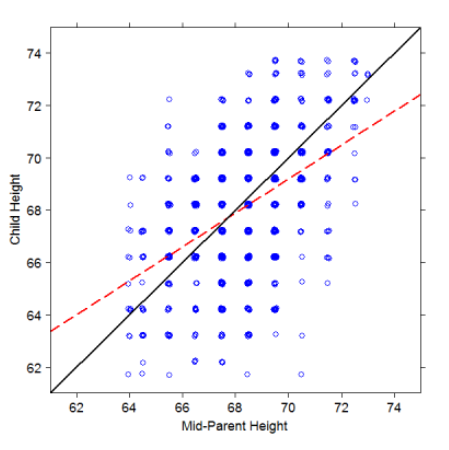
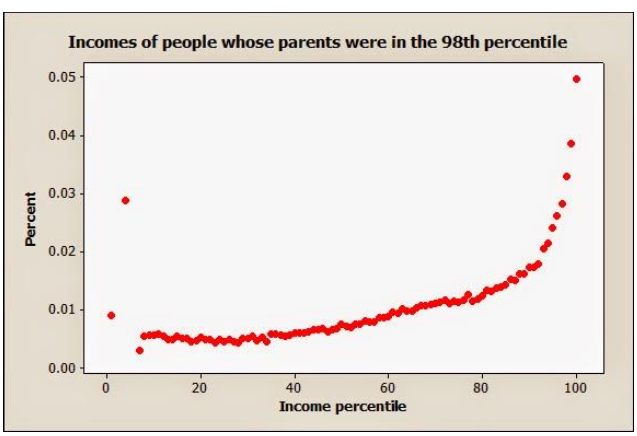
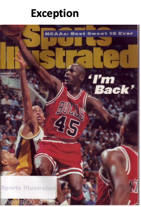
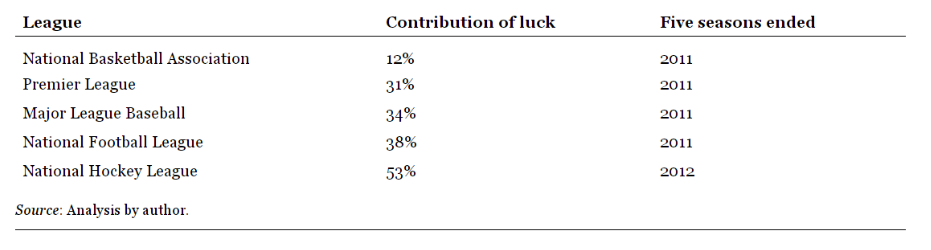
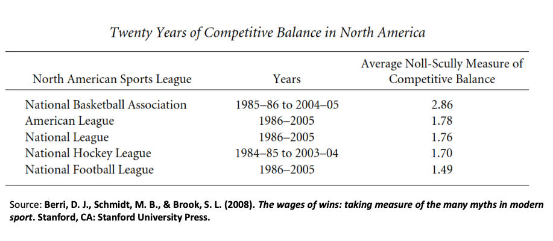

```{r setup, include=FALSE}
knitr::opts_chunk$set(echo = TRUE, message=F, warning = F)
library(knitr)
library(dplyr)
library(ggplot2)
library(measures)
library(odds.converter)
library(SportsAnalytics270)
```


# Regression to the mean

Libraries used

```{r echo=T, eval = F}
library(knitr)
library(dplyr)
library(ggplot2)
library(measures)
library(odds.converter)
library(SportsAnalytics270)
```


# Regression to the mean: Height

Sir Francis Galton proved that the kids of shorter parents have higher height than their parents, and kids of taller parents have shorter height than their parents

\bcenter
```{r, echo=F,out.width="60%", out.height="80%"}

```
\ecenter

# Regression to the mean: Wealth

If your income is at the 98th percentile of the income distribution — that is, you earn more than 98 percent of the population — the best guess is that your children, when they are adults, will be in the 65th percentile.

\bcenter
```{r, echo=F,out.width="60%", out.height="80%"}

```
\ecenter

# Regression to the mean: Examples

IN 2006, TRADINGMARKETS, a company that helps people trade stocks, asked ten Playboy Playmates to select five stocks each. The idea was to see if they could beat the market. The winner was Deanna Brooks, Playmate of the Month in May 1998.
The stocks she picked rose 43.4 percent, trouncing the S& P 500, which gained 13.6 percent, and beating more than 90 percent of the money managers who actively try to outperform a given index.
Brooks wasn't the only one who fared well. Four of the other ten Playmates had better returns than the S& P 500 while less than a third of the active money managers did.


\bcenter
```{r, echo=F,out.width="60%", out.height="80%"}

```
\ecenter

# Sports Illustrated cover Jynx


::: {.col data-latex="{0.55\textwidth}"}
```{r, echo=FALSE, out.width="60%", out.height="60%"}

```


:::

::: {.col data-latex="{0.05\textwidth}"}
\ 
<!-- an empty Div (with a white space), serving as
a column separator -->
:::

::: {.col data-latex="{0.4\textwidth}"}
***The Sports Illustrated*** **cover jinx** is an urban legend that states that individuals or teams who appear on the cover of the Sports Illustrated magazine will subsequently be jinxed (experience bad luck)  


```{r, echo=FALSE, out.width="60%", out.height="60%"}

```
:::
::::::


# Regression to the mean: Definitions

**Regression to the mean** is a statistical phenomenon that can make natural variation in repeated data look like real change. It happens when unusually large or small measurements tend to be followed by measurements that are closer to the mean.  

**Regression to the mean** is a technical way of saying that things tend to even out over time.  

The term [**Regression to the mean**] is now generally used to label the phenomenon that a variable that is extreme on its first measurement will tend to be closer to the center of the distribution for a later measurement.

# True score theory

From the perspective of classical test theory, an examinee's obtained test score (X) is composed of two components, a true score component (T) and an error component (E)

\bcenter
X = T + E
\ecenter

# Skills and Luck: the formula

\bcenter
*Outcome = Skills + Luck*

*Skills = Outcome - Luck*  

\ecenter

# How much is the skill and how much is the luck ?

\bcenter

*Skills = Outcome - Luck*  

*Var(Skills) = Var(Outcome) - Var(luck)*
\ecenter

# Example: NBA

We will assume that the game outcome has Binomial distribution

\bcenter
$P(\text{win x games}) = \frac{n!}{x!(n-x)!}p^x*(1-p)^{(n-x)}$  

$\mu = np$  

$\sigma^2 = np(1-p)$  

\ecenter


# Example: NBA


```{r, eval=F}
data("nba_misc")
head(nba_misc)
```

\tiny
```{r, echo=F}
library(SportsAnalytics270)
data("nba_misc")
head(nba_misc)
```

# Example: NBA

Every team has played 82 games. Create another variable with win ratio

```{r}
nba_misc$WR<-nba_misc$W/82
```

Lets get the variance of the winning ratio- This is the variance for outcome


```{r}
var(nba_misc$WR)
```

Let us look at the variance for the luck. Here we assume that the chance of winning for each team is the same 0.5.

```{r}
0.5*0.5/82
```

For variance of the luck (proportion p), we use the following formula  

$\frac{p(1-p)}{n}$

# Example: NBA

*Var(Skills) = Var(Outcome) - Var(Luck)*  

*Var(Skills) = 0.02151839 - 0.00304878*

*Var(Skills) = 0.01846961*

The paradox fo Skill:  
  More skills means luck is more important  

Assuming that the variance in luck stays constant  

# Example: NBA

*Var(Skills) = Var(Outcome) - Var(Luck)*  

*Var(Skills) = 0.02151839 - 0.00304878*  

*Var(Skills) = 0.01846961*  

This analysis allows us to look at the ratio of variance (luck) to variance (observed) in order to determine the contribution of luck.  

\bcenter
$\frac{0.00304878}{0.01556699} = 19$%
\ecenter

# Paradox of skill


**The less variation in skill there is, the more important luck is.**

# Skill or luck ?

Manchester United vs Bayern Munich UCL Final  

1999  

[https://youtu.be/YnecJa5satA?t=112](https://youtu.be/YnecJa5satA?t=112)  

# Manchester United vs Bayern Munich, UCL final 1999

Overall  
Box-Score Statistics

```{r, echo=F}

mu_table <- data.frame(Statistic = c("Goals Scored", "Total Shots", "Shots on target",
                                     "Ball possession", "Corner kicks", "Fouls committed", 
                                     "Offsides", "Yellow cards", "Red cards"),
                        MU = c(2,15,9,"53%",12,11,6,0,0),
                        Bayern = c(1,15,7,"47%",7,10,8,1,0))
kable(mu_table)
```


# So what ?

**The contribution of luck in some professional sports leagues**

```{r, echo=F, out.width="70%"}

```


Mauboussin, Michael J.. The Success Equation: Untangling Skill and Luck in Business, Sports, and Investing. Harvard Business Review Press.

# Curse of the Bambino

```{r, echo=F, out.width="40%"}

```

* In 1919 Red Sox sold their star player, Babe Ruth to New York Yankees  
* Red Sox was not able to win World Series for the next 86 years, despite of being a favorite in many final games

# Regression to the mean

Construct the variable DF of difference

```{r}
data(nba_east)
data(nba_west)
nba_st <- rbind(nba_east,nba_west)


nba_st$PW <- nba_st$PS^14.105/(nba_st$PS^14.105+nba_st$PA^14.105)
nba_st$G <- nba_st$W+nba_st$L
nba_st$PW_G <- round(nba_st$PW*nba_st$G)

nba_st$DF <- nba_st$PW_G-nba_st$W
```

# Regression to the mean

Let's plot for one team

```{r, fig.width=10, fig.height=4}
nba_st$DF <- nba_st$PW_G-nba_st$W

nba_st %>% filter(Team=="Sacramento Kings") %>%
ggplot(aes(x=Season, y=DF))+geom_point()+geom_line()+
  ggtitle('Wins difference for Sacramento Kings')

```

# Regression to the mean


```{r}
means <- nba_st %>% group_by(Team) %>% summarise(mean=mean(DF))
head(means)
```

Average difference by teams (You need dplyr here)


# Regression to the mean

The histogram of the averages

```{r, fig.width=10, fig.height=4}
ggplot(means, aes(x=mean))+geom_histogram()
```

# Competitive Balance in Sports 

## Competitive Balance in Sports 

# Competitive Balance

Definition from economics:  

**A market situation where no business is too big or has an unfair advantage.**
Source: [http://lexicon.ft.com/Term?term=competitive-balance](http://lexicon.ft.com/Term?term=competitive-balance)

Definition in Sports:  

**The degree of uncertainty in the match outcome or the final league standings.**    

Higher is the Competitive Balance, higher is the uncertainty

# Competitive Balance: Dimensions

**Long-run  **

Distribution of championships over time  

**Seasonal**  

Within season  

**Short-run**  

Match uncertainty Outcome of contest

# Measuring Seasonal Dimensions

* Statistical measures
  + Range, variance or deviation
* Standard deviation (SD)
  + Dispersion from mean
  + If SD is low, then CB is high
* CB is often measured by
  + SD of actual wins ÷ idealized SD
  + As measure increases, competitive balance worsens
 
# Seriea: Measuring balance with standard deviation


```{r }
data("seriea_st")
colnames(seriea_st)

```


## The dataset

```{r}
head(seriea_st)
```

# Standard Deviations: Serie A


```{r}
(seriea_s<-seriea_st %>%
  group_by(Season) %>%
  summarise(SD=sd(Pt)))
```


# Standard Deviations: Serie A

```{r, fig.width=8, fig.height=4}
ggplot(seriea_s, aes(Season, SD))+geom_bar(stat="identity")+
  ggtitle("Standard Deviation of Seria A by Season")+
  coord_cartesian(ylim=c(10,22))
```


# NFL

NFL data


\tiny
```{r}
data(nfl_st)
summary(nfl_st)
```


# NFL data: SD

```{r}
(nfl_s<-nfl_st %>%
  group_by(Season) %>%
  summarise(SD=sd(Wpct)))
```


# NFL data: SD


```{r, fig.width=8, fig.height=4}
ggplot(nfl_s, aes(Season, SD))+geom_bar(stat="identity")+
  ggtitle("NFL standard deviations by season")+
  coord_cartesian(ylim=c(0.1,0.25))
```


# StDev approach: the drawbacks

* **Depends on how the game is played and how the points are distributed**  
  
  
* **Cannot be used to compare different sports**  

# Measuring Seasonal Dimensions

There are several drawbacks of using standard deviation as a measure of competitive balance.  

The number of the games played are not always constant over time or same for different sports and leagues.  

To deal with this problem, $\sigma$ is benchmarked against standard deviation that describes dispersion for the league with ideal competitive balance.  

# Measuring Seasonal Dimensions

Lets assume we are dealing with a game, where the match outcome is either win or loose.  

As previously, we will define $w$ (wins ratio) as a number of games a team has won, divided by the number of games it has played.  

The standard deviation of the wins ratio will be defined as  

\bcenter
$\sigma = \sqrt{\frac{\sum_{\text{i=1}}^n{(w_i - 0.5)^2}}{n}}$
\ecenter  

$n$ - number of teams  

$w_i$ - winning ration of team i


# Measuring Seasonal Dimensions

Ideally, each team will have 0.5 probability of winning any game (ignoring home-field advantage).
Then the ideal standard deviation will be calculated with the following formula


\bcenter
$\sqrt{\frac{0.5*(1-0.5)}{m}} = \frac{0.5}{\sqrt{m}}$
\ecenter

Where $m$ is the number of games played by each team.  


# Measuring Seasonal Dimensions

**Now we can define relative measure of competitive balance**

\bcenter
$\sigma_\text{relative} = \frac{\sigma}{0.5/\sqrt{m}}$
\ecenter

This is also called Noll-Scully number

# Measuring Seasonal Dimensions: Noll-Scully number


* Ideally, Noll-Scully number will be equal to 1
* Higher is the number, lower is Competitive Balance
* Closer is the number to 1, higher is Competitive Balance

# Measuring Seasonal Dimensions: Noll-Scully number

The Noll-Scully compares what a league actually looks like to what it  
would ideally look like. In a perfect world — i.e. one where actual  
balance matches the ideal — the metric would return a 1.0, meaning   
the league is balanced.  

If the number is above 1.0 it means the teams are further away in wins  
than we would expect given the ideal.  

If the number is below 1.0 — which is very rare case— it means the   
teams are closer in wins than we would expect.

# Noll-Scully number: Calculations

Noll-Scully number

```{r}
#Ideal StDev
id_s <- 0.5/sqrt(16)
# Win percentage StDev
sd_wpct <- sd(nfl_st$Wpct)
# Noll-Scully number
sd_wpct/id_s

```

# Calculating season-by season

```{r}
(nfl_s<-nfl_st %>%
  group_by(Season) %>%
  summarise(NS=sd(Wpct)/id_s))
```


# Plotting results


```{r, fig.width=8, fig.height=4}
ggplot(nfl_s, aes(Season, NS))+geom_bar(stat="identity")+
  coord_cartesian(ylim=c(1,1.75))+
  ggtitle("Noll-Skully number by season")
  
```

# Measuring Seasonal Dimensions: Noll-Scully number


```{r, fig.width=8, fig.height=4}
ggplot(nfl_s, aes(Season, NS))+geom_bar(stat="identity")+
  ggtitle("Noll-Skully number by season")+
  coord_cartesian(ylim=c(1,1.75))+
  geom_hline(yintercept=mean(nfl_s$NS), col="red", size=1.5)
  
```

* 1998-2025: the number runs from about 1.3 to 1.75
* The red line is the mean, about 1.56
* The NFL is about one and a half times as spread out as a coin-flip season

# Previous studies

```{r,echo=F,out.height="80%",out.width="80%"}

```

# Concentration indexes

## Concentration indexes

# Measuring Seasonal dimensions: Concentration of points

**Concentration Index for points**

\bcenter
$C5 = \frac{\text{Number of points earned by top N clubs}}{\text{Total number of points earned by all clubs}}$
\ecenter

# Measuring Seasonal dimensions: Concentration of points

## Concentration index for points
```{r}

top5<- seriea_st %>%
    group_by(Season) %>%
    filter(Rank<6) %>%
    summarize(TopP=sum(Pt))

all<-seriea_st %>%
    group_by(Season) %>%
    summarize(Pt=sum(Pt))

C5<-data.frame(Season=top5$Season,C5=top5$TopP/all$Pt)
    
```

# Measuring Seasonal dimensions: Competitive imbalance

```{r, fig.width=8, fig.height=4}
ggplot(C5, aes(Season, C5))+geom_bar(stat="identity")+
  ggtitle("C5 index for Serie A, 1996-2022")+
  coord_cartesian(ylim=c(0.2,0.42))
```

# Measuring Seasonal dimensions: Competitive Balance

```{r, fig.width=8, fig.height=4}
ggplot(C5, aes(Season, 1-C5))+geom_bar(stat="identity")+
  ggtitle("C5 index for Serie A, 1996-2022")+
  coord_cartesian(ylim=c(0.4,0.65))
```

# Measuring Long Run dimensions

Concentration Index  
\    
\  
\  
Proportion of championships (or points) by top n teams

e.g. $CI_5:$ dominance of top 5 teams


# Measuring Long Run dimensions

How many times did every team become a champion?
```{r}
(champ_c <- seriea_st %>%
  filter(Rank ==1) %>% group_by(Team) %>%
  summarize(champ=n()) %>% arrange(desc(champ)))
```

CI4 for championship

```{r}
100*sum(champ_c[1:4,2])/sum(champ_c$champ)
```

* Juventus won 16 of these titles
* The top four clubs won about 93 percent
* A high championship CI means long-run balance is low

# Herfindahl-Hirschman Index - HHI

## Herfindahl-Hirschman Index - HHI

# Herfindahl-Hirschman Index - HHI

Definition comes from economics  

The Herfindahl-Hirschman index (HHI) is a commonly accepted measure of market  
concentration. It is calculated by squaring the market share of each firm competing  
in a market, and then summing the resulting numbers  

Read more: [http://www.investopedia.com/terms/h/hhi.asp#ixzz4t8sTjDns](http://www.investopedia.com/terms/h/hhi.asp#ixzz4t8sTjDns)

# Herfindahl-Hirschman Index - HHI

\bcenter
$HHI = \sum_{\text{i=1}}^n w_{i}^2$
\ecenter

Simple case: 2 firms in the market  

* Highly competitive industry, both firms have the same market share  

$HHI = \sum_{\text{i=1}}^2 w_{i}^2 = 0.5^2 + 0.5^2$

* Monopoly, 1 firm has 100%  

$HHI = \sum_{\text{i=1}}^2 w_{i}^2 = 1^2 + 0^2$

# Herfindahl-Hirschman Index - HHI

\bcenter
$HHI = \sum_{\text{i=1}}^n w_{i}^2$
\ecenter

lower and upper bounds

\bcenter
$1/n \le HHI \le 1$
\ecenter

# Herfindahl-Hirschman Index – in sports

Several variations of the index exists.  

\bcenter
$HHI = \sum_{\text{i=1}}^{n} (\frac{p_i}{ \sum_{\text{i=1}}^{n}p_i})^2$
\ecenter

$p_i$ is the number of the points the team has earned.

* $p_i / \sum p_i$ is team $i$'s share of all points that season
* Square the shares, then add them
* Every team level on points: each share is $1/n$, so $HHI = 1/n$
* One team takes every point: $HHI = 1$
* A lower HHI means the points are more spread out

# Doing it in R: Serie A

```{r}
HHI = seriea_st %>%
        group_by(Season) %>%
        mutate(Perc=Pt/sum(Pt))%>%
        summarise(HHI = sum(Perc^2))
```


# Doing it in R: Serie A


```{r, fig.width=8, fig.height=4}
ggplot(HHI, aes(Season, HHI))+geom_bar(stat="identity")+
  ggtitle("HHI index by season")+
  coord_cartesian(ylim=c(0,0.065))
```

# Doing it in R: Serie A

Number of the teams per season

```{r}
seriea_st %>%
      group_by(Season) %>%
      summarise(count=n())
```

* 1996-2004: 18 teams, so equal points means $HHI = 1/18 \approx 0.056$
* From 2005: 20 teams, so equal points means $HHI = 1/20 = 0.05$
* A smaller raw HHI can be the extra clubs, not a closer season
* 2018 has 40 rows in this file. Do not read that bar as a real change in balance

# Adjusted HHI

Increasing number of the teams affects lower bound (in some cases upper bound as well)  

\bcenter
$dHHI = \sum_{\text{i=1}}^n w_i^2 - 1/n$
\ecenter

* $1/n$ is the HHI of a perfectly even season
* Subtract it, and a perfectly even season scores 0
* A lower dHHI means a more balanced season
* Use it when $n$ changes. Raw HHI does not survive the move from 18 teams to 20

# Adjusted HHI

\tiny
 
```{r}
dHHI<-seriea_st %>%
      group_by(Season) %>%
      mutate(Perc=Pt/sum(Pt)) %>%
      summarise(HHI=(sum(Perc^2)-1/n()))
```

dHHI 

\tiny
```{r, fig.height=4.2}
ggplot(dHHI %>% filter(Season != 2018), aes(Season, HHI)) +
  geom_col() +
  geom_hline(yintercept = 0, col = "red", size = 1.5) +
  coord_cartesian(ylim = c(-0.001, 0.009)) +
  labs(y = "dHHI",
       title = "dHHI by season. The red line is 0, an even season")
```

* Nothing is wrong with the zero. An even season scores 0, and Serie A is only about 0.003 to 0.007 above it
* The bars look tall because the axis is that small gap. Raw HHI is near 0.05, and $1/n$ has already been subtracted
* 2018 is left off the chart. That season has 40 rows in the file

# HHI defined by Depken

\bcenter
$HHI = \sum_{\text{i=1}}^n (\frac{2*wins_i}{N*G_i})^2$  

$wins_i$- *number of wins by each team*  

*N - Number of teams*  

$G_i$ - *number of games played*

\ecenter


Assumptions

* No ties
* Number of games played by each is an even number

Source: Free-Agency and the Competitiveness of Major League Baseball, CRAIG A. DEPKEN, II, Review of Industrial Organization, Vol. 14, No. 3 (May 1999), pp. 205-217

# HHI defined by Depken

\bcenter
$HHI = \frac{4}{N^2G^2} \sum_{\text{i=1}}^n (wins_i)^2$  

\ecenter

Source: Free-Agency and the Competitiveness of Major League Baseball, CRAIG A. DEPKEN, II, Review of Industrial Organization, Vol. 14, No. 3 (May 1999), pp. 205-217

* Each game produces one win, so the league's wins total $NG/2$
* $2 \times wins_i / (NG)$ is team $i$'s share of those wins
* Every team wins half its games: $HHI = 1/N$
* For 30 MLB clubs that floor is $1/30 \approx 0.033$. That is the red line
* The formula needs the same $G$ for every club. The 2020 season was 60 games, so leaving 162 in the formula makes 2020 look far too balanced

# Major League of Baseball: dataset

```{r}
str(mlb_standings)
```

# MLB

* Each team plays 162 games per regular season
  + small violations occur, 160,161,163
  + We will assume the number of games to be 162
* 30 teams since 1999

```{r}
mlb_HHI <- mlb_standings %>%
      group_by(Season) %>%
      summarise(HHI=sum(W^2)*(4/(30^2*162^2)))
```


# HHI in MLB

```{r, fig.height=5}
ggplot(mlb_HHI, aes(Season, HHI))+geom_bar(stat="identity")+
  geom_hline(yintercept = 1/30, col="red", size=1.5)+
  coord_cartesian(ylim=c(0,0.035))+
  ggtitle("HHI index by season for MLB")
```

# Correlating imbalance measures with other variables

* Leading indicators: input indicators  

  Why is there a imbalance ?  
  
  Salary gap ? Macro, socio-economic variables?  
  
* Lagging indicators: output indicators
  + What is affected by the change in imbalance ? 
  + Attendance?
  + Teams revenue ?


# MLB: Salaries

Leading indicators: SalarY

```{r}
data(mlb_salary)
str(mlb_salary)
mlb_salary <- mlb_salary %>%
  filter(Season <= 2021)
```

# MLB: Salaries

Aggregate data by year

\tiny 
```{r}
mlb_s<-mlb_salary %>%
      group_by(Season) %>%
      summarise(Tot.salary=sum(Current))
```

```{r}
both <- inner_join(mlb_s, mlb_HHI, by = "Season")
cor(both$Tot.salary, both$HHI)
```

# MLB: Salaries

What about the standard deviation of the salary ?

```{r}
mlb_s<-mlb_salary %>%
      group_by(Season) %>%
      summarise(Tot.salary=sum(Current), SD=sd(Current))
```

```{r}
both <- inner_join(mlb_s, mlb_HHI, by = "Season")
cor(both$SD, both$HHI)
```

# MLB: Salaries

HHI for salary

```{r}
mlb_HHI_s<-mlb_salary %>%
        group_by(Season) %>%
        mutate(Perc=Current/sum(Current)) %>%
        summarise(HHI_S=sum(Perc^2))
```

Correlations for HHI_S and HHI

```{r}
both <- inner_join(mlb_HHI_s, mlb_HHI, by = "Season")
cor(both$HHI_S, both$HHI)
```

* Total payroll rises over time, so its correlation with win HHI is mostly that trend
* Salary HHI asks whether the money and the wins concentrated in the same seasons

# MLB: Salaries

```{r, echo=FALSE, fig.width=7, fig.height=3.4, out.height="0.72\\textheight", fig.align="center"}
ggplot(both, aes(HHI_S, HHI)) +
  geom_point() +
  geom_smooth(method = "lm", se = FALSE) +
  labs(x = "Salary HHI", y = "Win HHI",
       title = "Payroll concentration and win concentration")
```

# Short run competitiveness

## Short run competitiveness

# Short run competitiveness

* We are looking at how predictable are individual games.
* We can do it by using some machine learning or simpler algorithms (like Elo) to predict the probability of game outcome then calculate the prediction error – High error will indicate higher uncertainty, thus higher competitiveness.
* However, here we will look at the bookmaker’s odds as a predicted probabilities of events

# Match Outcome uncertainty

* Filter the data, by taking seasons starting from 2009, major leagues and exclude NA’s
* The variables H,D,A are bookmaker’s odds from Bet365

```{r,tidy=F}
data("f_data_sm")
f_2009 <- f_data_sm %>%
  filter(SEASON > 2008,
         COUNTRY %in% c("Italy", "Germany", "Spain","England", 
            "Netherlands", "Portugal"), !is.na(H) )
head(f_2009)
```

# Match Outcome uncertainty

* We need to convert odds to probabilities
* We also need vig-free probabilities, so the three chances sum to 1
* The vig is the bookmaker's margin built into the odds
* Try library odds.converter

```{r}
( x <- odds.fv(c(1.4,3.8,8), input = 'dec', output = 'prob'))
sum(x)

```

# Match Outcome uncertainty

**Brier score.** Average squared distance between the probabilities and what happened.

\bcenter
$BS = \frac{1}{M}\sum_{m=1}^{M}\sum_{k=1}^{3}(p_{mk} - o_{mk})^2$
\ecenter

* $p_{mk}$: vig-free probability of home, draw, or away
* $o_{mk}$: 1 if that result happened, 0 if it did not
* A result that was certain, and then happens, scores 0
* A match called 1/3, 1/3, 1/3 scores $2/3 \approx 0.67$
* A heavy favorite, 0.8 / 0.1 / 0.1, scores 0.06 if that favorite wins
* A higher Brier score means the matches were harder to call

# Match Outcome uncertainty

Replace variables H,D,A with vig-free probabilities

```{r}
f_2009[,c("H", "D", "A")] <- odds.fv(f_2009[,c("H", "D", "A")], 
                      input = 'dec',output = 'prob')
head(f_2009)
```

# Match Outcome uncertainty

Calculate brier score by country

```{r}
brier_score <- f_2009 %>% group_by(COUNTRY) %>%
  do(SCORE = multiclass.Brier(.[,c("H", "D", "A")], .$FTR))
brier_score <- as.data.frame(brier_score)
brier_score$SCORE <- unlist(brier_score$SCORE)
```

# Match Outcome uncertainty

```{r, fig.height=5}
ggplot(brier_score, aes(x=COUNTRY, y = SCORE))+geom_bar(stat='identity')+
  coord_cartesian(ylim = c(0.5,0.6))+ggtitle('Match Uncertainity by Country')
```


# Match Outcome uncertainty


```{r}
brier_score <- f_2009 %>% group_by(COUNTRY, SEASON) %>%
  do(SCORE = multiclass.Brier(.[,c("H", "D", "A")], .$FTR))
brier_score <- as.data.frame(brier_score)
brier_score$SCORE <- unlist(brier_score$SCORE)
```

# Match Outcome uncertainty: Italy


```{r, fig.height=5}
brier_score %>% filter(COUNTRY=='Italy') %>%
ggplot(aes(x=SEASON, y=SCORE))+geom_bar(stat='identity') + 
  scale_x_continuous(breaks = 2009:2022)
```

# Match Outcome uncertainty

```{r, fig.height=5}
ggplot(brier_score, aes(x=SEASON, y=SCORE))+
  geom_bar(stat='identity',position=position_dodge(width=1))+
  facet_grid(~COUNTRY)+ coord_flip()+ggtitle("Brier Score by Country")
```

# How to read the numbers

Read the pair. $\downarrow\ \downarrow$ means a lower number is less competitive. $\downarrow\ \uparrow$ means a lower number is more competitive.

\tiny

| Metric | Number | Competitiveness |
|---|---|---|
| SD of points or win percent | $\downarrow$ | $\uparrow$ |
| Noll-Scully | $\downarrow$ | $\uparrow$ |
| C5, top-5 share of points | $\downarrow$ | $\uparrow$ |
| Championship CI | $\downarrow$ | $\uparrow$ |
| 1 minus C5 | $\downarrow$ | $\downarrow$ |

Ideal SD, $0.5/\sqrt{m}$, is not a competitiveness score. A shorter season makes it larger.

# How to read the numbers

Read the pair. $\downarrow\ \downarrow$ means a lower number is less competitive. $\downarrow\ \uparrow$ means a lower number is more competitive.

\tiny

| Metric | Number | Competitiveness |
|---|---|---|
| HHI | $\downarrow$ | $\uparrow$ |
| dHHI | $\downarrow$ | $\uparrow$ |
| Depken HHI | $\downarrow$ | $\uparrow$ |
| Brier score | $\downarrow$ | $\downarrow$ |
| Salary HHI | $\downarrow$ | $\uparrow$ |

Salary HHI is payroll equality, not the league table. A lower salary HHI means the money is more spread out.


