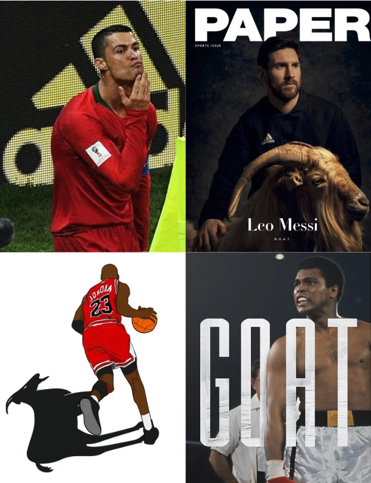
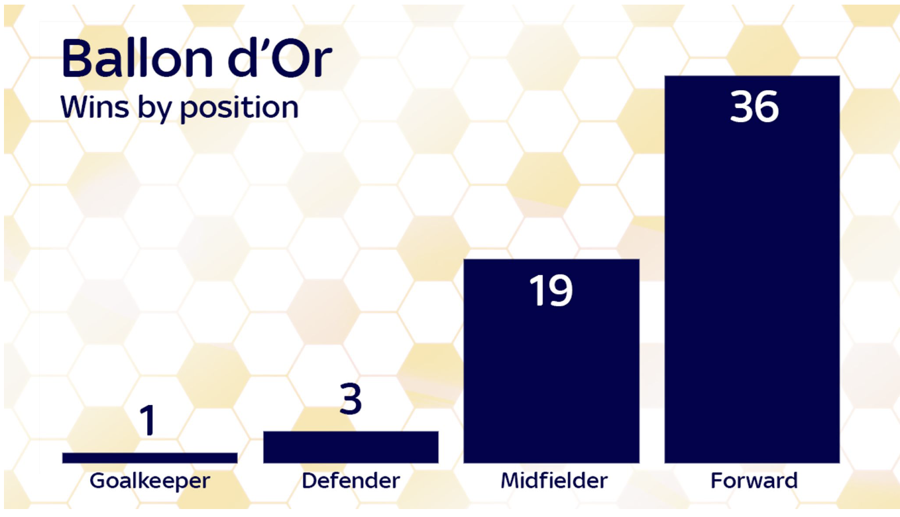
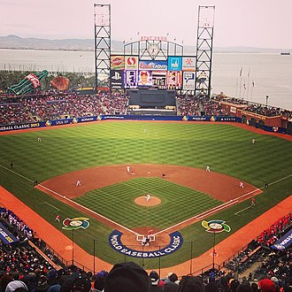
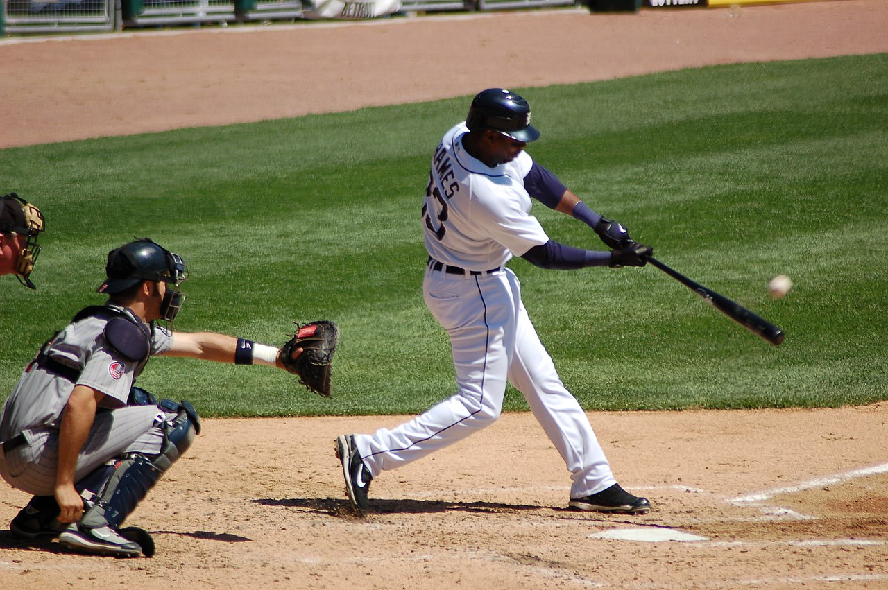
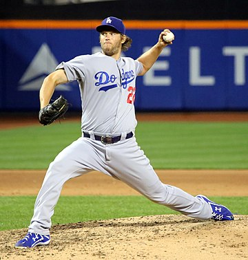
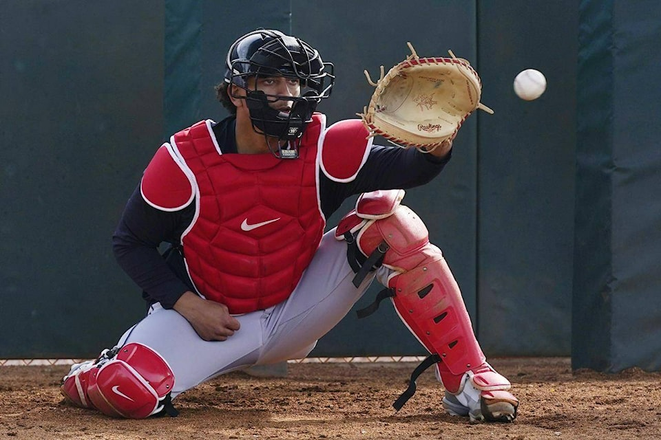
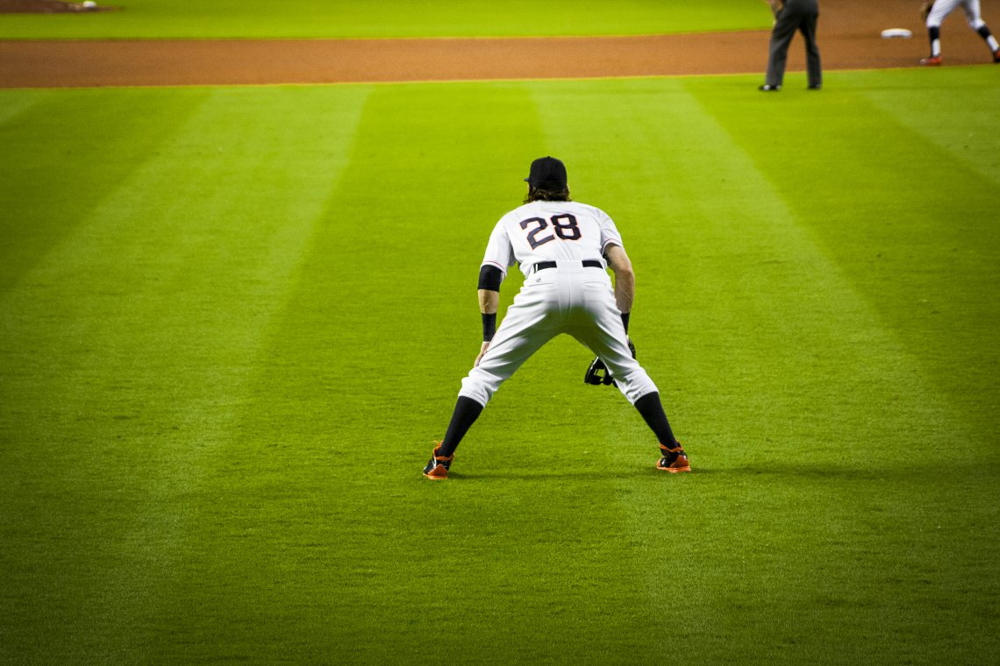

```{r setup, include=FALSE}
library(ggplot2)
library(dplyr)
library(Lahman)
library(tidyr)
# SET global width and height for the plots
options(repr.plot.width=8, repr.plot.height=4)
# knitr::opts_chunk$set(
#   fig.width = 8,  # Figure width in inches
#   fig.height = 4,  # Figure height in inches
#   message = FALSE,  # Suppress messages
#   warning = FALSE,
#   out.height = "80%",
#   # Suppress warnings
# )
```

# Libraries used

```{r, message=F}
library(dplyr)
library(ggplot2)
library(gridExtra)
library(Lahman)
library(tidyr)
```


# Introduction

### What is GOAT ?

# GOAT

Results according to google.com: 

```{r, out.width="90%", out.height="60%", fig.align="center", echo=F}

```

# GOAT

* GOAT(Greatest of All Time) is a term used to describe the greatest player in a given sport.
* The GOAT debate is one of the most passionate converstaion starters in sports.
* The concept of worshiping athletes came up from the ancient Greek mythology.
* The GOAT term was popularized in the 1990s in the hip-hop culture.
* The Social media has made the GOAT debate more popular.

# GOAT

<!-- Include two images side by side vertically -->

```{r, echo=F, out.height="80%", fig.align='center'}

```

# GOAT

### Who are the GOATs in different sports?  

# GOAT 

This is a question that has no official answer and is open to interpretation.

Sources of studies for GOAT analysis:

* Marca [article](https://www.marca.com/en/more-sports/2023/09/11/64ff69ddca47419c368b4579.html)
* Forbes [article](https://www.forbes.com/betting/sports-betting/goat-debate/)

# GOAT 


### How to find the "GOAT" of each sport ? 

# GOAT

* Asking the local barber ? 
* Conducting a survey ?
* Analyzing the players' statistics ? 

# GOAT

* What are the main characteristics of a good sports player?
* What are the main characteristics     of a GOAT?
* How to measure the greatness of a sports player? 
* Is the "GOAT"ness adaptable to each sport, or each player has a different "GOAT"ness level ? 

# GOAT

For some sports the "GOAT"ness of the player is more obvious than for others.  
Whereas for some other sports there is an ongoing debate.  

* Michael Jordan in basketball
 + There is even a saying "Michael Jordan of something" to describe the best in a field.
* Zinedine Zidane in football( I just think so !)
* Wayne Gretzky in ice hockey.
  + He has the most goals and assists in the history of the NHL.

# GOAT

* The GOAT players are expected to have rare abilities and skills and domination over the others.
* The GOAT type of players are pretty rare in sports history.
* In the language of statistics we need to refer back to the distributions.  
* The GOAT players are expected to be in the right tail of the distribution of the players.

# GOAT 

We are going to cover 3 different sports and identify the GOAT from each of the sports.  

Let's start with FOOTBALL !


# GOAT

What were the main GOAT debates over the years ?

* Maradona vs Pele
  + Pele has won 3 world cups, Maradona has won 1.
  + Maradona has major trophies on the club level as well.
  + None of them has a single Ballon D'or.
* Messi vs Ronaldo
  + Messi has more Ballon D'ors, Ronaldo has more Champions League trophies.
  + Messi shined only for Barcelona and Argentina, Ronaldo did it everywhere.
  + Ronaldo is more complete player with a wider range of skills.
  + Messi is the best in every skill he has.
  + Messi won every possible trophy.

# GOAT

```{r,echo=F, fig.align='center', out.width="75%"}

```


# GOAT

In football the most prestigous individual award is the Ballon D'or.
It is awarded to the best player in the world every year.

* The attacking players and midfielders have the highest number of awards.
* Only one goalkeeper and 4 central defenders won the trophy and no full back has ever won it.
* Players like Maradona, Pele, Alfredo Di Stefano, got special ballon d'or awards after their career.
* Pele is on the top of the lost for the player of the century. So we will consider him as the "GOAT" by the end of the 20th century.
* Now let's find the GOAT of the 21st century.


# GOAT 

### How to evaulaute an attacking players ?


# GOAT

We will look for the seasonal statistics of the players who played in the top 5 leagues and in the Champions league and Europa League.

```{r}
load("./data/tm_players_data.rda")
str(tm_players_data)
```


# GOAT

Let's summarize the data for all seasons and for all players.

```{r}
tm_players_data <- tm_players_data %>% 
  group_by(PlayerName) %>%
  summarise(
    Apperances = sum(Appearances),
    Goals = sum(Goals),
    Assists = sum(Assists),
    PPG = mean(PPG),
    PenaltyGoals = sum(PenaltyGoals),
    GoalContributions = Goals + Assists,
    MinutesPerGoal = mean(MinutesPerGoal),
    MinutesPlayed = sum(MinutesPlayed),
    MinutesPerGc = MinutesPlayed/GoalContributions,
    GamesWon = as.integer((MinutesPlayed / 96) * PPG),
    GCPer90 = GoalContributions / (MinutesPlayed / 90)
  )
```

# GOAT

Let's sort out only the players who played more than average in terms of Minutes Played on the field.  

Let's analyze the distributions of all of the metrics.

```{r}
tm_players_data <- tm_players_data %>% 
  filter(MinutesPlayed > mean(MinutesPlayed))
```


# GOAT
```{r,echo=T,eval=F}
(apperances_histogram <- ggplot(data = tm_players_data, aes(x = Apperances)) + 
  geom_histogram(bins = 30, fill = "blue", color = "black") +
  labs(title = "Histogram of Apperances in Top 5 Leagues",
       x = "Apperances", y = "Frequency"))
```
# GOAT
```{r,echo=F,eval=T, out.height="75%",fig.align="center"}
(apperances_histogram <- ggplot(data = tm_players_data, aes(x = Apperances)) + 
  geom_histogram(bins = 30, fill = "blue", color = "black") +
  labs(title = "Histogram of Apperances in Top 5 Leagues",
       x = "Apperances", y = "Frequency"))
```

# GOAT

Top 5 players with the maximum number of Apperances.
```{r}
tm_players_data %>% 
  arrange(desc(Apperances)) %>%
    select(PlayerName,Apperances) %>%
      head(5)
```
# GOAT

Now let's identify the players who brought most of the wins to their teams when on the field.

```{r, echo=T, eval=F}
(games_won_histogram <- ggplot(data = tm_players_data, aes(x = GamesWon)) + 
  geom_histogram(bins = 30, fill = "blue", color = "black") +
  labs(title = "Histogram of Games Won in Top 5 Leagues",
       x = "Games Won", y = "Frequency"))
```

# GOAT

```{r, echo=F, eval=T, out.height="75%",fig.align="center"}
(games_won_histogram <- ggplot(data = tm_players_data, aes(x = GamesWon)) + 
  geom_histogram(bins = 30, fill = "blue", color = "black") +
  labs(title = "Histogram of Games Won in Top 5 Leagues",
       x = "Games Won", y = "Frequency"))
```
# GOAT

Top 5 players with the maximum number of games won.
```{r}
tm_players_data %>% 
  arrange(desc(GamesWon)) %>%
    select(PlayerName,GamesWon) %>%
      head(5)
```

# GOAT

```{r, echo=T,eval=F}
(goals_histogram <- ggplot(data = tm_players_data, aes(x = Goals)) + 
  geom_histogram(bins = 30, fill = "blue", color = "black") +
  labs(title = "Histogram of Goals in Top 5 Leagues",
       x = "Goals", y = "Frequency"))
```

# GOAT

```{r, echo=F,eval=T, out.height="75%",fig.align="center"}
(goals_histogram <- ggplot(data = tm_players_data, aes(x = Goals)) + 
  geom_histogram(bins = 30, fill = "blue", color = "black") +
  labs(title = "Histogram of Goals in Top 5 Leagues", x = "Goals", y = "Frequency"))

```
# GOAT

Top 5 goal scorers

```{r}
tm_players_data %>% 
  arrange(desc(Goals)) %>%
    select(PlayerName,Goals) %>%
      head(5)
```

# GOAT

```{r, echo=T,eval=F}
(assists_histogram <- ggplot(data = tm_players_data, aes(x = Assists)) + 
  geom_histogram(bins = 30, fill = "blue", color = "black") +
  labs(title = "Histogram of Assists in Top 5 Leagues",
       x = "Assists", y = "Frequency"))
```

# GOAT

```{r, echo=F,eval=T, out.height="75%",fig.align="center"}
(assists_histogram <- ggplot(data = tm_players_data, aes(x = Assists)) + 
  geom_histogram(bins = 30, fill = "blue", color = "black") +
  labs(title = "Histogram of Assists in Top 5 Leagues", x = "Assists", y = "Frequency"))
```

# GOAT

Top 5 players with the maximum number of assists.
```{r}
tm_players_data %>% 
  arrange(desc(Assists)) %>%
    select(PlayerName,Assists) %>%
      head(5)
```

# GOAT

```{r, echo=T,eval=F}
(goal_contributions_histogram <- ggplot(data = tm_players_data, aes(x = GoalContributions)) + 
  geom_histogram(bins = 30, fill = "blue", color = "black") +
  labs(title = "Histogram of Goal Contributions in Top 5 Leagues",
       x = "Goal Contributions", y = "Frequency"))

```

# GOAT

```{r, echo=F,eval=T, out.height="75%",fig.align="center"}
(goal_contributions_histogram <- ggplot(data = tm_players_data, aes(x = GoalContributions)) + 
  geom_histogram(bins = 30, fill = "blue", color = "black") +
  labs(title = "Histogram of Goal Contributions in Top 5 Leagues",
       x = "Goal Contributions", y = "Frequency"))
```

# GOAT 

Top 5 players with the maximum number of goal contributions.
```{r}
tm_players_data %>% 
  arrange(desc(GoalContributions)) %>%
    select(PlayerName,GoalContributions) %>%
      head(5)
```


# GOAT

Let's visualize all of the metrics in a scatter plot.

```{r,echo=T,eval=F, fig.width=12}
(stats_scatter_plot <- ggplot(data = tm_players_data,
    aes(x = Apperances, y = GoalContributions, 
        size = Goals, color = Assists, alpha=GCPer90)) +
   geom_point() + labs(x = "Apperances", y = "Goal Contributions", title = "Statistics Scatter Plot",
        color = "Number of Assists", size = "Number of Goals", color = "Number of Assists", alpha = "Goal Contributions per one Game"
        ) + theme_minimal())
```

# GOAT

```{r,echo=F,eval=T,fig.width=12}
(stats_scatter_plot <- ggplot(data = tm_players_data,
    aes(x = Apperances, y = GoalContributions, 
        size = Goals, color = Assists, alpha=GCPer90)) +
   geom_point() + labs(x = "Apperances", y = "Goal Contributions", title = "Statistics Scatter Plot",
        color = "Number of Assists", size = "Number of Goals", color = "Number of Assists", alpha = "Goal Contributions per one Game"
        ) + theme_minimal())
```

# GOAT
\tiny
```{r,fig.width=14}
(stats_scatter_plot + geom_text(aes(label = PlayerName), size = 2) + geom_abline(intercept = 0, slope = 1, color = "red"))

```


# GOAT 

* What is one thing that is in common in all of the distributions we analyzed ?  
* How to get an all in one metric for all of the players to evaluate the level of their greatness ?  
* Which of these statistics were the hardest and most competitive to achieve ? 

# GOAT 

* None of them resembles a normal distribution.  
* Almost all of the distributions had a long right tail.  
* This is a good sign for the "GOAT"ness of the players.  
* This picture will be visible in any field that required talent, skills, opportunity and persistence.  

# GOAT 

**Why don't the distributions follow a Gaussian distribution ?**

# GOAT
The distributions are more likely to follow a lognormal distribution. 

The main charachteristics of a lognormal distribution are: 

* The distribution is skewed to the right(Mean > Median). 
* The distribution is uni modal(has one clear peak).  
* The logarithm of the data is normally distributed.  
* The distributions of natural abilities are more likely to follow a normal distribution.  
* The distributions of some abilities that require some work apart from nature are more likely to follow a log normal distribution. 

# GOAT

Let's analyze the height of the footballers

```{r, echo=T, eval=F}
load("./data/players_height.rda")
(height_histogram <- ggplot(data = player_heights, aes(x = height)) + 
  geom_histogram(bins = 15, fill = "blue", color = "black") +
  labs(title = "Histogram of Footballers' Heights",
       x = "Height", y = "Frequency"))
```

# GOAT

```{r, echo=F, eval=T, fig.align="center", out.height="75%"}
load("./data/players_height.rda")
(height_histogram <- ggplot(data = player_heights, aes(x = height)) + 
  geom_histogram(bins = 15, fill = "blue", color = "black") +
  labs(title = "Histogram of Footballers' Heights",
       x = "Height", y = "Frequency"))
```


# GOAT

Let's analyze the log normality of the players' statistics. 

```{r}
tm_players_data <- tm_players_data %>% 
  mutate(log_Apperances = log(Apperances),
         log_Goals = log(Goals),
         log_Assists = log(Assists),
         log_GoalContributions = log(GoalContributions)
         )
```

# GOAT

Let's visualize the lognormality of the data. 

```{r,echo=T,eval=F}
(log_apperances_histogram <- ggplot(data = tm_players_data, aes(x = log_Apperances)) + 
  geom_histogram(bins = 30, fill = "blue", color = "black") +
  labs(title = "Histogram of Log Apperances in Top 5 Leagues",
       x = "Log Apperances", y = "Frequency"))
```

# GOAT

```{r,echo=F,eval=T, out.height="75%",fig.align="center"}
(log_apperances_histogram <- ggplot(data = tm_players_data, aes(x = log_Apperances)) + 
  geom_histogram(bins = 30, fill = "blue", color = "black") +
  labs(title = "Histogram of Log Apperances in Top 5 Leagues",
       x = "Log Apperances", y = "Frequency"))
```

# GOAT
Let's compare the qq plots.

```{r, echo=T, eval=F}
(appereances_qq <- ggplot(data = tm_players_data, aes(sample = Apperances)) + 
  stat_qq() + 
  stat_qq_line() + 
  labs(title = "QQ Plot of Apperances in Top 5 Leagues"))
(log_appearances_qq <- ggplot(data = tm_players_data, aes(sample = log_Apperances)) + 
  stat_qq() + 
  stat_qq_line() + 
  labs(title = "QQ Plot of Log Apperances in Top 5 Leagues"))
grid.arrange(appereances_qq, log_appearances_qq, ncol = 2)
```

# GOAT

```{r, echo=F, eval=T, fig.height=6}
appereances_qq <- ggplot(data = tm_players_data, aes(sample = Apperances)) + 
  stat_qq() + 
  stat_qq_line() + 
  labs(title = "QQ Plot of Apperances in Top 5 Leagues")
log_appearances_qq <- ggplot(data = tm_players_data, aes(sample = log_Apperances)) + 
  stat_qq() + 
  stat_qq_line() + 
  labs(title = "QQ Plot of Apperances in Top 5 Leagues")
grid.arrange(appereances_qq, log_appearances_qq, ncol = 2)
```

# GOAT

Now the goal contributions

```{r, echo=T, eval=F}
gc_qq <- ggplot(data = tm_players_data, aes(sample = GoalContributions)) + 
  stat_qq() + 
  stat_qq_line() + 
  labs(title = "QQ Plot of Goal Contributions in Top 5 Leagues")
log_gc_qq <- ggplot(data = tm_players_data, aes(sample = log_GoalContributions)) + 
  stat_qq() + 
  stat_qq_line() + 
  labs(title = "QQ Plot of Log Goal Contributions in Top 5 Leagues")
grid.arrange(gc_qq, log_gc_qq, ncol = 2)
```

# GOAT

```{r, echo=F, eval=T,fig.height=6}
gc_qq <- ggplot(data = tm_players_data, aes(sample = GoalContributions)) + 
  stat_qq() + 
  stat_qq_line() + 
  labs(title = "QQ Plot of Goal Contributions in Top 5 Leagues")
log_gc_qq <- ggplot(data = tm_players_data, aes(sample = log_GoalContributions)) + 
  stat_qq() + 
  stat_qq_line() + 
  labs(title = "QQ Plot of Log Goal Contributions in Top 5 Leagues")
grid.arrange(gc_qq, log_gc_qq, ncol = 2)
```

# GOAT

Why ? 

Let's talk about two data generating processes. 

* Proportional gain
* Weakest link

It is important to note that we are working with samples of data, so we can just say that they are well modeled by Gaussian or log normal distributions. 
Let's recall the Central Limit Theorem.

# GOAT

The CENTRAL LIMIT THEOREM applies that if you add up some random factors, the sum will be *approximately* normally distributed.

* Mostly identical distributions.  
* Mostly non correlated factors.  
* Sample should be big enough to claim. 

# GOAT

Referring to the CENTRAL LIMIT COROLLARY, the product of multiple factors will tend to lognormal distribution, because multiplication of factors will be the same as adding the logarithgms.

$$ Y = X * X => \log{Y} = \log{X} + \log{X} $$

# GOAT 

This limits help us to interpret why the performance metrics follow up a log normal distribution. 

* They start with equal opportunities and abilities.  
* In the end the distribution is different from normal.  
* The difference in the distributions, explains the players' abilities to overcome an average player.

In other words, we are born GAUSSIAN, but we tend to become LOG-NORMAL. this implies to any field(finance, healthy lifestyle or else). So the best players' data is well simulated by proportional gain.  

# GOAT

Let's divide the factors affecting the greatness of the players into two categories.

Physical factors(Mostly well modelled by Gaussian):

* Height.
* Genetically inherited athletic abilities.

Other factors(well modeled by log normal):

* Opportunities for growth.  
* Tactical understanding.  
* Football IQ.  

The elite players' distribution is modeled by the multiplication of all of these factors and even more. 

# GOAT

What about the weakest link process ? 

Weakest link assumes that there is a risk factor for some ability, if not taken into account, they will face some limitations in their abilities.

* The players learn to obtain new abilities.
* Lack of attitude and resources will interfere the players from reaching world class.

# GOAT

Achievement is lognormal.  
Talent is Gaussian.  

<!-- TODO: add simulations, video: https://youtu.be/44D1bd7tQ4w?list=PL6MGCtM8bTGI66V9WmmqMO432DZzoHa6t&t=1069 -->

# GOAT

What about the greatness score ? 

How we can identify how far are the top players from their opponents ? 

# GOAT

Let's recall z-score.

* Z-score represents the number of standard deviations that a particular observation is away from the mean of the distribution.
* Z-score can be used to compare different distribution.

Z-score formula is:

$$ Z_{X} = \frac{X - \mu_x}{\sigma_x} $$


# GOAT

Let's calculate the average Z-score of the most important and competitive statistics for the player and identify how far did the best of the best get in that scale. 

How we can identify the competitvenes of each statistic ? 

# GOAT

Let's recall the C5 and HHI indexes.  

**Concentration Index**

\bcenter
$C5 = \frac{\text{Number of (goal contribusions) earned by top N players}}{\text{Total number of (goal contribusions) earned by all players}}$
\ecenter


# GOAT

\bcenter
$HHI = \sum_{\text{i=1}}^n w_{i}^2$
\ecenter

Simple case: 2 firms in the market  

* Highly competitive industry, both firms have the same market share  

$HHI = \sum_{\text{i=1}}^2 w_{i}^2 = 0.5^2 + 0.5^2$

* Monopoly, 1 firm has 100%  

$HHI = \sum_{\text{i=1}}^2 w_{i}^2 = 1^2 + 0^2$

# GOAT

\bcenter
$HHI = \sum_{\text{i=1}}^n w_{i}^2$
\ecenter

lower and upper bounds

\bcenter
$1/n \le HHI \le 1$
\ecenter

# GOAT

Several variations of the index exists.  

\bcenter
$HHI = \sum_{\text{i=1}}^{n} (\frac{gc_i}{ \sum_{\text{i=1}}^{n}gc_i})^2$
\ecenter

$gc_i$ is the number of the goal contributions the player has earned.

# GOAT

Let's identify the most competitive metrics and calculate a weighted mean of z-scores to get a "greatness" score for the players.

# GOAT

Calculating C5 metrics for the Minutes Played.
```{r}
top5_minutes_played <- tm_players_data %>%
  arrange(desc(MinutesPlayed)) %>%
  select(MinutesPlayed) %>% 
  head(5) %>%
  sum()
overall_minutes_played <- sum(tm_players_data$MinutesPlayed)
(c5_minutes_played <- (top5_minutes_played / overall_minutes_played)*100)
```

# GOAT

Calculating C5 metrics for the Goals.
```{r}
top5_goals <- tm_players_data %>%
  arrange(desc(Goals)) %>%
  select(Goals) %>% 
  head(5) %>%
  sum()

overall_goals <- sum(tm_players_data$Goals)
(c5_goals <- (top5_goals / overall_goals)*100)
```

# GOATs

Calculating C5 metrics for the Assists.
```{r}
top5_assists <- tm_players_data %>%
  arrange(desc(Assists)) %>%
  select(Assists) %>% 
  head(5) %>%
  sum()

overall_assists <- sum(tm_players_data$Assists)
(c5_assists <- (top5_assists / overall_assists)*100)
```

# GOATs

Calculating C5 metrics for the number of games won, when the player was on the field.
```{r}
top5_games_won <- tm_players_data %>%
  arrange(desc(GamesWon)) %>%
  select(GamesWon) %>% 
  head(5) %>%
  sum()

overall_games_won <- sum(tm_players_data$GamesWon)
(c5_games_won <- (top5_games_won / overall_games_won)*100)
```

# GOATs

Calculating C5 metrics for the Goal Contributions.
```{r}
top5_gc <- tm_players_data %>%
  arrange(desc(GoalContributions)) %>%
  select(GoalContributions) %>% 
  head(5) %>%
  sum()

overall_gc <- sum(tm_players_data$GoalContributions)
(c5_gc <- (top5_gc / overall_gc)*100)
```

# GOAT

C5 index for the number of goal contributions per 90 minutes.

```{r}
top5_gc_per90 <- tm_players_data %>%
  arrange(desc(GCPer90)) %>%
  select(GCPer90) %>% 
  head(5) %>%
  sum()

overall_gc_per90 <- sum(tm_players_data$GCPer90)
(c5_gc_per90 <- (top5_gc_per90 / overall_gc_per90)*100)
```

# GOAT 

Now let' find the HHI index for the same metrics.

```{r}
hhi_minutes_played <- sum((tm_players_data$MinutesPlayed /
                        sum(tm_players_data$MinutesPlayed))^2)
hhi_goals <- sum((tm_players_data$Goals /
                    sum(tm_players_data$Goals))^2)
hhi_assists <- sum((tm_players_data$Assists /
                      sum(tm_players_data$Assists))^2)
hhi_games_won <- sum((tm_players_data$GamesWon /
                        sum(tm_players_data$GamesWon))^2)
hhi_gc <- sum((tm_players_data$GoalContributions /
                 sum(tm_players_data$GoalContributions))^2)
hhi_gc_per90 <- sum((tm_players_data$GCPer90 /
                       sum(tm_players_data$GCPer90))^2)
```

# GOAT

```{r}
(hhi_minutes_played)
(hhi_goals)
(hhi_assists)
(hhi_games_won)
(hhi_gc)
(hhi_gc_per90)
```

# GOAT

Now let's get the weight for each statistic, as a low score for HHI identifies a more competitive market, let's take the inverse for the weights.

```{r}
goals_weight <- (c5_goals + 1/hhi_goals) / 2
minutes_weight <- (c5_minutes_played + 1/hhi_minutes_played) / 2
assists_weight <- (c5_assists + 1/hhi_assists) / 2
games_won_weight <- (c5_games_won + 1/hhi_games_won) / 2
gc_per90_weight <- (c5_gc_per90 + 1/hhi_gc_per90) / 2
```

# GOAT
Now let's get the z score for all of these metrics
```{r}
tm_players_data <- tm_players_data %>% 
  mutate(z_minutes = (MinutesPlayed - mean(MinutesPlayed)) / sd(MinutesPlayed),
         z_goals = (Goals - mean(Goals)) / sd(Goals),
         z_assists = (Assists - mean(Assists)) / sd(Assists),
         z_games_won = (GamesWon - mean(GamesWon)) / sd(GamesWon),
         z_gc = (GoalContributions - mean(GoalContributions)) / sd(GoalContributions),
         z_gc_per90 = (GCPer90 - mean(GCPer90)) / sd(GCPer90)
         )
```

# GOAT

Calculating the weighted mean of the z-scores for each player.

```{r}
tm_players_data <- tm_players_data %>% 
  mutate(greatness_score = (z_minutes * minutes_weight + 
                            z_goals * goals_weight + 
                            z_assists * assists_weight + 
                            z_games_won * games_won_weight +
                            z_gc_per90 * gc_per90_weight) / 5)
```

# GOAT

```{r,echo=T,eval=F}
(greatness_score_histogram <- ggplot(data = tm_players_data, aes(x = greatness_score)) + 
  geom_histogram(bins = 30, fill = "blue", color = "black") +
  labs(title = "Histogram of Greatness Score in Top 5 Leagues",
       x = "Greatness Score", y = "Frequency"))
```

# GOAT

```{r,echo=F,eval=T}
(greatness_score_histogram <- ggplot(data = tm_players_data, aes(x = greatness_score)) + 
  geom_histogram(bins = 30, fill = "blue", color = "black") +
  labs(title = "Histogram of Greatness Score in Top 5 Leagues",
       x = "Greatness Score", y = "Frequency"))
```

# GOAT

```{r, echo=T, eval=F,fig.align='center',out.height="75%"}
(greatness_score_boxplot <- ggplot(data = tm_players_data, aes(x = "", y = greatness_score)) + geom_jitter() +
  geom_boxplot(fill = "blue", color = "black") +
  labs(title = "Boxplot of Greatness Score in Top 5 Leagues",
       x = "", y = "Greatness Score"))
```

# GOAT

```{r, echo=F,eval=T,fig.align='center',out.height="75%"}
(greatness_score_boxplot <- ggplot(data = tm_players_data, aes(x = "", y = greatness_score)) + geom_jitter() +
  geom_boxplot(fill = "blue", color = "black") +
  labs(title = "Boxplot of Greatness Score in Top 5 Leagues",
       x = "", y = "Greatness Score"))
```

# GOAT

Let's identify the top 10 players with the highest greatness score. 
Any big names missing ?  
What other factors need to be considered ?  
\tiny
```{r}
tm_players_data %>% 
  arrange(desc(greatness_score)) %>%
    select(PlayerName,greatness_score) %>%
      head(10)
```


# GOAT

In game statistics are very crucial for determining the player's importance for the team. But most of the time the goals and assists make the headlines. The players who score bunch of goals are remembered for decades, but the midfielders or defenders who take care of the "dirty work" are not remembered as much.  


# Basketball

```{r, out.width="100%", fig.align="center", echo=F}

```

Regular seasons data from 1990/1991 to 2022/2023,


```{r nba data, include=FALSE}
nba = read.csv("data/nba_1991_2023_regular.csv")

nba <- nba %>%
  mutate(Player = case_when(
    Player == "Jason Kidd*" ~ "Jason Kidd",
    Player == "Kevin Garnett*" ~ "Kevin Garnett",
    Player == "Gary Payton*" ~ "Gary Payton",
    TRUE ~ Player # Conserve les autres noms inchangés
  ))
str(nba)

```

# Individual Performance - Basketball

$$
EFF = PTS + AST + STL + BLK - MFG - MFT - TOV
$$

  - PTS : Points scored by the player.
  
  - AST : Assists, when a player helps a teammate score.
  
  - STL : Steals, when a player takes the ball from an opponent.
  
  - BLK : Blocks, when a player prevents an opponent's shot.
  
  - MFG : Missed Field Goals, a negative stat.
  
  - MFT : Missed Free Throws.
  
  - TOV : Turnovers, or lost possessions.
  
# Efficiency

```{r nba data EFF, include =TRUE}
# EFF
nba = nba %>%
  mutate(
    MFG = FGA - FG,  #missed FG
    MFT = FTA - FT, #missed FT
    EFF = (PTS + AST + STL + BLK - MFG - MFT - TOV)
  )
```

# Efficiency

```{r nba data eff, include=TRUE, out.width="50%", fig.align="center", warning=FALSE, message=FALSE,eval=F}
ggplot(nba, aes(x = "", y = EFF))+
  geom_violin(fill = "green") + 
  stat_summary(fun = mean, geom = "point", shape = 20, size = 3, color = "red")+
  labs(title="Violinplot of Effeciency",y="Efficiency",x="Distribution")+
  theme_minimal()
```

# Efficiency

```{r nba data_2 eff_2, include=TRUE, out.width="50%", fig.align="center", warning=FALSE, message=FALSE,echo=F}
ggplot(nba, aes(x = "", y = EFF))+
  geom_violin(fill = "green") + 
  stat_summary(fun = mean, geom = "point", shape = 20, size = 3, color = "red")+
  labs(title="Violinplot of Effeciency",y="Efficiency",x="Distribution")+
  theme_minimal()
```


# Efficiency

```{r nba data eff table, include=TRUE, echo=FALSE, warning=FALSE, message=FALSE}
#Top 10
Top_EFF = nba %>% 
  arrange(desc(EFF)) %>%
  head(10)

Top_EFF$Player = c("Nikola Jokic", "Michael Jordan", "Damian Lillard", "Joel Embiid", "Shai Gilgeous-Alexander", "Damian Lillard", "James Harden", "Nikola Jokic", "Kevin Durant", "Luka Doncic")

knitr::kable(Top_EFF %>% select(Player, EFF), caption = "TOP 10 Effeciency")
```

# Efficiency

```{r}
Top_EFF_graph = Top_EFF %>%
  select(Player, PTS, AST, STL, BLK, MFG, MFT, TOV) %>%
  mutate(MFG = -MFG, 
         MFT = -MFT, 
         TOV = -TOV)
colors <- c(
  "PTS" = "#ADD8E6",
  "AST" = "#6495ED",
  "STL" = "#1E90FF", 
  "BLK" = "#00008B", 
  "MFG" = "yellow", 
  "MFT" = "orange", 
  "TOV" = "red" 
)
```


# Efficiency

```{r,eval=F}
Top_EFF_graph = pivot_longer(Top_EFF_graph, cols = -Player, names_to = "Statistic", values_to = "Value")
ggplot(Top_EFF_graph, aes(x = Player, y = Value)) +
  geom_bar(stat = "identity", aes(fill = Statistic)) +
  scale_fill_manual(values = colors) +
  theme_minimal() +
  theme(axis.text.x = element_text(angle = 45, hjust = 1)) +
  labs(title = "Efficiency components for 10 best players")
```

# Efficiency

```{r,echo=F, out.height="90%"}
Top_EFF_graph = pivot_longer(Top_EFF_graph, cols = -Player, names_to = "Statistic", values_to = "Value")
ggplot(Top_EFF_graph, aes(x = Player, y = Value)) +
  geom_bar(stat = "identity", aes(fill = Statistic)) +
  scale_fill_manual(values = colors) +
  theme_minimal() +
  theme(axis.text.x = element_text(angle = 45, hjust = 1)) +
  labs(title = "Efficiency components for 10 best players")
```
# Baseball

```{r, out.width="70%", fig.align="center", echo=F}

```

```{r names baseball, include=FALSE}
names = People %>%
  select(playerID, nameGiven)

names(names) = c("playerID", "Name")

Fielding <- Fielding %>%
  left_join(names %>% select(playerID, Name), by = "playerID")

Batting <- Batting %>%
  left_join(names %>% select(playerID, Name), by = "playerID")

Pitching <- Pitching %>%
  left_join(names %>% select(playerID, Name), by = "playerID")

Appearances <- Appearances %>%
  left_join(names %>% select(playerID, Name), by = "playerID")
```


  - Package Lahman
  
  - Different data bases
  
  - 1871 to 2023


[Rules](https://www.youtube.com/watch?v=skOsApsF0jQ)


# Hitters

```{r, out.width="50%", out.height="60%", fig.align="center", echo=F}

```


# Hitters - On Base Percentage

$$
OBP = \frac{H + BB + HBP}{AB + BB + HBP + SF}
$$
  
  - H : times a player reaches base with a successful hit.
  
  - BB : Bases on Balls – player walks to first after four balls from the pitcher.
  
  - HBP : Hit By Pitch – player reaches base by being hit with the ball.
  
  - AB : At Bats – total times batting, excluding walks and sacrifices.
  
  - SF : Sacrifice Flies – hits allowing a runner to score while the batter is out.


# Hitters - On Base Percentage

```{r baseball hitters data, include=TRUE, warning=FALSE, message=FALSE}

Batting = Batting %>% 
  mutate(
    OBP = (H + BB + HBP) / (AB + BB + HBP + SF), 
    single = H - `X2B` - `X3B` - HR,
    SLG = ((1 * single) + (2 * `X2B`) + (3 * `X3B`) + (4 * HR)) / AB,
    OPS = OBP + SLG
  )
```

# Hitters - On Base Percentage

```{r baseball hitters OPB, include=TRUE, warning=FALSE, message=FALSE, eval=F}
#Violin
ggplot(Batting, aes(x = "", y = OPS))+
  geom_violin(fill = "green") + 
  stat_summary(fun = mean, geom = "point", shape = 20, size = 3, color = "red")+
  labs(title="Violinplot of OPS",y="OPS",x="Distribution")+
  theme_minimal()
```

# Hitters - On Base Percentage

```{r baseball hitters_2 OPB, include=TRUE, warning=FALSE, message=FALSE, echo=F, out.height="90%"}
#Violin
ggplot(Batting, aes(x = "", y = OPS))+
  geom_violin(fill = "green") + 
  stat_summary(fun = mean, geom = "point", shape = 20, size = 3, color = "red")+
  labs(title="Violinplot of OPS",y="OPS",x="Distribution")+
  theme_minimal()
```

# Hitters - On Base Percentage


```{r baseball hitters OPB TOP10, include=TRUE, echo=FALSE, warning=FALSE, message=FALSE}
#Top 10
Top_Batting_OPS = Batting %>% arrange(desc(OPS)) %>%
  head(10)
knitr::kable(Top_Batting_OPS %>% select(Name, OPS), caption = "TOP 10 OBS")
```


# Pitchers

```{r, out.width="50%", out.height="60%", fig.align="center", echo=F}

```

# Pitchers - WHIP

$$
WHIP = \frac{W + H}{IPouts}
$$


  - W: Walks – bases on balls allowed by the pitcher.
  
  - H: Hits – hits given up by the pitcher.
  
  - IPouts: Outs – total outs recorded by the pitcher.
  
For exemple, WHIP of 1.5 means that, on average, the pitcher allows 1.5 base runners per inning through walks and hits.


# Pitchers - WHIP

```{r baseball pitcers Data, include=TRUE, out.width="70%", fig.align="center", warning=FALSE, message=FALSE}
Pitching = Pitching %>%
  mutate(
    WHIP = (W+H)/IPouts
         )
```


# Pitchers - WHIP

```{r baseball pitcers WHIP, include=TRUE, out.width="70%", fig.align="center", warning=FALSE, message=FALSE,eval=F}
#Violin
ggplot(Pitching, aes(x = "", y = WHIP))+
  geom_violin(fill = "green") + 
  stat_summary(fun = mean, geom = "point", shape = 20, size = 3, color = "red")+
  labs(title="Violinplot of WHIP",y="WHIP",x="Distribution")+
  theme_minimal()
```


# Pitchers - WHIP

```{r baseball pitcers_2 WHIP, include=TRUE, out.width="70%", fig.align="center", warning=FALSE, message=FALSE, echo=F}
#Violin
ggplot(Pitching, aes(x = "", y = WHIP))+
  geom_violin(fill = "green") + 
  stat_summary(fun = mean, geom = "point", shape = 20, size = 3, color = "red")+
  labs(title="Violinplot of WHIP",y="WHIP",x="Distribution")+
  theme_minimal()
```

# Pitchers - WHIP


```{r baseball pitcers WHIP TOP10, include=TRUE, echo=FALSE, out.width="70%", fig.align="center", warning=FALSE, message=FALSE}
#Top
Top_Pitching_WHIP = Pitching %>% arrange(WHIP) %>%
  head(10)
knitr::kable(Top_Pitching_WHIP %>% select(Name, WHIP), caption = "TOP 10 WHIP")
```


# Catchers

```{r, out.width="50%", out.height="60%", fig.align="center", echo=F}

```

# Catchers - Caught Stealing Percentage

$$
CS.P = \frac{CS}{CS + SB} \times 100
$$

- CS : times a runner is out while attempting to steal a base.
- SB : number of bases successfully stolen by a runner.

A Stolen Base (SB) is an offensive action where a runner advances by one base (for example, from first to second base) while the pitcher is delivering a pitch. This occurs when the runner takes a calculated risk to advance without the batter hitting the ball. Caught Stealing (CS) indicates the number of times a catcher successfully throws out a runner attempting to steal a base.


# Catchers - Caught Stealing Percentage

```{r baseball catchers, include=TRUE, out.width="70%", fig.align="center", warning=FALSE, message=FALSE}

Fielding = Fielding %>%
  mutate(
    CS.P = (CS/(CS+SB))*100
  )
```


# Catchers - Caught Stealing Percentage

```{r baseball CS.P, include=TRUE, out.width="70%", fig.align="center", warning=FALSE, message=FALSE, eval=F}
#Violin
ggplot(Fielding, aes(x = "", y = CS.P))+
  geom_violin(fill = "green") + 
  stat_summary(fun = mean, geom = "point", shape = 20, size = 3, color = "red")+
  labs(title="Violinplot of CS percentage",y="CS.P",x="Distribution")+
  theme_minimal()
```

# Catchers - Caught Stealing Percentage

```{r baseball_2 CS.P, include=TRUE, out.width="70%", fig.align="center", warning=FALSE, message=FALSE, echo=F}
#Violin
ggplot(Fielding, aes(x = "", y = CS.P))+
  geom_violin(fill = "green") + 
  stat_summary(fun = mean, geom = "point", shape = 20, size = 3, color = "red")+
  labs(title="Violinplot of CS percentage",y="CS.P",x="Distribution")+
  theme_minimal()
```


# Catchers - Caught Stealing Percentage

```{r baseball CS.P TOP10, include=TRUE, echo=FALSE, out.width="70%", fig.align="center", warning=FALSE, message=FALSE}
#Top
Top_Fielding_CS.P = Fielding %>% arrange(desc(CS.P)) %>%
  head(10)
knitr::kable(Top_Fielding_CS.P %>% select(Name, CS.P), caption = "TOP 10 CS.P")
```


# Fielders

```{r, out.width="50%", out.height="60%", fig.align="center", echo=F}

```


# Fielders - Fielding Percentage

$$
FP = \left( \frac{A + PO}{A + PO + E} \right) \times 100
$$


- A is the number of assists,

- PO is the number of outputs,

- E is the number of errors.


# Fielders - Fielding Percentage

```{r baseball data, include=TRUE, out.width="70%", fig.align="center", warning=FALSE, message=FALSE}

Fielding = Fielding %>%
  mutate(
    FP = (A + PO/(A + PO + E))*100
  )
```


# Fielders - Fielding Percentage

```{r baseball FP, include=TRUE, out.width="70%", fig.align="center", warning=FALSE, message=FALSE, eval=F}
#Violin
ggplot(Fielding, aes(x = "", y = FP))+
  geom_violin(fill = "green") + 
  stat_summary(fun = mean, geom = "point", shape = 20, size = 3, color = "red")+
  labs(title="Violinplot of CS percentage",y="FP",x="Distribution")+
  theme_minimal()
```

# Fielders - Fielding Percentage

```{r baseball FP_2, include=TRUE, out.width="70%", fig.align="center", warning=FALSE, message=FALSE, echo=F}
#Violin
ggplot(Fielding, aes(x = "", y = FP))+
  geom_violin(fill = "green") + 
  stat_summary(fun = mean, geom = "point", shape = 20, size = 3, color = "red")+
  labs(title="Violinplot of CS percentage",y="FP",x="Distribution")+
  theme_minimal()
```


# Fielders - Fielding Percentage

```{r baseball FP TOP 10, include=TRUE, echo=FALSE, out.width="70%", fig.align="center", warning=FALSE, message=FALSE}
#Top 10
Top_Fielding_FP = Fielding %>% arrange(desc(FP)) %>%
  head(10)

knitr::kable(Top_Fielding_FP %>% select(Name, FP), caption = "TOP 10 FP")
```


# Longevity

```{r data longevity, include=TRUE, out.width="70%", fig.align="center", warning=FALSE, message=FALSE}
nba_app = nba %>% 
  group_by(Player) %>%
  summarise(G = sum(G))

Appearances1 = Appearances %>% 
  group_by(playerID) %>%
  summarise(G_all = sum(G_all))

Appearances1 <- Appearances1 %>%
  left_join(names %>% select(playerID, Name), by = "playerID")

```

# Longevity

```{r longevity app, include=TRUE, out.width="70%", fig.align="center", warning=FALSE, message=FALSE}
#Top
nba_app_10 = nba_app %>% arrange(desc(G)) %>%
  head(10)

#Top
bb_app_10 = Appearances1 %>% arrange(desc(G_all)) %>%
  head(10)

```

# Longevity

```{r}
knitr::kable(bb_app_10 %>% select(Name, G_all), caption = "TOP 10 Baseball")
```

# Longevity


```{r}
knitr::kable(nba_app_10 %>% select(Player, G), caption = "TOP 10 Basketball")
```


# Normalisation

$$
N_{ij} = \frac{M_{ij}}{\overline{M}_i}
$$


  where:
  
  - \( N_{ij} \) is the normalized number of games for player j in year i,
  
  - \( M_{ij} \) is the number of games played by player j in year i,
  
  - \( \overline{M}_i \) is the average number of games played by all players in year i.
  

# Normalisation

```{r Normalisation of Longevity, include=TRUE, warning=FALSE, message=FALSE}
#Basket
nba_app_avg = nba %>%
  group_by(Year) %>%
  summarise(G_avg = mean(G, na.rm = TRUE))

nba = merge(nba, nba_app_avg, by = "Year")

nba_norm = nba %>% 
  group_by(Player) %>%
  summarise(Norm = sum(G/G_avg))

# Baseball
bb_app_avg = Appearances %>%
  group_by(yearID) %>%
  summarise(G_avg = mean(G_all, na.rm = TRUE))

Appearances = merge(Appearances, bb_app_avg, by = "yearID")

bb_norm = Appearances %>% 
  group_by(Name) %>%
  summarise(Norm = sum(G_all/G_avg))
```


# Standardisation

$$
S_{ij} = \frac{N_{ij}}{\max(M_i)} \times 100
$$

  - \( S_{ij} \) is the standardized number of games for player j in year j,

  - \( N_{ij} \) is the normalized number of games for player j in year j,
  
  - \( \max(M_i) \) is the the maximum standardized number of games among all players in year i,

# Standardisation

```{r Standardisation of Longevity, include=TRUE, warning=FALSE, message=FALSE}

#Basket
nba_norm$Str <- (nba_norm$Norm / max(nba_norm$Norm)) * 100

# Baseball
bb_norm$Str <- (bb_norm$Norm / max(bb_norm$Norm)) * 100
```

# Comparison

```{r comparaison code, include=TRUE, out.width="70%", fig.align="center", warning=FALSE, message=FALSE, eval=F}
bb_norm$Sport = "Baseball"
nba_norm$Sport = "Basketball"
names(bb_norm) = c("Player", "Norm", "Str", "Sport")
Longevity = rbind(bb_norm, nba_norm)
ggplot(Longevity, aes(y = Str, x=Sport, fill = Sport))+
  geom_violin()
```

# Comparison

```{r comparaison_2 code, include=TRUE, out.width="70%", fig.align="center", warning=FALSE, message=FALSE,echo=F}
bb_norm$Sport = "Baseball"
nba_norm$Sport = "Basketball"
names(bb_norm) = c("Player", "Norm", "Str", "Sport")
Longevity = rbind(bb_norm, nba_norm)
ggplot(Longevity, aes(y = Str, x=Sport, fill = Sport))+
  geom_violin()
```

# Comparison

\tiny
```{r, out.height="70%"}
ggplot(Longevity, aes(x = Str, fill = Sport))+
  geom_density(alpha = 0.5)+
  theme_minimal()
```

# Comparison

```{r}
Top_Longevity = Longevity %>% arrange(desc(Str)) %>%
  head(10)
knitr::kable(Top_Longevity, caption = "TOP 10 Appearances", digits = 3)
```