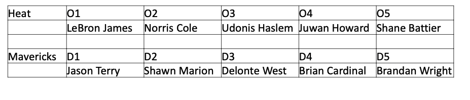

# Rasch Model

Libraries used

```{r setup, include=F}

knitr::opts_chunk$set(echo = TRUE, message = F, warning = F)

library(glmnet)
library(ggplot2)
library(Matrix)
```

```{r, echo=T, eval=F}
library(glmnet)
library(ggplot2)
library(Matrix)
```

# Bradley-Terry and Rasch model

* In Bradley-Terry model each team is either home team or away team
* We look at how many times a team being home team one against the other team being away team, and vice versa
* Bradley-Terry helps to rank teams by their ability to win

# Bradley-Terry and Rasch model

* In Rasch model every team is either on defense or on offense.
  + For each possession during the game, there are 5 offensive and 5 defensive
* If Bradley-Terry model helps to rank the teams, Rasch model helps to estimate the players offensive and defensive skills

# Rasch model for NBA

One row is one **possession**, not one stint. The outcome is points scored on that trip.

$E[P_i] = \alpha + \sum_{j=1}^5 \beta_{O_{ij}} + \sum_{j=1}^5 \delta_{D_{ij}} + \theta H_i$

* $i = 1,\ldots,n$ possessions, $j = 1,\ldots,5$ players on each side
* $O_{ij}$: $j$th player on **offense** on possession $i$
* $D_{ij}$: $j$th player on **defense** on possession $i$
* $H_i = 1$ if the **offense** is the home team, else $0$
* $P_i$: points scored on that possession (0, 2, 3, ...)
* $E[P_i]$: expected points on that possession

# Rasch Model

$E[P_i] = \alpha + \sum_{j=1}^5 \beta_{O_{ij}} + \sum_{j=1}^5 \delta_{D_{ij}} + \theta H_i$

* $\alpha$: league baseline points per possession
* $\beta$: **offense**. Larger (more positive) is better
* $\delta$: **defense**. Smaller (more negative) is better: that player allows fewer points
* $\theta$: home-court boost when $H_i = 1$

APM used one dummy per player and home margin. Rasch uses **two** numbers per player, and the $Y$ is points on this trip.


# The matrix representation of the model

Independent variables

\bcenter
```{r, echo=F,out.width="90%", out.height="80%"}
knitr::include_graphics("./images/rasch_1.png")
```
\ecenter


# The matrix representation of the model

Dependent variable and the coefficients


\bcenter
```{r, echo=F,out.width="90%", out.height="80%"}
knitr::include_graphics("./images/rasch_2.png")
```
\ecenter

# The possession file: `nba11_12`

2011-12 lockout season. One row is **one possession**. Same ten players stay on the floor until the trip ends.

```{r, echo=F}
data(nba11_12, package = "SportsAnalytics270")
```

```{r, eval = F}
data(nba11_12, package = "SportsAnalytics270")
```

* Offense: `O1` to `O5` (names)
* Defense: `D1` to `D5`
* `Home`: 1 if the **offense** is the home team
* `Points`: points scored on this trip
* `Date`

# Three possessions, Christmas, Knicks at home

Row 1: Celtics have the ball (`Home = 0`). Row 2: Knicks have the ball (`Home = 1`).

\tiny
```{r}
nba11_12[1:3, c("O1", "O5", "D1", "D5", "Home", "Points", "Date")]
```

Garnett is on offense in row 1 and on defense in row 2. The same five names swap sides when the other team gets the ball.

# One possession, by hand

Row 1: Celtics offense, Knicks defense, `Home = 0`, `Points = 0`.

* Five Celtics names get an **offense** dummy of 1
* Five Knicks names get a **defense** dummy of 1
* Everyone else that night: 0
* Home-court column: 0, because the offense is away

The $Y$ for this row is 0 points.

# Stack the ten names

`unlist` walks `O1` through `D5` **by column**: every offensive name first, then every defensive name.

\tiny
```{r}
player <- unlist(nba11_12[, 1:10])
length(player)
player[c(1, nrow(nba11_12) + 1)]
```

`length(player)` is $10 \times 209{,}781$: ten names per possession. The first name is row 1, `O1`. One full column later is row 1, `O2`.

# How many distinct players?

```{r}
num.p <- length(unique(player))
num.p
```

478 people. Each will get **two** columns: one as `off`, one as `def`.

# Tag each name as offense or defense

First $5n$ names are the `O` columns, so they get `"off"`. The last $5n$ names are the `D` columns, so they get `"def"`.

\tiny
```{r}
prefix <- rep(c("off", "def"), each = 5 * nrow(nba11_12))
tag <- paste(prefix, player)
c(names = length(player), tags = length(tag))
head(tag, 3)
tail(tag, 3)
```

`paste` glues the role to the name. `head(tag, 3)` is `O1` on the first three possessions, not three teammates. Those strings become the column names of $X$.

# One possession as ten tags

Same Christmas row. This is what the first possession contributes to $X$.

\tiny
```{r}
one <- nba11_12[1, ]
paste("off", unlist(one[1:5]))
paste("def", unlist(one[6:10]))
c(Home = one$Home, Points = one$Points)
```

Ten 1s in that row. The rest of the 956 player-role columns stay 0.

# Size of $X$

* Rows: 209,781 possessions
* Columns: $478 \times 2 + 1$ home = 957
* Entries: about 201 million. Almost all are 0. Each row has only **10 or 11** ones (ten players, plus home if \(H_i=1\))

A **sparse** matrix stores only those ones, as pairs `(row, column)`. Next: a 2-possession toy, then the same recipe on `nba11_12`.

# Toy possessions

Two trips, two on offense, two on defense. Same swap as Christmas: the other team gets the ball in row 2.

\tiny
```{r}
toy <- data.frame(
  O1 = c("Rondo", "Anthony"),
  O2 = c("Allen", "Chandler"),
  D1 = c("Anthony", "Rondo"),
  D2 = c("Chandler", "Allen"),
  Home = c(0, 1),
  Points = c(0, 2),
  stringsAsFactors = FALSE
)
toy
```

Row 1: Rondo/Allen. `Home = 0`. Row 2: Anthony/Chandler. `Home = 1`.

# Toy: unlist, then tag

Column-major: all `O1`, all `O2`, all `D1`, all `D2`. The first half of the names are offense.

\tiny
```{r}
toy_player <- unlist(toy[, 1:4], use.names = FALSE)
toy_prefix <- rep(c("off", "def"), each = 2 * nrow(toy))
toy_tag <- paste(toy_prefix, toy_player)
data.frame(slot = seq_along(toy_tag), prefix = toy_prefix,
           player = toy_player, tag = toy_tag, stringsAsFactors = FALSE)
```

Eight tags. Each unique `tag` becomes one column.

# Toy: factor levels are the columns

`as.numeric(factor(tag))` is the column index. Levels are **alphabetical**.

\tiny
```{r}
toy_fac <- factor(toy_tag)
data.frame(level = seq_along(levels(toy_fac)),
           column = levels(toy_fac), stringsAsFactors = FALSE)
```

`"def Allen"` is column 1, not `"off Rondo"`. That is why `coef` is later split into all `def`, then all `off`.

# Toy: the index table `(i, j)`

`i` is the possession. `j` is that tag's column. `sparseMatrix(i, j)` puts a 1 at each pair.

\tiny
```{r}
toy_i <- rep(1:nrow(toy), 4)
toy_j <- as.numeric(toy_fac)
data.frame(i = toy_i, tag = toy_tag, j = toy_j, stringsAsFactors = FALSE)
```

Possession 1 appears four times (two `off`, two `def`). No home yet.

# Toy: those ones as a dense grid

This is what the sparse object *means*. Zeros are not stored.

\tiny
```{r}
X_toy <- sparseMatrix(toy_i, toy_j)
colnames(X_toy) <- levels(toy_fac)
as.matrix(X_toy)
```

Row 1 has 1s under Rondo/Allen on offense and Anthony/Chandler on defense. Row 2 is the swap.

# Toy: insert home as column 1

Shift every player column by \(+1\). Possessions with `Home = 1` get an extra pair `(row, 1)`.

\tiny
```{r}
toy_i2 <- c(which(toy$Home == 1), toy_i)
toy_j2 <- c(rep(1, sum(toy$Home == 1)), toy_j + 1)
X_toy2 <- sparseMatrix(toy_i2, toy_j2)
colnames(X_toy2) <- c("Home", levels(toy_fac))
as.matrix(X_toy2)
toy$Points
```

Row 2, `Home` is 1. `y` is `Points`: 0 then 2. Real $X$ is this recipe with 5+5 players and 209k rows.

# Real $X$: the same `(i, j)` recipe

`i` repeats each possession number **10** times, in the same order as `unlist` (by column).

\tiny
```{r}
tag.factor <- as.factor(tag)
i <- rep(1:nrow(nba11_12), 10)
j <- as.numeric(tag.factor)
data.frame(
  i = i[1:10],
  tag = as.character(tag.factor[1:10]),
  j = j[1:10],
  stringsAsFactors = FALSE
)
```

These ten pairs are **not** the ten players on possession 1. They are `O1` on possessions 1–10. Possession 1's other nine names sit \(n, 2n, \ldots\) later in `i`/`j`.

# Possession 1's ten ones

Row 1 of \(X\) is the ten tags from `one`.

\tiny
```{r}
n <- nrow(nba11_12)
idx1 <- 0:9 * n + 1
data.frame(
  i = i[idx1],
  tag = as.character(tag.factor[idx1]),
  j = j[idx1],
  stringsAsFactors = FALSE
)
```

`i` is 1 ten times. `j` is Garnett-off, Pavlovic-off, ..., Fields-def.

# Add home, then build the real $X$

Column 1 = home court. `j + 1` leaves room. `which(Home == 1)` are the rows that get a 1 there.

\tiny
```{r}
i.new <- c(which(nba11_12$Home == 1), i)
j.new <- c(rep(1, sum(nba11_12$Home == 1)), j + 1)
X <- sparseMatrix(i.new, j.new)
y <- nba11_12$Points
c(rows = nrow(X), cols = ncol(X), nnz = nnzero(X),
  home_ones = sum(nba11_12$Home == 1), player_ones = length(i))
```

Nonzeros \(\approx\) 10 per row, plus one extra on home-offense rows. `y` lines up with the rows of \(X\).

# Check row 1 of $X$

Christmas, offense away, so **no** home 1. Ten player ones only.

\tiny
```{r}
hit <- which(X[1, ] != 0)
data.frame(
  column = as.integer(hit),
  name = c("Home", sort(unique(tag)))[hit],
  value = as.numeric(X[1, hit]),
  stringsAsFactors = FALSE
)
```

Column 1 (`Home`) is missing, as `Home = 0`. The names match the ten tags from possession 1.

# Why sparse?

A dense $209{,}781 \times 957$ table is about 200 million zeros. Ridge only needs the ones.

`sparseMatrix(i, j)` is the index table: each pair is one 1. That is the design matrix for \(\sum \beta + \sum \delta + \theta H\).

# Why not ordinary `lm`?

$X$ has 957 columns. Lineups repeat, and ten players always share the same $P_i$. Ordinary `lm` can give huge $\beta$s to whoever was on a lucky trip (Benson in APM).

We still want $\hat P = \alpha + \sum \beta + \sum \delta + \theta H$. We add a **penalty** so unused players stay near 0.

# Ridge in one line

Minimize

\[
\sum_i (P_i - \hat P_i)^2 + \lambda \sum_k (\beta_k^2 + \delta_k^2)
\]

* First sum: fit the possessions
* Second sum: keep player effects small
* $\lambda = 0$ is ordinary least squares
* $\lambda$ large: every $\beta$ and $\delta$ is pulled toward **0** (average player)
* Home $\theta$ and intercept $\alpha$ are usually left unpenalized

The ten people on the trip **share** the points. Nobody gets the whole $P_i$.

# What `glmnet` is

`glmnet` fits that penalized model. One knob, confusingly also called `alpha`, chooses the **shape** of the penalty:

* `alpha = 0`: **ridge** (sum of squares). What we use. Every player keeps a small number
* `alpha = 1`: **lasso** (sum of absolute values). Many coefficients become exactly 0
* In between: elastic net

This `alpha` is **not** the intercept $\alpha$ in the Rasch formula.

`standardize = FALSE` because our $X$ is already 0/1. Scaling those columns would change the meaning of $\beta$.

# What the `cv` in `cv.glmnet` does

We do not pick $\lambda$ by hand. Cross-validation does.

* Split the possessions into folds (default **10**)
* For each candidate $\lambda$, fit on 9 folds, predict the held-out fold
* Score: mean squared error of $\hat P$ vs $P$
* `lambda.min`: $\lambda$ with the **lowest** CV error
* `lambda.1se`: a slightly larger $\lambda$ (more shrinkage) whose error is still within 1 SE of the minimum

We take `s = "lambda.min"`: the best prediction on held-out possessions.

# The call, argument by argument

```r
cv.glmnet(X, y, alpha = 0, standardize = FALSE)
```

* `X`: sparse dummy matrix (home + off/def columns)
* `y`: points on that possession
* `alpha = 0`: ridge, not lasso
* `standardize = FALSE`: do not rescale 0/1 columns
* `set.seed(1)`: the fold ids are random; fix them so the lecture is reproducible

Then `coef(model, s = "lambda.min")` is one number per column, plus the intercept.

# Fit the Rasch ridge

\tiny
```{r}
set.seed(1)
model <- cv.glmnet(X, y, alpha = 0, standardize = FALSE)
coef <- coef(model, s = "lambda.min")[, 1]
names(coef) <- c("Intercept", "HFA", sort(unique(tag)))
head(names(coef), 4)
```

Names: intercept, home, then every `def`/`off` tag in alphabetical order. Next we split that vector into $\alpha, \theta, \delta, \beta$.

# Split the coefficient vector

`"def ..."` sorts before `"off ..."`, so the first 478 player names are defense.

\tiny
```{r}
alpha <- coef[1]
theta <- coef[2]
delta <- coef[2 + 1:num.p]
beta  <- coef[2 + num.p + 1:num.p]
c(alpha = unname(alpha), theta = unname(theta),
  n_def = length(delta), n_off = length(beta))
```

`alpha` is baseline points per possession. `theta` is extra points when the offense is at home.

# How the coefficients are found

That `cv.glmnet` fit *is* the Rasch coefficients.

* Each row of $X$ has ten 1s (five `off`, five `def`) and maybe home
* $y_i = P_i$ is points on that trip
* Ridge + CV, as on the previous slides: share the points, shrink toward the average player
* No closed form like a plus/minus sum

# When to use Rasch (this version)

Use it when you have **possessions** (who is on offense, who is on defense, points on that trip), and you want **two** skills per player.

* Lineup design: expected points if these five play these five
* Separate “does he help scoring?” from “does he stop scoring?”
* Not a substitute for box-score scoring titles or raw plus/minus game logs

If you only have stint **margin**, stay with APM. If you only have wins, stay with Bradley–Terry.

# Advantages

* Splits offense and defense; APM is one number
* \(Y\) is points on **this trip**, so a stop and a score are not mixed into one margin
* Ridge handles 478 players \(\times\) 2 roles; ordinary `lm` would blow up
* Lineup math is a sum: plug in ten names plus home
* Neutral-court ratings (\(\alpha + \theta/2\)) are comparable across home and away

# Disadvantages

* Needs play-by-play with ten names **and** points per possession, not just box scores
* Small-sample players still shrink a lot; the rating is “toward average,” not a scouting report
* Linear in points: a 3 and a 2 enter as numbers, not as shot quality
* No ball-handler vs screener: five offense \(\beta\)s are added as equals
* Coefficients move if you change \(\lambda\), the season, or who is in the file
* Does not say the player is “good”; it says how this lineup’s expected points moved

# Offensive coefficients $\beta$

Larger $\beta$ means that player adds more expected points when he is on offense, holding the other nine fixed.

```{r}
head(sort(beta, decreasing = TRUE), n = 10)
```

These are **not** points he scored. They are extra expected points on the possession.

# Defensive coefficients $\delta$

Smaller (more negative) $\delta$ is better defense: expected points **fall** when he is on that side.

```{r}
head(sort(delta), n = 10)
```

A positive $\delta$ means the offense scores *more* than average when he is defending.

# One lineup, by hand

Miami on offense, Dallas on defense, **at Dallas**. So $H_i = 0$: the offense is away.

\bcenter
```{r, echo=F, out.width="90%", out.height="70%"}

```
\ecenter

Plug the ten names into the same formula.

# The prediction is a sum

$E[P_i] = \alpha + \sum_{j=1}^5 \beta_{O_{ij}} + \sum_{j=1}^5 \delta_{D_{ij}} + \theta H_i$

$H_i = 0$ because Miami is the away offense.

$P = \alpha + \beta_{\text{James}} + \beta_{\text{Cole}} + \beta_{\text{Haslem}} + \beta_{\text{Howard}} + \beta_{\text{Battier}}$

$+~\delta_{\text{Terry}} + \delta_{\text{Marion}} + \delta_{\text{West}} + \delta_{\text{Cardinal}} + \delta_{\text{Wright}} + \theta \times 0$

# Look up the ten coefficients

The names must match `names(beta)` and `names(delta)`: `"off LeBron James"`, not `"LeBron"`.

\tiny
```{r tidy=F}
off <- c("off LeBron James", "off Norris Cole", "off Udonis Haslem",
         "off Juwan Howard", "off Shane Battier")
beta[off]
def <- c("def Jason Terry", "def Shawn Marion", "def Delonte West",
         "def Brian Cardinal", "def Brandan Wright")
delta[def]
```

# Add them

Baseline, five offense $\beta$s, five defense $\delta$s, no home boost.

\tiny
```{r}
c(alpha = unname(alpha), theta = unname(theta))
alpha + sum(beta[off]) + sum(delta[def]) + theta * 0
```

About 0.95 expected points on this possession. A made 2 is 2, a miss is 0, so 0.95 is a typical NBA trip.

# Scale to points per 100 possessions

$\alpha + \theta/2$ is a **neutral court** (half of home court), from Sam Powers. Multiply by 100 so the units are points per 100 possessions.

\tiny
```{r}
def.rating <- 100 * (alpha + theta / 2 + delta)
off.rating <- 100 * (alpha + theta / 2 + beta)
```

`delta` (or `beta`) for an average player is near 0 after ridge, so the rating is about $100(\alpha + \theta/2)$.

# Best defensive ratings

If you put this player with **four average teammates**, against **five average offense**, how many points per 100 possessions would they **allow**? Lower is better.

```{r}
head(sort(def.rating), n = 10)
```

# Best offensive ratings

Same thought experiment on offense: four average teammates, five average defenders. Higher is better.

```{r}
head(sort(off.rating, decreasing = TRUE), n = 10)
```

# Raw points per 100, no regression

`X'y / column sums` is just the average $P_i$ while that column is 1. No adjustment for who else was on the floor.

\tiny
```{r}
pp100 <- 100 * (crossprod(X, y) / colSums(X))[, 1]
names(pp100) <- c("Home", sort(unique(tag)))
def.pp100 <- pp100[1 + 1:num.p]
off.pp100 <- pp100[1 + num.p + 1:num.p]
head(sort(off.pp100, decreasing = TRUE), n = 10)
```

This can put a lucky bench player first, same trap as unfiltered plus/minus. The ridge ratings above are the adjusted numbers.

# Offensive vs. defensive rating

Ridge $\beta$ vs ridge $\delta$, on the per-100 scale. Near 0 means no linear link: a good scorer need not be a good defender in this model.

\tiny
```{r}
cor(off.rating, def.rating)
```

```{r, fig.height=3.2, fig.width=7.4, echo=FALSE, out.width="\\linewidth"}
ggplot() + geom_point(aes(x = off.rating, y = def.rating), size = 0.6) +
  labs(title = "Offensive rating vs defensive rating",
       x = "Offensive rating", y = "Defensive rating")
```

# Offensive rating vs raw points

The x-axis is adjusted. The y-axis is raw points per 100 while that player was on offense.

\tiny
```{r}
cor(off.rating, off.pp100)
```

```{r, echo=FALSE, fig.width=7.4, fig.height=3.2, out.width="\\linewidth"}
ggplot() + geom_point(aes(x = off.rating, y = off.pp100), size = 0.6) +
  labs(title = "Offensive rating vs points scored",
       x = "Offensive rating", y = "Raw points per 100")
```

# Defensive rating vs raw points allowed

Lower rating should go with fewer points allowed. Raw y is unadjusted.

\tiny
```{r, echo=FALSE, fig.width=7.4, fig.height=3.2, out.width="\\linewidth"}
ggplot() + geom_point(aes(x = def.rating, y = def.pp100), size = 0.6) +
  labs(title = "Defensive rating vs points allowed",
       x = "Defensive rating", y = "Raw points allowed per 100")
cor(def.rating, def.pp100)
```

