```{r setup, include = FALSE}
knitr::opts_chunk$set(echo = TRUE, warning = FALSE, message = FALSE)
options(tinytex.verbose = T)

options(scipen = 999)
library(devtools)
library(knitr)
```


# Intro to R

## Intro to R

- Go to [Comprehensive R Archive Network (CRAN)](https://cran.r-project.org/) and install version for your operating system
- Go to [RStudio](https://www.rstudio.com/products/rstudio/download/) and install RStudio IDE
- You need to install R before installing RStudio


```{r, echo = F, out.height = '40%', out.width = '30%', fig.align = 'right'}

```

## Intro to R

Configure the pane layout of RStudio as you wish

```{r, echo = F, out.width = "90%"}
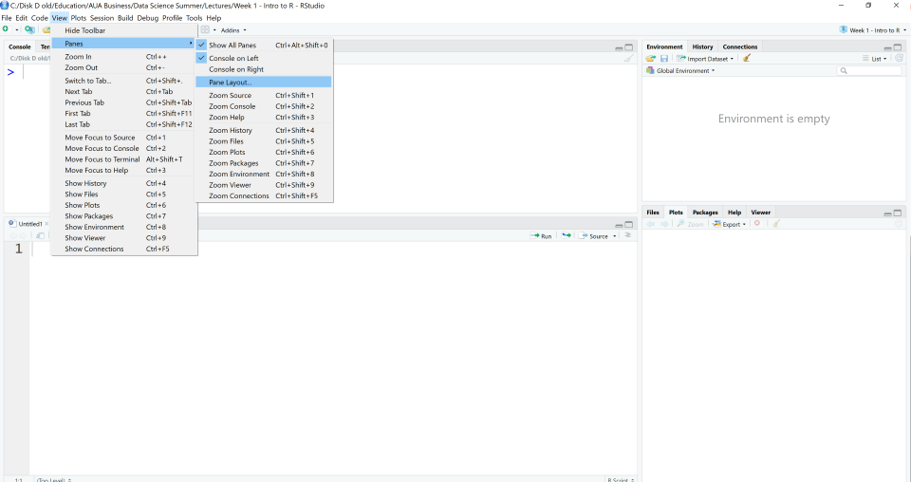
```

## Intro to R

```{r, echo = F, out.width = "90%"}
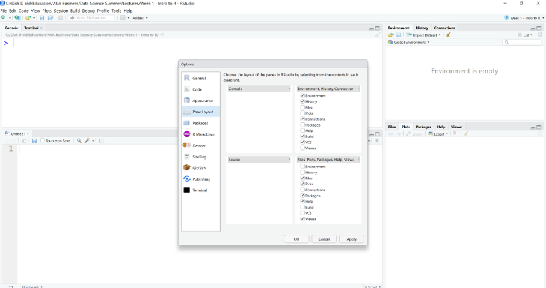
```


## Intro to R

RStudio projects make it straightforward to divide your work into multiple contexts, each with their own working directory, workspace, history, and source documents.

**Creating Projects**

- RStudio projects are associated with R working directories. You can create an RStudio project:
    - in a brand new directory;
    - in an existing directory where you already have R code and data;
    - by cloning a version control (Git or Subversion) repository.


## Intro to R

- Create an empty directory
- Go to File $\rightarrow$ New Project
- Choose existing directory

\hfill\break

```{r, echo = F, out.height = '50%', out.width = '50%', fig.align = 'right'}
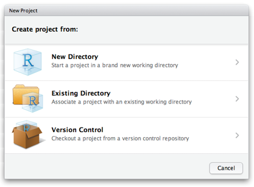
```


## Intro to R

- Now when you have created your project, all files associated with the project need to be saved in the project directory
- To check the project directory do getwd() in Console

\hfill\break

```{r, echo = F, out.width = '60%'}
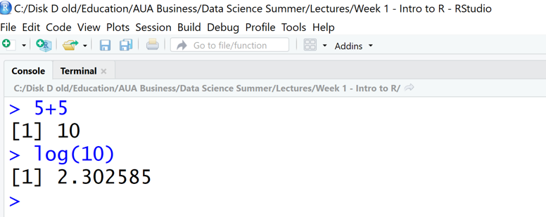
```

\hfill\break

The name of the project appears at the top of RStudio window


## Why do we need RStudio Project?

The benefits of RStudio project:

- Can have different projects with their own environment.
- While opening a project, R restores previous work and project history includes recent commands which had been used in the project.
- Source pane remembers the files which had been opened.


## Intro to R

When a new project is created, RStudio:

- Creates a project file (with an .Rproj extension) within the project directory. This file contains various project options (discussed below) and can also be used as a shortcut for opening the project directly from the filesystem.
- Creates a hidden directory (named .Rproj.user) where project-specific temporary files (e.g. auto-saved source documents, window-state, etc.) are stored. This directory is also automatically added to .Rbuildignore, .gitignore, etc. if required.
- Loads the project into RStudio and displays its name in the Projects toolbar (which is located on the far right side of the main toolbar).


## Intro to R

**Opening Projects**

\hfill\break

There are several ways to open a project:

- Using the **Open Project** command (available from both the Projects menu and the Projects toolbar) to browse for and select an existing project file (e.g. MyProject.Rproj).
- Selecting a project from the list of the most recently opened projects (also available from both the Projects menu and toolbar).
- Double-clicking on the project file within the system shell (e.g. Windows Explorer, OSX Finder, etc.).


## Intro to R

**The source editor**

- If you plan to reuse your code, write it in source editor

\hfill\break

```{r, echo = F, out.width = '90%'}
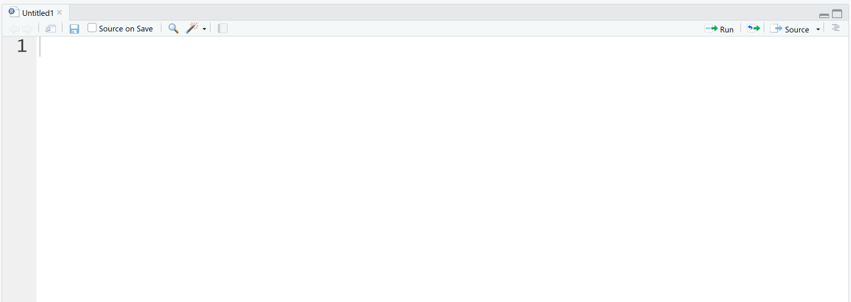
```


## Intro to R

Here you can type any valid R command after the > prompt followed by **Enter** and R will execute that command. 

\hfill\break

```{r, echo = F, out.height = '40%', out.width = '60%'}
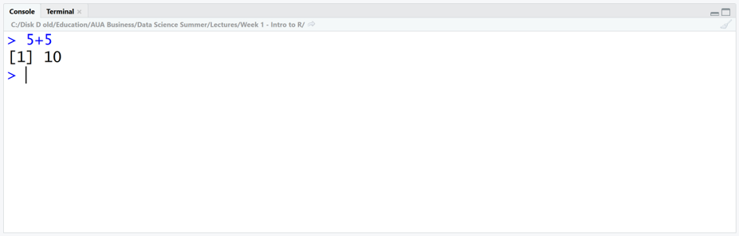
```

\hfill\break
Use console as a calculator
\hfill\break

[1] is the index for the output, just ignore it


## Intro to R

This will create new script file

\hfill\break

```{r, echo = F, out.height = '70%', out.width = '70%'}
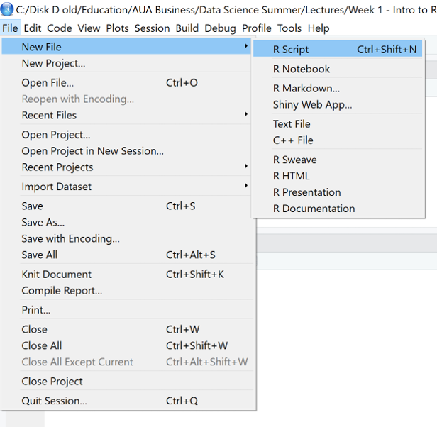
```


## Intro to R

- To run the script line from source editor, put the cursor anywhere on the line and hit **Ctrl+Enter**
- You will see the output in the console

\hfill\break

```{r, echo = F, out.height = '50%', out.width = '50%'}
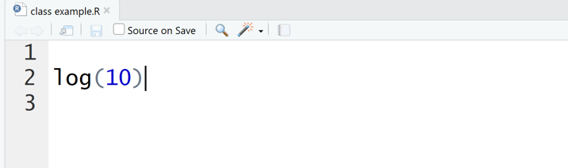
```


## Intro to R

- If you have a piece of text in your editor that is not a code (thus is not executable by R) then you need to comment it, add # before each line
- When you run this line of code, it will be printed in Console as a text
- To comment large chunk of text, use **Ctrl+Shift+C**

\hfill\break

```{r, echo = F, out.height = '60%', out.width = '60%'}
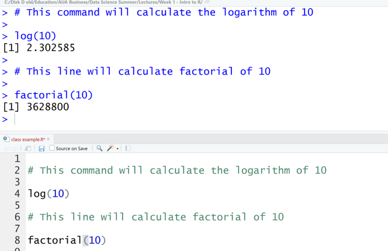
```


## Intro to R

- The environment window contains objects (data, values, functions) R has currently stored in its memory. 
- The history window shows all commands that were executed in the Console.

\hfill\break

```{r, echo = F, out.height = '50%', out.width = '50%'}
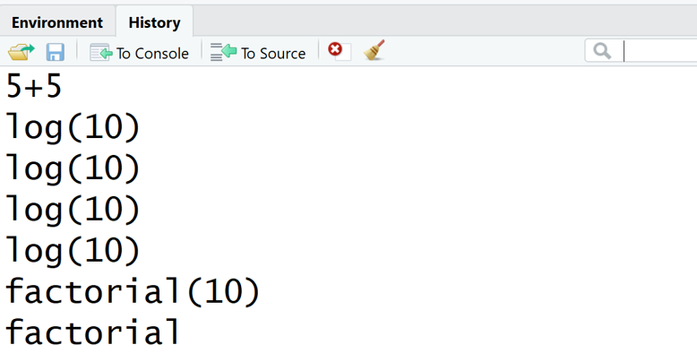
```


## Intro to R

Bottom right: files, plots, packages, help, & viewer pane. Here you can open files, view plots, install and load packages, read main pages, and view markdown and other documents in the viewer tab.

\hfill\break

```{r, echo = F, out.height = '50%', out.width = '50%'}
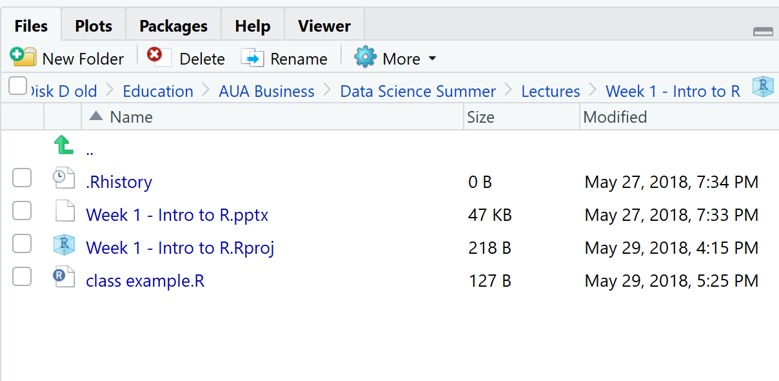
```


## Intro to R

Some useful shortcuts:

- type first few letters of the function/object then hit Tab to open dropdown menu with possible options

\hfill\break

```{r, echo = F, out.height = '60%', out.width = '60%'}
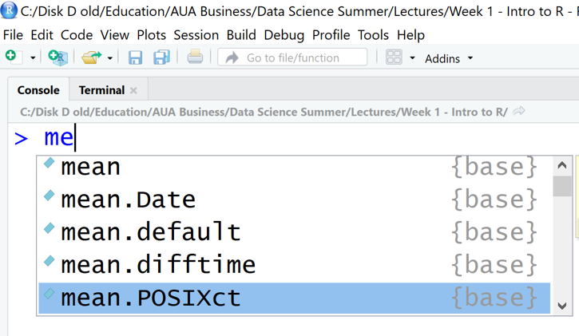
```


## Intro to R

It's often the case that you want to re-execute commands that you previously entered. The RStudio console supports the ability to recall previous commands using the arrow keys:

- **Up** - Recall previous command(s)
- **Down** - Reverse of Up

\hfill\break

You can even view a list of your recent commands by pressing **Ctrl+Up** on Windows or **Command+Up** on a Mac.

\hfill\break

```{r, echo = F, out.width = "60%"}
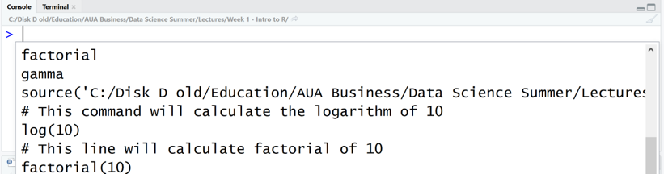
```


## Intro to R

- When you download R from the CRAN, you get that "base" R system.
- The base R system comes with basic functionality; implements the R language.
- One reason R is so useful is the large collection of packages that extend the basic functionality of R.
- R packages are developed and published by the larger R community.


## Intro to R

- Packages can be installed with the install.packages() function in R.
- To install a single package, pass the name of the library to the install.packages() function as the first argument.
- The following code installs the devtools package from CRAN.

\hfill\break

```{r,eval=F}
install.packages("devtools")
```

## Intro to R

- The package needs to be installed only once
- To load the package into R environment you need to use function library()
- You need to load the library everytime you start a new R 

```{r, eval=F}
library(devtools)
```


## Intro to R

- You can also install packages from github
- The following code will install the following package from github

```{r, eval=F}
library(devtools)
install_github("christophM/iml")
```

\hfill\break
If you do not want to load the entire package but want to use some function from it, use the following command

\hfill\break
package::function_name

```{r eval=F}
devtools::install_github("christophM/iml")
```


## Intro to R

To access help/documentation on a function from R base package

```{r eval=F}
?mean
```

To access help/documentation on function from a library

```{r eval=F}
#??geom_path
```

The same

```{r eval=F}
#?ggplot2::geom_path
```

Help on the package

```{r eval=F}
help(package='ggplot2')
```


## Intro to R

- Each package on CRAN has its own webpage
- This includes documentation and sometimes includes vignettes 

\hfill\break

- If you have a specific task to do, then look at R Task View
- [Here](https://cran.r-project.org/web/views/TimeSeries.html) are all the packages and R functionality described for the Time series analysis


## Intro to R programming language

- Anything in R is an object.
- Objects are assigned values using <- . (An equal sign = can also be used.) For e.g., the following command assigns value 5 to object x.

```{r}
x <- 5
x
```
\hfill\break

- R is case sensitive, thus Data10 and data10 are two different objects.
- A tidy code requires a space before the assignment operator and a space after.
    - You can see what is inside the object just by simple entering the name of the object in command line
    - When the object is created it should appear in your Environment Window
    - If the object is not in your environment window you cannot work with it
    - The assignment operator works in the opposite direction as well


## Intro to R programming language

A basic concept in (statistical) programming is called a variable.

A variable allows you to store a value (e.g. 4) or an object (e.g. a function description) in R. You can then later use this variable's name to easily access the value or the object that is stored within this variable.

You can assign a value 4 to a variable my_var with the command


```{r}
my_var <-4
my_var
```


## Intro to R programming language

You can do basic operations with variables

```{r}
my_var <- 4
your_var <- 5
my_var + your_var
```

Or you can create a new variable

```{r}
var2<- my_var + your_var
var2
```

## Intro to R programming language


R works with numerous data types.  
Some of the most basic types to get started are:  

- Decimals values like 4.5 are called numerics.
- Natural numbers like 4 are called integers. Integers are also numerics.
- Boolean values (TRUE or FALSE) are called logical.
- Text (or string) values are called characters.

Note how the quotation marks indicate that "some text" is a character.

## Intro to R programming language

- Assign integer 42 to variable my_numeric

- String  "universe“ to my_character 

- **FALSE** to boolean my_logical 

## Intro to R programming language

**Vector** is a type of data structure that contains similar types of data, i.e., integer, double, logical, complex, etc. In order to create a vector c() function is used.

```{r}
x <- c(10,5,6)
x
```
\hfill\break

```{r}
x1 <- c(1:10)
x1
```
\hfill\break

The same as (only when you have a sequence)

```{r}
x1 <- 1:10
x1
```


A character vector

```{r}
y <- c("CS", "DS", "ES")
y
```


# Working with vectors

## Working with vectors

Create 2 new vectors

```{r pressure}
revenue <- c(140, 50, 20, 120, 240)
expenses <- c(24, 50, 100, 50, 10)
```


```{r}
names(revenue) <- c("Monday", "Tuesday", "Wednesday", "Thursday", "Friday")
```


## Working with vectors

Subseting vector by element name

```{r}
revenue["Monday"]
```


## Working with vectors

Subseting element from vector by position.
In R indexing starts from 1

```{r}
revenue[4]
```


You can select 1 and 3 elements

```{r}
revenue[c(1,3)]
```

Or elements from 1 to 4

```{r}
1:4
```

```{r}
revenue[c(1:4)]
```


## Working with vectors


Arithmetic operations of vectors are performed member-by-member, i.e., memberwise.

For example, the following three statements are completely equivalent:

c(1, 2, 3) + c(4, 5, 6) 

c(1 + 4, 2 + 5, 3 + 6)

c(5, 7, 9) 


## Working with vectors

Find daily income

```{r}
inc_d <- revenue-expenses
inc_d
```


Find the days with positive revenue

This will give you a boolean vector

```{r}
inc_d>0
```

subset
```{r}
inc_pos<-inc_d[inc_d>0]
inc_pos
```


## Working with vectors

You can make comparison between vectors two

```{r}
revenue > expenses
```


## Working with vectors

The (logical) comparison operators known to R are:

- **<** for less than
- **>**  for greater than
- **<=** for less than or equal to
- **>=** for greater than or equal to
- **==** for equal to each other
- **!=** not equal to each other

## Working with vectors

Recycling
```{r}
u<-c(10,20,30)
v<-c(1,2,3,4,5,6,7,8,9)
u+v
```


## Working with vectors

You can use sum() command to get the sum of all element in the vector


```{r}
sum(inc_d)
```


Finding the average

```{r}
mean(inc_d)
```

You can do other operations with vectors too


```{r}
inc_d*2
```


## Working with vectors

In R, missing values are represented by the symbol NA (not available). Impossible values (e.g., dividing by zero) are represented by the symbol NaN (not a number).


```{r}
d<-c(0,1,6,NA,5 ,NaN)
```

```{r}
is.na(d)
```


```{r}
!is.na(d)
```


## Operations with matrices


In R, a matrix is a collection of elements of the same data type (numeric, character, or logical) arranged into a fixed number of rows and columns.  
Since you are only working with rows and columns, a matrix is called two-dimensional.  
You can construct a matrix in R with the matrix() function.  
Consider the following example:

```{r}
matrix(1:9, byrow = TRUE, nrow = 3)
```


## Operations with matrices

Box office Star Wars (in millions!)

```{r}
new_hope <- c(460.998, 314.4)
empire_strikes <- c(290.475, 247.900)
return_jedi <- c(309.306, 165.8)
box_office <-c(new_hope, empire_strikes, return_jedi)
box_office
```


## Operations with matrices

Construct star_wars_matrix


```{r}
star_wars_matrix <- matrix(box_office, nrow = 3, byrow = TRUE)
star_wars_matrix
```


## Operations with matrices

We could have done the same using rbind command

```{r}
star_wars_m1 <- rbind(new_hope, empire_strikes, return_jedi)
star_wars_m1
```


## Operations with matrices

Naming rows and columns

```{r}
region <- c("US", "non-US")
titles <- c("A New Hope", "The Empire Strikes Back", "Return of the Jedi")

# Name the columns with region
colnames(star_wars_matrix) <- region

# Name the rows with titles
rownames(star_wars_matrix) <- titles

# Print out star_wars_matrix
star_wars_matrix

```


## Operations with matrices

Lets get worldwide box-office for the tree movies


```{r}
worldwide_vector <- rowSums(star_wars_matrix)
worldwide_vector
```

Get US and Non-US box office for all tree movies combined

```{r}
combined_vector<-colSums(star_wars_matrix)
combined_vector
```


## Operations with matrices

Similar to vectors, you can use the square brackets [ ] to select one or multiple elements from a matrix. 
Whereas vectors have one dimension, matrices have two dimensions. You should therefore use a comma to separate that what to select from the rows from that what you want to select from the columns. 

For example:  

- my_matrix[1,2] selects the element at the first row and second column.
- my_matrix[1:3,2:4] results in a matrix with the data on the rows 1, 2, 3 and columns 2, 3, 4.

If you want to select all elements of a row or a column, no number is needed before or after the comma, respectively:  

- my_matrix[,1] selects all elements of the first column.
- my_matrix[1,] selects all elements of the first row.


## Operations with matrices

Take the first row -  A new hope

```{r}
new_hope<-star_wars_matrix[1,]
new_hope
```


Take the first column
```{r}
US <- star_wars_matrix[,1]
US
```


## Operations with matrices

US box office for "A new hope"

```{r}
star_wars_matrix[1,1]
```

You can do the subseting by the names of rows and columns as well, if they are specified

```{r}
star_wars_matrix[,"non-US"]
star_wars_matrix["A New Hope","non-US"]
```

# Dataframes

## Dataframes

- Data frame is a data set that contain different data types instead of only one. You can combine numeric and character variables into the same dataset
- A data frame has the variables of a data set as columns and the observations as rows. 
- Has the most use in Data Analytics

## Working with dataframes

```{r}
data(mtcars)
```

Look at the description

```{r}
?mtcars
```


## Working with dataframes

Look at the top 5 observations

```{r}
head(mtcars, n=5)
```


## Working with dataframes

Look at the bottom file observations

```{r}
tail(mtcars, n=5)
```


## Working with dataframes

```{r}
str(mtcars)
```


## Working with dataframes

Look at the summary of the dataframe

```{r}
summary(mtcars)
```


## Working with dataframes

Subseting the dataframes

Get the dimensions of the dataframe

```{r}

dim(mtcars)
```


Create a new dataframe with the first two columns and all the rows

```{r}
df1 <- mtcars[,1:2]
dim(df1)
```


## Working with dataframes

Create a new dataframe with column 1,2,3 and 6, and first 10 rows

```{r}
df2 <- mtcars[1:10,c(1:3,6)]
dim(df2)
```

Create a new dataframe with all the variables, except 1 and 4

```{r}
df3 <- mtcars[,-c(1,4)]
dim(df3)
```

## Working with dataframes

If the columns or rows have names, you can subset them by names as well

```{r}
df4 <- mtcars[,c("mpg", "gear", "disp")]
names(df4)
```

## Working with dataframes

You can access a column in dataframe using $ sign if columns have names

```{r}
mpg <- mtcars$mpg
mpg
```

## Working with dataframes

You can subset a dataframe by rows by condition on any column

Keep only rows where mpg is more than or equal to 15

```{r}

df5 <- mtcars[mtcars$mpg>=15, ]
summary(df5)
```


## Working with dataframes

Can subset by rows using more than 1 condition.

AND logical operator

```{r}
df6 <- mtcars[mtcars$mpg>15 & mtcars$carb<3,]
summary(df6)
```

## Working with dataframes

```{r, echo = F, out.width = "80%"}
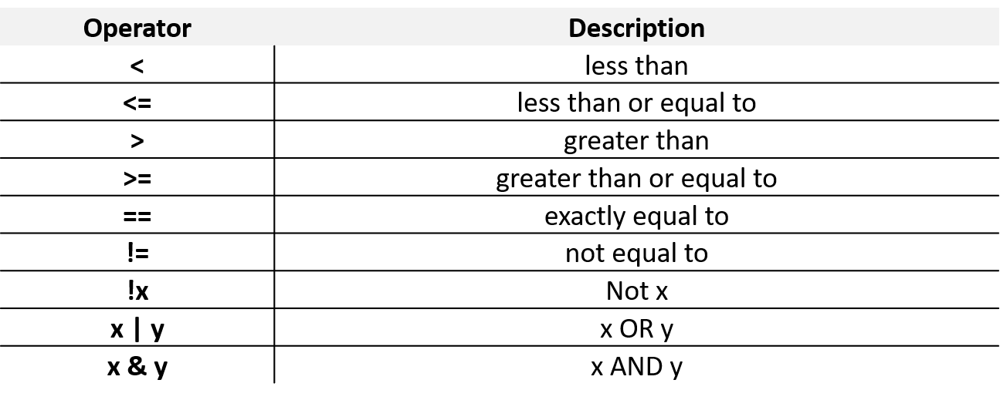
```

## Working with dataframes

The OR logical operator

```{r}
df7 <- mtcars[mtcars$mpg>15 | mtcars$carb<3, ]
summary(df7)
```

## Working with dataframes

Creating the final season schedule for Serie A.

The following varaibles describe the first 5 places for Serie A at 1996.

```{r}
Team<-c("AC Milan","Juventus","Lazio","ACF Fiorentina","AS Roma","Parma AC")
Wins<-c(21,19,17,17,16,16)
Draws<-c(10,8,8,8,10,10)
Points<-c(73,65,59,59,58,58)

```


## Working with dataframes

We can combine these variables into a dataframe

```{r}
seriea <- data.frame(Team,Points, Wins, Draws)
str(seriea)
```

## Working with dataframes

Working with variables

```{r}
mean(seriea$Points)
```

```{r}
mean(seriea[,"Points"])
```


## Working with dataframes

We can create a new variable within the dataframe that will show the 
number of games each team has lost (total 34 games were played)

```{r}
seriea$Lost<-34-(seriea$Wins+seriea$Draws)
```


## Working with dataframes

Dataframe has column and rownames

```{r}
colnames(seriea)
rownames(seriea)
```


# Lists

## Lists

 - Vectors (one dimensional array): can hold numeric, character or logical values. The elements in a vector all have the same data type.
- Matrices (two dimensional array): can hold numeric, character or logical values. The elements in a matrix all have the same data type.
- Data frames (two-dimensional objects): can hold numeric, character or logical values. Within a column all elements have the same data type, but different columns can be of different data type.

## Lists

```{r}
# Vector with numerics from 1 up to 10
my_vector <- 1:10 

# Matrix with numerics from 1 up to 9
my_matrix <- matrix(1:9, ncol = 3)

# First 5 elements of the built-in data frame mtcars
my_df <- mtcars[1:5,]

# a character 
my_char<-"DataMata"

# combine into a list
my_list<-list(my_vector, my_matrix, my_df, my_char)
my_list
```


## Lists


New list for movie shining
\tiny
```{r}
moviename<-"The Shining"
actors<-c("Jack Nicholson","Shelley Duvall",
          "Danny Lloyd","Scatman Crothers",
          "Barry Nelson" )
reviews<-data.frame(scores=c(4.5,4,5),
        sources=c("IMDb1", "IMDb2", "IMDb3"),
        comments =c(
          "Best Horror Film I Have Ever Seen",
          "A truly brilliant and scary film from Stanley Kubrick", 
          "A masterpiece of psychological horror"))
```

## Lists

Named list

```{r}
shining_list<-list(moviename=moviename, actors=actors, reviews=reviews)
shining_list
```


Subsetting the list.

One way to select a component is using the numbered position of that component. 
For example, to "grab" the first component of shining_list you type

```{r}
shining_list[[1]]
```


## Lists

A quick way to check this out is typing it in the console. Important to remember: to select elements from vectors, you use single square brackets: [ ]. Don't mix them up!

You can also refer to the names of the components, with [[ ]] or with the $ sign. Both will select the data frame representing the reviews:

```{r}
shining_list[["reviews"]]
shining_list$reviews
```

## Lists


Besides selecting components, you often need to select specific elements out of these components. For example, with shining_list[[2]][1] you select from the second component, actors (shining_list[[2]]), the first element ([1])

```{r}
shining_list[[2]][1]
```


## Lists

Adding new value to the list,
simply use c

```{r}
shining_list<-c(shining_list, year=1980)
shining_list
```

# Functions

## Functions

- In programming, you use functions to incorporate sets of instructions that you want to use repeatedly or that, because of their complexity, are better self-contained in a sub program and called when needed. 
- A function is a piece of code written to carry out a specified task; it can or can not accept arguments or parameters and it can or can not return one or more values.
- In fact, there are several possible formal definitions of ‘function’ spanning from mathematics to computer science.
- **Generically, its arguments constitute the input and return values as output.**


## Functions

- Functions have named arguments which potentially have default values. 
- The formal arguments are the arguments included in the function definition.
- The formals function returns a list of all the formal arguments of a function.
- Not every function call in R makes use of all the formal arguments.
- Function arguments can be missing or might have default values.


## Functions

The function runif() generates random numbers from continuous uniform distribution
\hfill\break

Arguments are:

- n, number of observations, with no default - so needs to be specified
- min, the minimum
- max, the maximum

```{r}
formals(runif)
```

```{r}
args(runif)
```


## Functions

R functions' arguments can be matched **positionally** or **by name**. So the following calls to runif() are all equivalent (you can mix them as well).

- Matching by name

```{r}
runif(min=1, n=10, max=2)
```
\hfill\break

- Matching by position

```{r}
runif(10,1,2)
```

\hfill\break

Note, as the process is random you might get different results.


## Functions

Matched by position, this will give an error

```{r, warning=T}
runif(1,10,2)
```


## Functions

- If the argument has a default value and is not defined then the default value is used.
- Generated 10 numbers with min=0, max=1

```{r}
runif(10)
```


## Functions

You can look at the arguments of the function and their description by hitting **Tab** inside the brackets

\hfill\break

```{r, echo = F, out.width = "80%"}
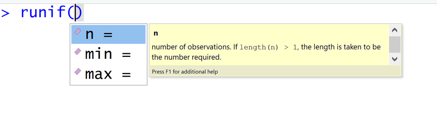
```


<!-- ## Functions -->

<!-- **General rule: if you have to copy a code more than twice, write a function.** -->
<!-- \hfill\break -->

<!-- f <- function(a, b = 1, c = 2, d = NULL) {  -->
<!-- \hfill\break -->
<!-- 	what needs to be done -->
<!-- \hfill\break -->
<!-- }  -->

<!-- \hfill\break -->

<!-- In addition to not specifying a default value, you can also set an argument value to NULL.  -->


<!-- ## Functions -->

<!-- - User-defined functions are stored in the global environment and can be accessed easily. -->
<!-- - The following function will calculate the x power of y (default value of y is 2). -->

<!-- ```{r} -->
<!-- foo <- function (x, y=2){ -->
<!--   x^y -->
<!-- } -->

<!-- foo(4) -->
<!-- ``` -->


<!-- ## Functions -->

<!-- Arguments to functions are evaluated lazily, so they are evaluated only as needed.  -->

<!-- ```{r} -->
<!-- foo <- function (x,y){ -->
<!--   x^2 -->
<!-- } -->

<!-- foo(3) -->
<!-- ``` -->

<!-- \hfill\break -->
<!-- \hfill\break -->

<!-- This function never actually uses the argument \textcolor{red}{y}, so calling f(2) will not produce an error because the 2 gets positionally matched to \textcolor{red}{x}.  -->


<!-- ## Functions -->

<!-- - The return value of a function is the last expression in the function body to be evaluated. -->
<!-- - It can be also specified with the function return() -->


<!-- ## Functions -->

<!-- The following function will calculate the z-score of a vector -->

<!-- ```{r} -->
<!-- norm <- function(x) { -->
<!--   return((x-mean(x))/sd(x)) -->
<!-- } -->

<!-- norm(mtcars$mpg) -->
<!-- ``` -->


<!-- ## Functions -->

<!-- - Create a function that will do Max-Min normalization -->
<!-- - Use functions max() and min() to get the minimum and maximum values in the vector -->

<!-- $$Z_i = \frac{x_i - min(x)}{max(x)-min(x)}$$ -->

<!-- \hfill\break -->

<!-- Test it on one of the columns of mtcars. -->

<!-- ```{r, include = F} -->
<!-- normalize <- function(x) { -->
<!--     return ((x - min(x)) / (max(x) - min(x))) -->
<!--   } -->
<!-- ``` -->


<!-- ## Functions -->

<!-- - Create a function that will do the following -->
<!--    - apply max-min normalization on each variable in the data frame; -->
<!--    - return new data frame with normalized variables. -->
<!--      - You need to define your max-min function for a vector inside the function. -->
<!--      - You can use for loop inside the function. -->
<!--      - To create a data frame use the function cbind(). -->

<!-- - What do you think is the most likely situation when the function will give an error ? -->
<!-- - Apply function on mtcars. -->
<!-- - How can you make the function any better?  -->


<!-- ## Functions -->

<!-- Define function normalize -->

<!-- ```{r} -->
<!-- normalize_df <- function(df){ -->
<!--   normalize <- function(x) { -->
<!--     return ((x - min(x)) / (max(x) - min(x))) -->
<!--   } -->

<!--   df1 <-c() -->
<!--   for (i in 1:ncol(df)){ -->
<!--     x <- normalize(df[,i]) -->
<!--     df1 <- cbind(df1,x) -->
<!--   } -->
<!--   df1 <- as.data.frame(df1) -->
<!--   colnames(df1) <- colnames(df) -->
<!--   # returns df -->
<!--   return(df1) -->
<!-- } -->

<!-- ``` -->

<!-- ```{r, include=F} -->
<!-- mtcars_norm <- normalize_df(mtcars) -->
<!-- head(mtcars_norm) -->
<!-- ``` -->


