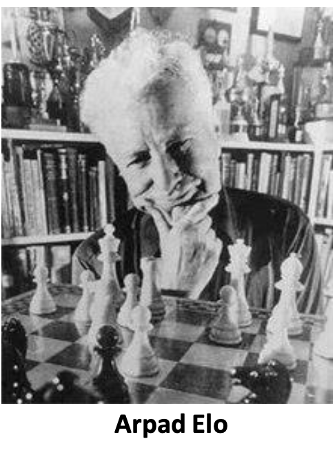

```{r setup, include=FALSE}
knitr::opts_chunk$set(echo = TRUE, warning=F, message=F)
library(dplyr)
library(elo)
library(ggplot2)
library(SportsAnalytics270)
library(caret)
```

# Predictions based on Performance Ratings


Libraries used

```{r, echo=T, eval = F}
library(dplyr)
library(elo)
library(ggplot2)
library(SportsAnalytics270)
library(caret)
```

# Predictions based on Performance Ratings
## Elo ratings

# Elo rating system

* Is initially developed by Hungarian-american professor of physics Arpad Elo.
* Initially was used to rank chess players.
* Can be used to predict the game outcome for any two-players or two-teams game.

```{r, echo=F, out.width="50%", out.height="80%"}

```

# Elo rating system

* The basic idea
* Assign performance rating to each team/player. This rating is going to show
the ability of the team to win.
* After each game update the rating of the player based on the outcome.
* Use the ability scores to predict the match outcome of the game


# Elo rating system

The general formula  

The expected probability of winning a game by Team A will be calculated by the following formula.  

For home team  


\bcenter
$Y^H = \frac{1}{1+c^{(R^A - \theta - R^H)/d}}$
\ecenter

For away team \ 

\bcenter
$Y^A = 1 - \frac{1}{1+c^{(R^A - \theta - R^H)/d}}$
\ecenter

Where $R^H, R^A$ are home and away teams Ratings, $\theta$ is some context parameter (can be omitted) such as home team advantage.  
The parameters c and d are used to scale the ratings and are usually taken as c=10, d=400

# Elo rating system

*  Why are c=10, d=400.
*  This is just for convention and scaling. If the Player A is 10 times more likely to beat Player B (Odds) then the difference of the Elo scores needs to be 400.
*  Assume teams playing in neutral field $\theta=0$ 


\bcenter

$Y^H = \frac{1}{1+10^{(R^A - R^H)/400}}, Y^A = 1 - \frac{1}{1+10^{(R^A - R^H)/400}}$ \ 

$Odds(\text{H beats A}) = \frac{Y^H}{Y^A} = \frac{\frac{1}{1+10^{(R^A - R^H)/400}}}{1 - \frac{1}{1+10^{(R^A- R^H)/400}}} =  \frac{\frac{1}{1+10^{(R^A - R^H)/400}} }{ \frac{10^{(R^A-R^H)/400}}{1 + 10^{(R^A-R^H)/400}} } = 10^{(R^H - R^A)/400}$

\ecenter

If $R^H - R^A = 400$, then $Odds(\text{H beats A}) = 10$


# Elo rating system

* Several R packages for elo rating calculations
* We will use mostly “elo”

```{r eval=F}
install.packages("PlayerRatings")
install.packages("elo")
install.packages("EloRating")
```


# Elo rating system

* predict probability to win for player A and player B
* Calculate the odds to win

```{r}
elo.prob(elo.A=1500, elo.B=1500)
```

```{r}
elo.prob(elo.A=1900, elo.B=1500)
```
# Elo rating system

c = 10, d = 400 parameters

```{r}
elo.prob(elo.A=1900, elo.B=1500)
# The odds
elo.prob(elo.A=1900, elo.B=1500)/(1-elo.prob(elo.A=1900, elo.B=1500))
```

With the difference of 400 elo rating points, it is 10 times more likely that the Team A will win.

# Elo rating system

The rating is updated with the following formula  

$R^H_T = R^H_{t-1} + K * (\alpha^H - y^H)$  

where  


$R^H_t$ updated rating for the home team  

$R^H_{t-1}$ rating before the game  

$\alpha^H$ is the actual outcome for the game  

$y^H$ is the predicted probability of Home team to win  

$K$ is a positive number  


# Elo rating system

**The actual score for the home team $\alpha^H$ is given by**

```{r equation_1, echo=F}
eq <-  noquote(paste(expression("1, HomeTeamWon\\\\0.5, Draw\\\\0, Otherwise")))
```


$$
\alpha^H = \begin{cases} `r eq` \end{cases}
$$
In football/soccer the coefficient K can be updated based on the goal differential
\bcenter
$K = k_0(1+\delta)^\lambda$
\ecenter

Where $\lambda$ is absolute goal difference, $k_0, \lambda$ are positive constants
There are several suggestions for the value of K, we will take it equal to 20.

# Elo rating system

example: Two players  

* Player A, Elo rating of 1500
* Player B, Elo rating of 1600

\bcenter
$R^H_T = R^H_{t-1} + K * (\alpha^H - y^H)$
\ecenter

```{r}
# prob for A
elo.prob(elo.A=1500, elo.B=1600)
```


```{r}
1500+20*(1-0.359935)
```


```{r}
elo.prob(elo.A=1600, elo.B=1500)
1600+20*(0-0.640065)
```

# Elo rating system

* The player A will get increase in rating by 12.8013
* The player B will get decrease in rating by 12.8013
* 12.8013 is calculated using function elo.update()

```{r}
elo.calc(elo.A=1500, elo.B=1600, wins.A=1, k = 20)
```


```{r}
elo.update(elo.A=1500,elo.B=1600,wins.A=1, k=20)
```


# Elo rating system

Dataset on EPL games for seasons 2000-2022

```{r}
data("epl_00_22")
str(epl_00_22)
```

# Elo rating system

score function from Elo package do a very simple calculation: Based on the game score returns a vector with the results, 1 if team A won, 0.5 if it was a draw and 0  
if Team A lost  


3 games, 2-0, 0-0, 0-1

```{r}
score(2,0)
score(0,0)
score(0,1)
```

# Elo rating system

Run Elo model

```{r}
elos <- elo.run(score(HG, AG) ~ Home + Away,
        data = epl_00_22, k = 20)
elos_df <- as.data.frame(elos)
```

score(HG, AG) calculates the final score of the game based on Home Goal and Away Goal statistics

# Elo rating system: Choosing K

* K values can be updated based on the importance of the games
* The Eloratings.net uses the following values for k for national teams

```{r, echo=F}
library(knitr)
elo_table <- data.frame(Competition = c("Friendly match", "All minor tournaments", 
                                       "World Cup and continental qualifiers and major tournaments", 
                                       "Continental championship finals and major intercontinental tournaments",
                                       "FIFA World Cup finals"),
                        Multiplier = c(20,30,40,50,60))
kable(elo_table)
```


# Elo rating system

* Look at the dataframe
* initial values for elo is are set to 1500

```{r}
head(elos_df)
```

# Elo rating system

* The final elo ratings
* n=10 as there are 10 games each round

```{r, eval=F}
tail(elos_df, n=10)
```

\tiny
```{r,echo=F}
tail(elos_df, n=10)
```

# Elo rating system
Get the final elos

```{r, eval=F}
elo_final <- final.elos(elos)
sort(elo_final, decreasing = T)
```

\tiny
```{r, echo=F}
elo_final <- final.elos(elos)
sort(elo_final, decreasing = T)
```

# Elo rating system

* Taking into account Home advantage
* $\theta$ Home advantage parameter = 200
* This means that for every game, 200 is added to home teams elo rating


\bcenter
$Y^H = \frac{1}{1+c^{(R^A - 200 - R^H)/d}}$ \ 

$Y^A = 1 - \frac{1}{1+c^{(R^A - 200 - R^H)/d}}$
\ecenter


# Elo rating system

```{r tidy=F}
epl2 <- elo.run(score(HG, AG) ~ adjust(Home, 200) +
                              Away,  data = epl_00_22, k = 20)
```


```{r, eval=F}
sort(final.elos(epl2), decreasing = T)
```


\tiny

```{r, echo=F}
sort(final.elos(epl2), decreasing = T)
```
# Elo rating system

Defining dynamic K factor  

Update the Elo rating formula using the following equation

\bcenter
$R^H_t = R^H_{t-1} + K * G * (\alpha^H - y^H)$
\ecenter


Where G is a goal difference factor. Website [Eloratings.net](http://www.eloratings.net/) uses the following formula for G Factor.

```{r equation, echo=F}
eq <-  noquote(paste(expression("1, N <= 1\\\\1.5, N = 2\\\\ (N + 11)/8 , N >= 3")))
```


$$
G= \begin{cases} `r eq` \end{cases}
$$

# Elo rating system


Adding the goal difference factor

```{r}
epl_00_22$G <- ifelse(abs(epl_00_22$HG-epl_00_22$AG)<=1, 1,
                    ifelse(abs(epl_00_22$HG-epl_00_22$AG)==2,1.5,
                           (abs(epl_00_22$HG-epl_00_22$AG)+11)/8))
```

```{r}
head(epl_00_22,5)
```

# Elo rating system

```{r}
epl3<-elo.run(score(HG, AG) ~ adjust(Home, 200) + Away +
                              k(20*epl_00_22$G),  data = epl_00_22 )
```


```{r, eval=F}
sort(final.elos(epl3), decreasing = T)
```


\tiny
```{r, echo=F}
sort(final.elos(epl3), decreasing = T)
```

# Elo rating system

* Can we predict the actual outcome and not just the probability ? 
* Result for the home team


```{r equation_2, echo=F}
eq <-  noquote(paste(expression("1, p >= 0.55\\\\0.5, 0.45 < p < 0.55 \\\\0, p <= 0,45")))
```


$$
\text{Predicted outcome} = \begin{cases} `r eq` \end{cases}
$$
```{r}

epl2 <- elo.run(score(HG, AG) ~ adjust(Home, 50) +
                              Away,  data = epl_00_22, k = 20)
epl2 <- as.data.frame(epl2)

epl2$Predicted <- ifelse(epl2$p.A>=0.55, 1,
                         ifelse(epl2$p.A<=0.45,0,0.5))
library(caret)
confusion <- table(epl2$wins.A, epl2$Predicted)
```

```{r}
sum(diag(confusion))/nrow(epl2)
```

# Elo rating system


* The teams change every season, players come and go
* The rating of the previous season cannot be carried fully to the new season 
* The following formula is suggested by MARS rating system 

**New Season Starting Rating = 1500+(Previous Season Final Rating-1500)/2**  

*For newly promoted teams*  

**New Season Starting Rating = 1500+(Average Final Rating of relegated teams-1500)/2)**

# Elo rating system

To get elo rating working better

* Tune home advantage parameter
* Tune new teams initial elo’s parameters
* different K parameters for different games
* Think of what else can influence the game

# Elo rating system

Lot of different web-sites provides elo ratings in different sports

* Some mix of elo ratings and optimizations from FiveThirtyEight on NBA teams and
games [https://projects.fivethirtyeight.com/carmelo/](https://projects.fivethirtyeight.com/carmelo/)
* Elo ratings from nfl [https://projects.fivethirtyeight.com/complete-history-of-the-nfl/](https://projects.fivethirtyeight.com/complete-history-of-the-nfl/)
* Football team elos
* European clubs elo ratings [http://clubelo.com/](http://clubelo.com/)
* for national teams [http://eloratings.net](http://eloratings.net)