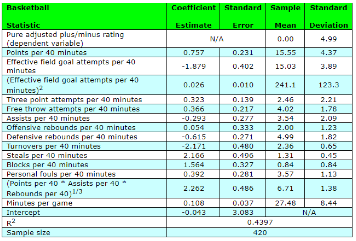

# NBA Individual Power Ratings

Libraries used

```{r, eval=F, echo=T}
library(SportsAnalytics270)
library(dplyr)
library(ggplot2)
library(VGAM)
library(zoo)
library(tidyr)
```


```{r setup, include=FALSE}
knitr::opts_chunk$set(echo = TRUE, message=F, warning=F)
library(SportsAnalytics270)
library(dplyr)
library(ggplot2)
library(VGAM)
library(zoo)
library(tidyr)
```


## NBA Individual Power Ratings

2 main stages of the game.

* Attacking
* Defending

https://www.youtube.com/watch?v=wYjp2zoqQrs

## NBA Individual Power Ratings

5 main positions on the field.

* Center - On offense, the center tries to score on close shots and rebound. But on defence, the center tries to block opponents’ shots and rebound their misses.  

* Power Forward - The power forward does many of the things a center does, playing near the basket while rebounding and defending taller players. But power forwards also take longer shots than centers.  

* Small Forward - The small forward plays against small and large players. They roam all over on the court. Small forwards can score from long shots and close ones.  

* Point Guard - The point guard runs the offense.The point guard defends the opponent’s point guard and tries to steal the ball.  

* Shooting Guard - The shooting guard can make shots from long distance and also is a good dribbler.

Let's watch a short video,  

https://www.youtube.com/watch?v=4_4CymXARWQ

## NBA Individual Power Ratings

```{r echo=F, fig.align='center', out.height="80%", out.width="60%"}
knitr::include_graphics("./images/Basketball_Positions.png")
```

## NBA Individual Power Ratings

Defining attributes for each position.

* Center - The center is the tallest player on each team, playing near the basket.
* Power Forward - The power forward is very close to center player, but in this position they should also have good shooting attributes.
* Small Forward - The small forward should have good shooting efficiency in close and far distances.
* Point Guard - The point guard should have good defending characteristics.
* Shooting Guard - The shooting guard should have good dribbling attributes and shooting accuracy in long ranges.

What measures other than the height and shooting can be used to position the players on the field ?

## NBA Individual Power Ratings

In game statistics

* STEALS 
 
* TURNOVERS - Turnover occurs when a team loses possession of the ball to the opposing team before a player takes a shot at their team's basket.  
https://www.youtube.com/shorts/I4MDXOWrUmk
* REBOUNDS
  1. OFFENSIVE REBOUNDS - An offensive rebound occurs when offensive players regain possession of the ball after a missed shot.
  2. DEFENSIVE REBOUNDS -  Defensive rebounds occur when defensive players gain possession of the ball after an offensive player misses the shot.
* BLOCKS - Block occurs when a defensive player legally deflects a field goal attempt from an offensive player to prevent a score.
* FOULS
  1. PERSONAL FOULS
  2. FLAGRANT FOULS
  3. TECHINCAL FOULS


## NBA Individual Power Ratings

### Dataset

```{r, include = F}
data("nba_players")
nba_players <- nba_players %>%
  filter(Year > 1997)
```

\tiny
```{r}
str(nba_players)
```


## NBA Individual Power Ratings

Let's select the performance metrics.

```{r}
nba_players <- nba_players %>%
  select(Year, Player, Pos,
         G, GS, MP, STL, TOV, ORB, DRB, PF, BLK, PTS, AST,
         FT, FTA, FG, FGA, X3P, X3PA, X2P, X2PA, ORB., DRB.,
         TRB., AST., STL., BLK., TOV., FG., X3P., FT.,) %>%
  arrange(Player, Year) 
head(nba_players, 3)
```

## NBA Individual Power Ratings

Let's try to evaluate the player's performance based on the amount of time they spent on the field.  
We will use the players' historical data to measure their performance for each Year, by taking 5 preceding Years only in order to avoid one Year stars.
We will use success/failure approach by dividing the metrics of the players into successful and non-succesfull actions and then compare their success rate with their playing Minutes.

## NBA Individual Power Ratings

Let's start with defending attributes.

Successful actions, when defending  

* STEALS
* BLOCKS
* DEFENSIVE REBOUNDS

Non Successful actions, when defending  


* PERSONAL FOULS
* TURNOVER

## NBA Individual Power Ratings

Let's calculate the difference between the cumulative success actions and cumulative failure actions.  
\tiny
```{r}
nba_players_defence <- nba_players %>%
  arrange(Player, Year) %>% 
  filter(Pos %in% c('SF','PG')) %>%
  group_by(Player) %>%
  mutate(STL_TOV = STL - TOV,
         STL_PF = STL - PF,
         DRB_TOV = DRB - TOV,
         BLK_TOV = BLK - TOV,
         BLK_PF = BLK - PF) %>%
  drop_na() %>%
  ungroup()
```

## NBA Individual Power Ratings

Let's check if the metrics are correlated to the amount of time the players spent on the field.

```{r}
cor_with_MP <- function(x){
  return(cor(x, nba_players_defence$MP))
}

nba_players_defence %>%
  select(STL_TOV, STL_PF, DRB_TOV, BLK_TOV, BLK_PF) %>%
  apply(2,cor_with_MP)
```


## NBA Individual Power Ratings

The metric with the highest positive correlation rate is the Seasonal difference between
the seasonal number of defensive rebounds made and number of turnovers made.  

\tiny
```{r, out.height="60%", fig.align="center"}
ggplot(nba_players_defence, aes(x = DRB_TOV, y = (MP))) + 
  geom_point() + 
  ggtitle("Number of Minutes played vs Seasonal defensive rating(DRB - TOV)") + 
  xlab("Seasonal Defensive Rating(DRB - TOV)") + 
  ylab("Minutes played")
```

## NBA Individual Power Ratings

The metric with the highest negative correlation rate is the difference between
the cumulative number of blocks made and cumulative number of turnovers made.  

\tiny
```{r, out.height="60%",fig.align="center"}
ggplot(nba_players_defence, aes(x = BLK_PF, y = (MP))) + 
  geom_point() + 
  ggtitle("Number of Minutes played vs Seasonal defensive rating(BLK - PF)") + 
  xlab("Seasonal Defensive Rating(BLK - PF)") + 
  ylab("Minutes played")
```

## NBA Individual Power Ratings

Let's fit a model with the defensive power ratings.  

\tiny
```{r}
summary(lm(MP ~ (STL_TOV + STL_PF + DRB_TOV + BLK_PF ), data = nba_players_defence))
```


## NBA Individual Power Ratings


* Majority of the players make many fouls, but still play relatively often if they make more steals.
* Having more turnovers mostly causes less playing practice.
* Having more defensive rebounds and steals can improve player's playing practice.


## NBA Individual Power Ratings

For the attacking attributes we will calculate the difference between the attempts made for successful actions and actual successful actions.

Successful actions, when attacking  

* FIELD GOALS
* 3 POINT GOALS
* FREE THROWS
* OFFENSIVE REBOUNDS
* POINTS SCORED
* ASSISTS MADE

Non Successful actions, when attacking  

* FIELD GOALS ATTEMPTS
* 3 POINT ATTEMPTS
* FREE THROW ATTEMPTS

## NBA Individual Power Ratings


```{r}
nba_players_offense <- nba_players %>%
  arrange(Player, Year)  %>% 
  group_by(Player) %>%
  mutate(FGA_FG = FGA - FG,
         X3PA_X3P = X3PA - X3P,
         FTA_FT = FTA - FT) %>%
  drop_na() %>%
  ungroup()
```

## NBA Individual Power Ratings

Let's check if the Seasonal metrics are correlated to the amount of time the players spent on the field.

```{r}
cor_with_MP <- function(x){
  return(cor(x, nba_players_offense$MP))
}

nba_players_offense %>%
  select(FGA_FG, X3PA_X3P, FTA_FT, AST, PTS) %>%
  apply(2,cor_with_MP)
```

## NBA Individual Power Ratings

The Seasonal metric with the highest correlation is the difference between the number of points scored by the player.

\tiny
```{r, out.height="60%",fig.align="center"}
ggplot(nba_players_offense,aes(x = PTS, y = MP)) + 
  geom_point() +
  ggtitle("Number of Minutes played vs Seasonal offensive rating(PTS)") + 
  xlab("Points scored") + 
  ylab("Minutes played")
```

## NBA Individual Power Ratings
\tiny
```{r}
summary(lm(MP ~ (PTS + AST + FGA_FG + X3PA_X3P + FTA_FT), data = nba_players_offense))
```


## NBA Individual Power Ratings

* Scoring more points/assisting = playing more
* Attempting more to score a field goal or a field throw.


# Plus/Minus

## Plus/Minus


### The concept

Plus-minus measures the point differential for the team when the player is on the court,  

Point differential is the difference in the points scored for and the points scored against the team.  

The NHL's Montreal Canadiens were the first team to track the plus \- minus of its players, starting sometime in the 1950s. Other teams followed in the early 1960s, and the NHL started officially compiling the statistic for the 1967 \- 68 season.

## Plus/minus for NBA

```{r, echo=F}
load("./data/nba12.rda")
load("./data/nba12p.rda")
library(SportsAnalytics270)
library(dplyr)
library(ggplot2)
library(VGAM)
library(zoo)
library(tidyr)
```

```{r}
colnames(nba12)
```


## Plus/minus for NBA

Subseting the data frame for Oklahoma City Thunders
```{r}
oks_g <- grepl("OKC", nba12$GameID, fixed = TRUE)
okc<-nba12[oks_g == T,]
```

```{r}
head(okc[,19:23], n=5)
```


## Plus/minus for NBA

Create the line-ups variable


```{r tidy=F}
okc$line_h <- 
  paste(okc$HomePlayer1Name, okc$HomePlayer2Name,     
        okc$HomePlayer3Name, okc$HomePlayer4Name, 
        okc$HomePlayer5Name, sep = ",")

okc$line_a <- 
  paste(okc$AwayPlayer1Name, okc$AwayPlayer2Name, 
        okc$AwayPlayer3Name,okc$AwayPlayer4Name, 
        okc$AwayPlayer5Name,   sep = ",")

okc$line_h[1:5]
```

## Plus/minus for NBA

Calculating plus/minus variable for time stunts  


Away team  

```{r}
# Home team plus minus
okc$Home_PM <- okc$PointsScoredHome - okc$PointsScoredAway
# Away team plus minus
okc$Away_PM <- -okc$Home_PM
```

Check if Durant is playing

```{r}
# is Durant playing at home?
okc$D_H <- grepl("Durant", okc$line_h, fixed = TRUE)
# is Durant playing away?
okc$D_A <- grepl("Durant", okc$line_a, fixed = TRUE)
```

## Plus/minus for NBA 

Get the plus minus for Durant for the whole season

```{r tidy=F}
sum(okc$Home_PM[okc$D_H == T]) + sum(okc$Away_PM[okc$D_A == T])
```

This will be the plus/minus for the whole season

## Plus/minus for NBA

For each game

```{r tidy=F}
durant_pm <- okc %>%
  mutate(PM=ifelse(D_H==T, 
                   Home_PM, 
                   ifelse(D_A==T, Away_PM,0))) %>%
  group_by(GameID) %>%
  summarise(PM=sum(PM))

```

```{r}
head(durant_pm, n=5)
```


## Plus/minus for NBA

```{r, fig.height=5}
ggplot(durant_pm, aes(x=GameID, y=PM))+
  geom_bar(stat="identity")+
  ggtitle("Plus/Minus for Kevin Durant")

```

## On court and off court +/\- and Roland’s rating

The on court +/\- number represents the team's net points with the player on the floor per 48 minutes, while the off court number is the team's net with the player off the floor per 48 minutes.  

The Roland Rating is the difference between the two, with a positive number indicating the team has played better with the player than without.  

## Net Plus/minus for NBA

Create a variable that shows OKC plus/minus, depending on whether it is playing at home or away

```{r tidy=F}
okc <- okc %>%
# makes PM for OKC
mutate(OKC_PM = ifelse(AwayT == "OKC", Away_PM, 
                       ifelse(HomeT == "OKC", Home_PM, 0)),
        D_PM = ifelse(D_H == T | D_A == T, T, F)
        )
```

## Net Plus/minus for NBA

For each game, D_PM has a value of FALSE if Durant has not played, and TRUE if He has. PM is showing the plus/minus for that game

```{r}
durant_pm <- okc %>%
group_by(GameID, D_PM) %>%
summarise(PM = sum(OKC_PM))
head(durant_pm)
```

## Net Plus/minus for NBA

```{r}
durant_pm <- okc %>%
group_by(GameID, D_PM) %>%
summarise(PM = sum(OKC_PM)) %>%
group_by(GameID) %>%
mutate(NET = PM - lag(PM, 1)) %>%
filter(NET != "NA") %>%
select(GameID, NET)
head(durant_pm)
```

## Plus/minus for NBA

```{r, fig.height=5}
ggplot(durant_pm, aes(x=GameID, y=NET))+
  geom_bar(stat="identity")+
  ggtitle("Net Plus/Minus for Kevin Durant")
```

# Adjusted plus/minus

## Adjusted plus/minus

The plus/minus rating is adjusted by the players who are on the court

\bcenter
$MARGIN = \beta_0 + \beta_1X_1 + \beta_2X_@ + ... \beta_kX_k + \epsilon$

where  

$X_k = 1$, if player k is playing at home,  
$X_k = -1$, if player k is playing away,  
$X_k = 0$, if player k is not playing  

\ecenter

## Adjusted plus/minus

According to Dan Rosenbaum’s [approach](http://www.82games.com/comm30.htm), $\beta$ coefficients will show the adjusted plus/minus of the players, or   

$\beta_k$ measures the difference between player k and the reference players, holding the other k
players constant

## Adjusted plus/minus

### Data preparation/ this will take at least 30-40 minutes on the average machine

Data prep for adjusted plus/minus
\tiny
```{r tidy=F, eval=F}
# Get home and away teams
nba3 <- nba12[, c("HomePlayer1ID", "HomePlayer2ID",
                  "HomePlayer3ID", "HomePlayer4ID", "HomePlayer5ID")]

nba4 <- nba12[, c("AwayPlayer1ID", "AwayPlayer2ID", 
                  "AwayPlayer3ID", "AwayPlayer4ID","AwayPlayer5ID")]

# MAke ID as character
nba3 <- as.data.frame(sapply(nba3, as.character))
nba4 <- as.data.frame(sapply(nba4, as.character))

#create dummy variables
nba3 <- as.data.frame(model.matrix(~. - 1, nba3))
nba4 <- as.data.frame(model.matrix(~. - 1, nba4))
# for away team
nba4[nba4==1]<- -1
# change colnames to be more readable
colnames(nba3) <- gsub("HomePlayer[123456789]ID", "", colnames(nba3))
colnames(nba4) <- gsub("AwayPlayer[123456789]ID", "", colnames(nba4))

# nba3 remove double entries
nba3 <- t(nba3)     # transpose the data.frame
nba3 <- by(nba3, INDICES=row.names(nba3), FUN=colSums) # collapse the rows with the same name
nba3 <- as.data.frame(do.call(cbind,aggr))
nba4 <- t(nba4)     # transpose the data.frame
nba4 <- by(nba4, INDICES=row.names(nba4), FUN=colSums) # collapse the rows with the same name
nba4 <- as.data.frame(do.call(cbind,nba4))

#combine home and away players and double columns 
nba5<-data.frame(nba3,nba4)
nba5 <- t(nba5)     # transpose the data.frame
nba5 <- by(nba5, INDICES=row.names(nba5), FUN=colSums) # collapse the rows with the same name
nba5 <- as.data.frame(do.call(cbind,nba5))
```

## Adjusted plus/minus

```{r, echo  = F}
load("./data/nba5.rda")
```

```{r, eval  = F}
load("nba5.rda")
```

```{r}
dim(nba5)
```

## Adjusted plus/minus

Coefficients are named by player ID, we need to match with player names  


Add plus/minus as dependent variable

```{r}
nba5<-data.frame(PM=nba12$PointsScoredHome-nba12$PointsScoredAway, nba5)
```

Run the regression

```{r}
model<-lm(PM~., data=nba5)
coeff<-sort(coefficients(model), decreasing=T)
coeff[1:10]
```

Remove X from the begining of the coeff name and match with player info

```{r}
name1<-names(coeff)
name1<-gsub("X", "", name1)
name1<-as.data.frame(name1)
```

## Adjusted plus/minus
Corresponding dataframe with player level information

```{r, echo = F}
load("./data/nba12p.rda")
```

```{r, eval = F}
load('nba12p.rda')
```


```{r}
head(nba12p[,1:3],5)
```


## Adjusted plus/minus

```{r}
nba12p$PlayerID<-as.character(nba12p$PlayerID)
name2<-left_join(name1, nba12p[,1:2], by=c("name1"="PlayerID"))
name2[1:5,]
```

rename coefficients by names

```{r}
names(coeff)<-name2$PlayerTrueName
```

## Adjusted plus/minus

Do you know this players?  

Lets look at top ten players

```{r}
coeff[1:10]
```

Benson, Keith - [https://goo.gl/YxMsJ9](https://goo.gl/YxMsJ9)

## Adjusted plus/minus

Leave only players that has played more than 250 minutes (By Rosenbaum)  

```{r}
summary(nba12p$SimpleMin)
```

\tiny
```{r, fig.height=4}
ggplot(data=nba12p, aes(SimpleMin))+geom_histogram()+
  ggtitle("Histogram for Played Minutes")
```

## Adjusted plus/minus

Getting players with more than 250m of play

```{r}
more250<-nba12p$PlayerID[nba12p$SimpleMin>250]
length(more250)
more250[1:10]
```


```{r}
# Subset the dataframe by more250
colnames(nba5) <- gsub("X", "", colnames(nba5))
nba6<-nba5[,colnames(nba5) %in% more250]
nba6<-data.frame(PM=nba5$PM, nba6)
# Make the model
model2<-lm(PM~., data=nba6)
# get the coefficients
coeff2<-sort(coefficients(model2), decreasing=T)

```

## Adjusted plus/minus

```{r}
coeff2[1:10]
```


## Adjusted plus/minus

Get the adjust plus/minus from coefficients

```{r}
name1<-names(coeff2)
name1<-gsub("X", "", name1)
name1<-as.data.frame(name1)
name2<-left_join(name1, nba12p[,1:2], by=c("name1"="PlayerID"))
name2$rank <- rownames(name2)
rownames(name2) <- c()
name2 <- name2 %>%
  tidyr::drop_na()
names(coeff2)<-name2$PlayerTrueName
```

## Adjusted plus/minus

```{r}
coeff2[1:10]
```

Nelson Jameer [https://goo.gl/eNj7sq](https://goo.gl/eNj7sq)


## Adjusted plus/minus

Where is Durant ?

```{r}
name2[name2$PlayerTrueName=="Durant, Kevin",]
```

Where is Lebron ?
```{r}
name2[name2$PlayerTrueName=="James, LeBron",]
```

## Adjusted plus/minus

* Modifications
  + Take only players that played more then 250 minutes during one season
  + As a depended variable, take margin of Plus/minus per 100 possessions
  

\bcenter
$\text{Margin} = \frac{\text{Home Points}}{\text{Home Possession}} - \frac{\text{Away Points}}{\text{Away Possesssion}}$
\ecenter


## Adjusted plus/minus

```{r}
str(nba12)
```


## Adjusted plus/minus

PM for possessions


```{r}
nba12$PM_Home <- nba12$PointsScoredHome/nba12$PossessionsHome
nba12$PM_Away <- nba12$PointsScoredAway/nba12$PossessionsAway
nba12$Margin<-nba12$PM_Home-nba12$PM_Away

summary(nba12$PM_Home)
summary(nba12$PM_Away)
summary(nba12$Margin)
```


## Adjusted plus/minus

We have a choice, remove cases with not number values, or impute with the mean


We will remove
\tiny
```{r}
nba6$PM<-nba12$Margin
nba6$Secs<-nba12$ElapsedSecs/60
nba7<-nba6[is.finite(nba6$PM),]
dim(nba7)
```


## Adjusted plus/minus

The model

```{r}
model3<-lm(PM~.,data=nba7)

coeff3<-sort(coefficients(model3), decreasing=T)
# basic cleaning
name1<-names(coeff3)
name1<-gsub("X", "", name1)
name1<-as.data.frame(name1)
name2<-left_join(name1, nba12p[,1:2], by=c("name1"="PlayerID"))
name2$rank <- rownames(name2)
rownames(name2) <- c()
name2 <- name2 %>%
  tidyr::drop_na()
names(coeff3)<-name2$PlayerTrueName
```

## Adjusted plus/minus

```{r}
# top 10
coeff3[1:10]
```

Steve Nash, Phoenix, [https://goo.gl/BczeBv](https://goo.gl/BczeBv)

## Adjusted plus/minus

Interpretations: If you take 4 average players and Steve Nash than the team will make by 0.35 points/per possession more then another team with 5 average players

```{r}
# top 10
coeff3[1:10]
```

## Adjusted plus/minus

Where is Durant ?

```{r}
name2 %>%
  filter(PlayerTrueName == "Durant, Kevin")
```

Where is LeBron ?

```{r}
name2 %>%
  filter(PlayerTrueName == "James, LeBron")
```

## Adjusted plus/minus

We can scale the Plus/Minus values around the mean, such as the positive coefficient will show that the player is doing better than the average and negative will mean that the player is doing worst than the average.

```{r}
coeff3<-coeff3-mean(coeff3)
```


```{r, fig.height=4}
ggplot()+aes(coeff3)+geom_histogram()+
  ggtitle("Histogram for scaled coefficients")
```

## Other considerations for regression

* Weighted by the duration of the stint, so longer time periods have bigger weights
* Weighting cases by clutch time vs garbage time  

**Clutch Time:** During the 4th quarter or overtime, with less than five minutes remaining, and neither team ahead by more than X points.  

**Garbage Time:** 4th quarter and overtime where either team has a lead of X points   

The value of X varies for different analyses, most often 5 and 10.  


# Weighted regression

## Weighted regression

```{r, echo = F}
load("./data/nba12.rda")
```


```{r}
nba7$Secs<-nba7$Secs/60
model4<-lm(PM~.,data=nba7, weights = Secs)
coeff4<-sort(coefficients(model4), decreasing=T)
# basic cleaning
name1<-names(coeff4)
name1<-gsub("X", "", name1)
name1<-as.data.frame(name1)
name2<-left_join(name1, nba12p[,1:2], by=c("name1"="PlayerID"))
names(coeff4)<-name2$PlayerTrueName
coeff[1:10]
```

## Adjusted plus/minus

* The APM is not an indicator on how good or bad the player is.
* The APM shows how helpful where the players for their team success.

## APM regressed against other statistics

Dan Rosenbaum suggests to run the following regression to understand the impact of the box score statistics on APM  

\bcenter
$Y = \beta_0 + \beta_1X_1 + \beta_2X_@ + ... \beta_kX_k + \epsilon$
\ecenter

Where Y is the coefficients of the players from Plus/Minus model,  

$X_1,..X_k$ are box score statistics

## APM regressed against other statistics

The results of the regression are the following:  

Each coefficient shows the effect of the players box-score statistics on the APM  

\bcenter
```{r, echo=F,out.width="80%", out.height="80%"}

```
\ecenter


## Other metrics

* Box-Score PM (Statistical Plus/Minus)- use Box-Score statistics for each stint of time of time for each player as inputs (steals, rebounds, offensive rating, etc)
* ESPN-Real Plus/Minus – is calculated by ESPN again using some sort of regression analysis.
* Offensive Plus/Minus and Defensive Plus/Minus
* Win shares: Contribution of each player into wins of the
team.
* VORP – Value Over Replacement Level

## Where to find the ratings?

Plus/Minus  

* Best lineup by plus/minus  
[https://stats.nba.com/lineups/traditional/](https://stats.nba.com/lineups/traditional/)  

* ESPN: Offensive Real Plus/Minus, Defensive real Plus/Minus, RPM and Wins share (from 2014)
[https://www.espn.com/nba/statistics/rpm/_/sort/RPM](https://www.espn.com/nba/statistics/rpm/_/sort/RPM)  

* Plus minus by player  
[https://www.basketball-reference.com/players/d/duranke01/gamelog/2012/](https://www.basketball-reference.com/players/d/duranke01/gamelog/2012/)


## Other Metrics

* WINVAL by Wayne Winston: The exact method of calculating tha Adjusted P/M is not public, however.  

\bcenter
*Margin of victory = sum(Rating of all 5 home team players) - sum(Rating of all 5 away team players)*
\ecenter

