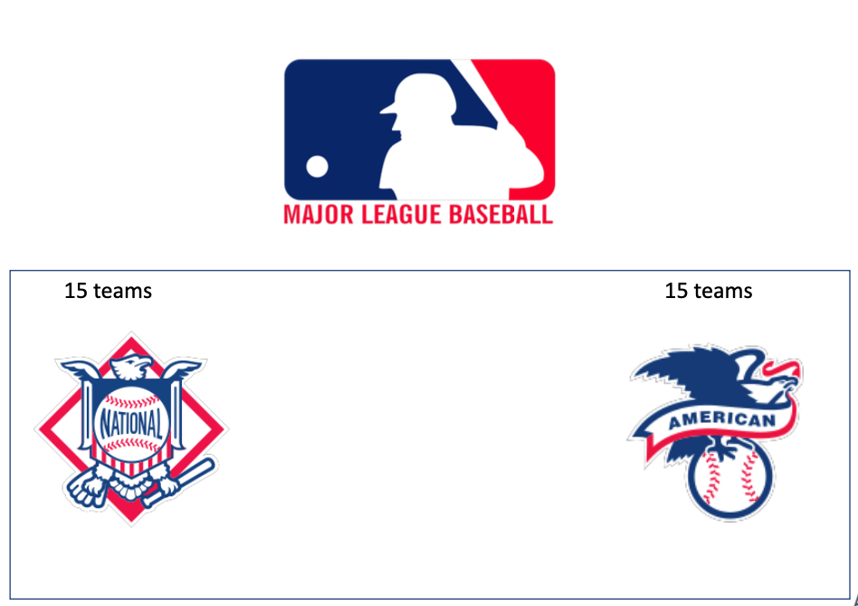
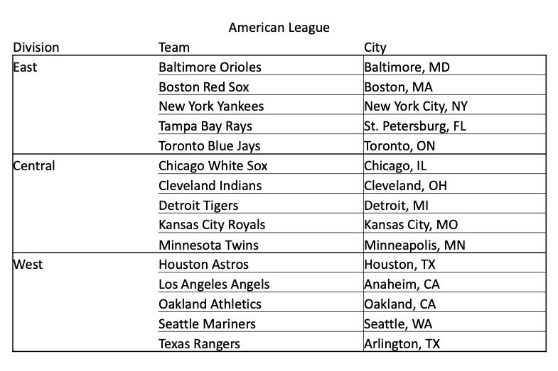
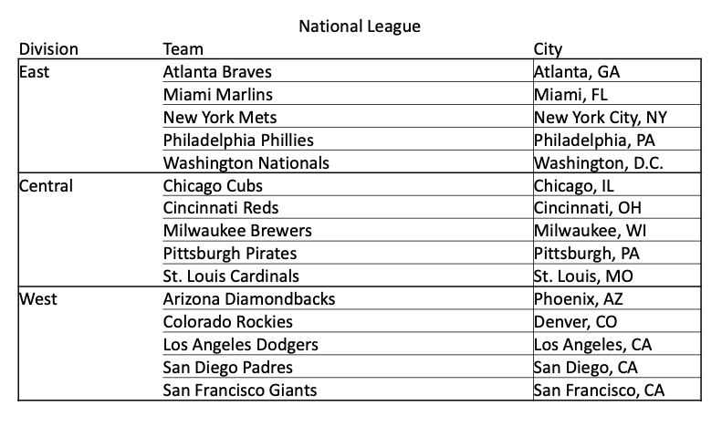
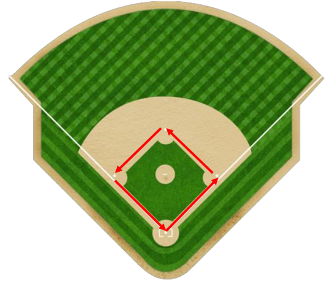
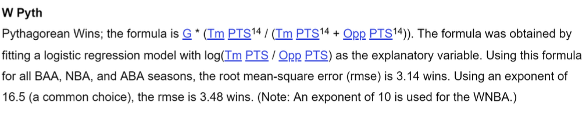

# Pythagorean wins and winning percentage

Libraries used

```{r echo=T, eval=F}
library(ggplot2)
library(dplyr)
library(SportsAnalytics270)
```


# Major League of Baseball

\bcenter
```{r, echo=F,out.width="90%", out.height="80%"}

```
\ecenter

# Major League of Baseball: American League

\bcenter
```{r, echo=F,out.width="90%", out.height="80%"}

```
\ecenter

# Major League of Baseball: National League

\bcenter
```{r, echo=F,out.width="90%", out.height="80%"}

```
\ecenter

# Major League of Baseball

**Regular Season**

The Major League Baseball season runs from the start of April to the end of September, with each club playing 162 games.  

Teams normally play "series" of three (occasionally four) games on consecutive days against the same opponent, normally with a "homestand" of two or three series, or a road trip.  

**Playoffs**  

At the end of the regular season the three divisional winners and the wild-card team (from each league go forward into the playoffs. The four teams in each league play two series of knockout baseball to determine the who.  

The two league winners then meet in the "World Series" (so called, because the first sponsor was the "Daily World" newspaper).

# Major League of Baseball

World Series  

* Is played between the winners of playoffs of American League and National League.
* Is a best-of-seven tournament.   
* World Series is won by the team who will win 4 games out of 7.

# Baseball: The game

**Baseball rules explained**

[https://www.youtube.com/playlist?list=PLAj29Nf-lKG7V5z9zg3SSJmPVccUtNhQX](https://www.youtube.com/playlist?list=PLAj29Nf-lKG7V5z9zg3SSJmPVccUtNhQX)

# Baseball Data


* Lahman season-by-season dataset 
  + From authors website  
    [http://www.seanlahman.com/baseball-archive/statistics/](http://www.seanlahman.com/baseball-archive/statistics/)
* Retrosheets game-by-game data, play-by-play data [http://www.retrosheet.org/](http://www.retrosheet.org/)
* PITCHf/x pitch-by-pitch data

# Runs and winning percentage

## Runs and winning percentage

# Lahman teams dataset


```{r setup, include=FALSE}
knitr::opts_chunk$set(echo = TRUE, warning = F, message = F)
library(ggplot2)
library(dplyr)
library(SportsAnalytics270)
```


```{r}
library(SportsAnalytics270)
head(mlb_standings)

```

# Pythagorean wins

In baseball, a run is scored when a player advances around first, second and
third base and returns safely to home plate, touching the bases in that order, before three outs are recorded and all obligations to reach base safely on batted balls are met or assured.  

The team that scores more runs, wins

```{r, echo=F,out.width="90%", out.height="70%"}

```

# Pythagorean wins

We are going to model winning percentage based on Runs allowed and Runs created

* Create two variables:  
  Runs differential: Runs-Runs Allowed  
  Winning percentage
  
Create Winning Percentage and Run differential

```{r, size=50}
# Winning percentage
mlb_standings$Wpct<-mlb_standings$W/(mlb_standings$W+mlb_standings$L)
# Run differential
mlb_standings$RD<-mlb_standings$R-mlb_standings$RA
```

# Pythagorean wins

Scatterplot shows clear relationship between Run differential and Winning Percentage

```{r,fig.height=5}
library(ggplot2)
ggplot(mlb_standings, aes(x=RD, y=Wpct))+geom_point()+
  geom_smooth(method = "lm", se=F)+
  labs(x="Run differential",y="Winning percentage")
```


# Pythagorean wins

Simple linear regression model with Winning percentage as a dependent and Runs differential as an independent variable  

$Wnpct = \beta_0 + \beta_1 * RD + \epsilon$

\tiny 

```{r}
options(scipen=999)
mod<-lm(Wpct~RD, data=mlb_standings)
summary(mod)
```

# Pythagorean wins

How will you interpret intercept and slope ?


```{r}
coefficients(mod)
```

# Pythagorean wins

```{r}
coefficients(mod)
```

How will you interpret intercept and slope ?  

**Intercept:** If run differential is 0, thus the team makes and allows equal number of runs, then you expect to win 50% of the games.  

**slope:** 1 unit increase in run differential increases the winning percentage by 0.000623.

# Pythagorean wins

The predicted value for Winning percentage can be out of Range [0:1]

```{r}
coefficients(mod)
```

What will be your prediction for a team with Run differential of 850 ?

# Pythagorean formula for Winning percentage

Is derived empirically by Bill James, the founder of Sabermetrics  

\bcenter
$Wpct = \frac{R^2}{R^2 + RA^2}$
\ecenter

R - runs made  
RA - runs allowed

The number of the wins calculated by Pythagorean formula is called
***Pythagorean wins.***

# Generic Pythagorean formula

\bcenter
$Wpct = \frac{R^2}{R^2 + RA^2}$
\ecenter

The equation can be rewritten in the following way  

$\frac{W}{L} = \frac{R^k}{RA^k}$ $log(\frac{W}{L}) = k * log(\frac{R}{RA})$

Now we can fit regression model to find the best value for k  

According to Wayne Winston estimates, the best value for k is 1.9

# The logic behind Pythagorean formula

* The team wins games in proportion of their “quality” to win.
* Lets say the quality of the team to win is defined by the Run ration

\bcenter
$\frac{\text{Runs}}{\text{Runs Allowed}}$
\ecenter


* Team A with runs of 60 and runs allowed of 40 will have quality ratio of 60/40
* Then quality measure of the opponent (all teams collectively) will be 40/60
* Thus to calculate the probability of the team to win:

\bcenter
$\frac{60/40}{\frac{60}{40} + \frac{40}{60}} = \frac{60^2}{60^2 + 40^2}$
\ecenter

# Wayne Winston modification

$Wpct = \frac{R^2}{R^2 + RA^2}$  

$Wpct = \frac{Rt^2}{Rt^2 + 1}$ where, Rt is the runs ration  

$Rt = \frac{\text{Runs}}{\text{Runs allowed}}$

# Usage

\bcenter
$Wpct = \frac{Rt^2}{Rt^2 + 1}$
\ecenter

Suppose a team has scored 850 runs and allowed 800 runs last season.  

Rt=850/800=1.0625  

Using Pythagorean formula, the predicted winning percentage will be 0.53 or 85.9 games (162*0.53)  

Suppose the team trades player A who has created 150 runs for a player who has created 170.  

All other things equal this will result the team to score 870 runs. What will happen with winning percentage ?  

Rt=870/800 and the predicted winning percentage 0.5418 which translates to 87.7 games.  

Buying the player will help the team, to win 2 more games.

# Calculate some accuracy measure

Root Mean Square error

\bcenter
$RMSE = \sqrt{\frac{ \sum_\text{i=1}^n{(\hat{y_i} -y_i)^2 }  } {n} }$
\ecenter


```{r}
mlb_standings$PW_percentage<-mlb_standings$R^1.9/
  (mlb_standings$R^1.9+mlb_standings$RA^1.9)

errors<-mlb_standings$Wpct-mlb_standings$PW_percentage

sqrt(mean(errors^2))
```

Our average error is 2.5%, or 0.025  

Or it will predict wrongly 4 games (162*0.025)


# Pythagorean wins

Now compare error from Pythagorean calculations vs error from regression model

```{r}
mod<-lm(Wpct~RD, data=mlb_standings)
# mod$ residuals gives you the error
sqrt(mean(mod$residuals^2))
```

# Pythagorean wins

Bad or good luck ?  

[https://www.baseball-reference.com/leagues/majors/2021-standings.shtml](https://www.baseball-reference.com/leagues/majors/2021-standings.shtml)

```{r}
mlb_standings$PW <- mlb_standings$PW_percentage*(mlb_standings$W+mlb_standings$L)
mlb_standings$PW <- round(mlb_standings$PW,0)
```


```{r}
mlb_standings %>%
  filter(Season == 2021)%>%
  select(Team, W, PW ) %>%
  head()
```


# Pythagorean wins for other sports

## Pythagorean wins for other sports


# Pythagorean wins in NBA

```{r}
library(SportsAnalytics270)
data(nba_east)
data(nba_west)
nba_st <- rbind(nba_east,nba_west)
```


```{r}
head(nba_st)
```

# Pythagorean wins in NBA

```{r}
nba_st$PD <- nba_st$PS - nba_st$PA
```

```{r, fig.height=5}
ggplot(nba_st, aes(x=PD, y=Pct))+geom_point()+
  geom_smooth(method = "lm", se=F)+
  labs(x="Points differential",y="Winning percentage")
```


# Pythagorean wins in NBA

```{r}
options(scipen=999)
model2 <- lm(Pct~PD, data=nba_st)
summary(model2)
```

# Generic Pythagorean formula
Recall: 

\bcenter
$Wpct = \frac{R^2}{R^2 + RA^2}$


$\frac{W}{L} = \frac{R^k}{RA^k}$ $log(\frac{W}{L}) = k * log(\frac{R}{RA})$


\ecenter

* We want to find the value of k
* General linear regression equation is: $y = \beta_0 + \beta_1X$, however here we have no
intercept model, thus $y = \beta_1X$

# Pythagorean wins in NBA

0 at the beginning of the right hand of the regression equation, indicates that we are fitting no intercept model

```{r}
nba_st$Ratio <- nba_st$PS/nba_st$PA
```


```{r}
model2 <- lm(log(W/L)~0+log(Ratio), data=nba_st)
```

# Pythagorean wins in NBA

```{r}
summary(model2)
```

# Pythagorean wins in NBA


The estimated value of K is 14.093  
```{r}
k = 14.093
```

```{r, echo=F,out.width="90%", out.height="70%"}

```

from: [https://www.basketball-reference.com/about/glossary.html#wins_pyth](https://www.basketball-reference.com/about/glossary.html#wins_pyth)

# Pythagorean wins in NBA


```{r}
nba_st$PW <- nba_st$PS^k/(nba_st$PS^k+nba_st$PA^k)
sqrt(mean((nba_st$PW-nba_st$Pct)^2))
```

```{r}
82*0.0367104
```

On average we are going to be “wrong” by 3 games per team

# Pythagorean wins in NBA

Lets have a look at the last season only  

Create variable PW_G, Pythagorean expected wins

```{r}
nba_st$G <- nba_st$W+nba_st$L
nba_st$PW_G <- round(nba_st$PW*nba_st$G)
nba_st %>% filter(Season==2021) %>% head()
```

# Pythagorean wins in NBA

teams above the line are “lucky”, below the line are “unlucky”  

```{r, fig.height=5}
nba_st %>% filter(Season==2021)%>%
  ggplot(aes(x=PW_G, y=W))+geom_point()+
  geom_abline(intercept =0 , slope = 1, col='red')
```

# Pythagorean wins in NBA

```{r, fig.height=5}
nba_st %>% filter(Season==2021)%>%
  ggplot(aes(x=PW_G, y=W, label=Team))+geom_point()+
  geom_abline(intercept =0 , slope = 1, col='red')+
  geom_text()
```


# Pythagorean wins for other sports

Pythagorean wins are also calculated for other sports.  
\bcenter
in NFL
\ecenter

\bcenter
$Win = \frac{ \text{points for}^{2.37} } {\text{points for}^{2.37} + \text{points against}^{2.37}  }$
\ecenter
