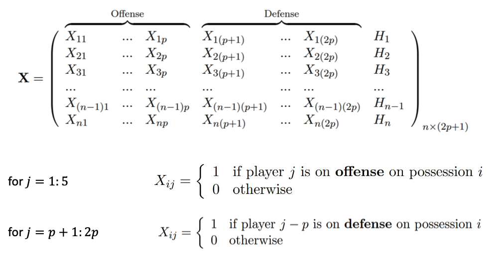
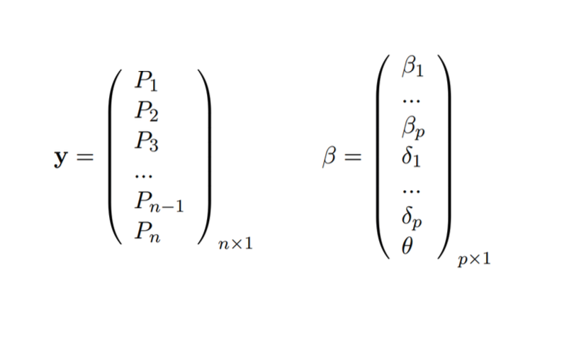

# Rasch Model

Libraries used

```{r, setup, include=F}
library(glmnet)
library(ggplot2)
library(Matrix)
```

```{r, echo=T, eval=F}
library(glmnet)
library(ggplot2)
library(Matrix)
```

# Bradley-Terry and Rasch model

* In Bradley-Terry model each team is either home team or away team
* We look at how many times a team being home team one against the other team being away team, and vice versa
* Bradley-Terry helps to rank teams by their ability to win

# Bradley-Terry and Rasch model

* In Rasch model every team is either on defense or on offense.
  + For each possession during the game, there are 5 offensive and 5 defensive
* If Bradley-Terry model helps to rank the teams, Rasch model helps to estimate the players offensive and defensive skills

# Rasch model for NBA

$E[P_i] = \alpha + \sum_\text{i=1}^5 \beta_{O_{ij}} + \sum_\text{i=1}^5 \delta_{D_{ij}} + \theta H_i$

Where,  

i = 1:n, *number of possessions*, j = 1:5  


* $O_{ij} \text{ identifies } j^{\text{th}} \text{ offensive player on } i^{\text{th}} possession$
* $D_{ij} \text{ identifies } j^{\text{th}} \text{ defensive player on } i^{\text{th}} possession$
* $H_{i} \text{ indicates whether offense is the home team on }  i^{\text{th}} possession$
* $P_{i} \text{ is the number of points scored on }  i^{\text{th}} possession$
* $E[P_i] \text{ is the expected number of the points scored on }  i^{\text{th}} possession$

# Rasch Model

$E[P_i] = \alpha + \sum_\text{i=1}^5 \beta_{O_{ij}} + \sum_\text{i=1}^5 \delta_{D_{ij}} + \theta H_i$  

$\text{Estimated } \beta_{O_j} \text{ coefficient will show the } j^{\text{th}} \text{ player's offensive strength }$  

$\delta_{D_j} \text{ coefficient }  \text{will show the } j^{\text{th}} \text{player's defensive strength}$


# The matrix representation of the model

Independent variables

\bcenter
```{r, echo=F,out.width="90%", out.height="80%"}

```
\ecenter


# The matrix representation of the model

Dependent variable and the coefficients


\bcenter
```{r, echo=F,out.width="90%", out.height="80%"}

```
\ecenter

# The data

The game Boston Celtics vs. New York Knicks - [https://goo.gl/KSQBXe](https://goo.gl/KSQBXe)


```{r}

load("./data/nba11_12.rda")
head(nba11_12)
```


# The data preperation

How many players are there ?

```{r}
player <- unlist(nba11_12[, 1:10])
player[1:30]
```

```{r}
length(player)
```

# The data preperation

```{r}
num.p <- length(unique(player))
num.p
```

```{r}
prefix = rep(c('off', 'def'), each = 5*nrow(nba11_12))
length(prefix)
tag = paste(prefix, player)
length(tag)
```

These will be our columns

# The data preperation

```{r}
tag[1:50]
```

# The data preperation

What will be the dimensions of our matrix? Number of the columns:  

478 players * 2 + 1 (for Home team indicator)= 957 Number of the rows:  

209,781  

Total number of entries: 957*209,781= 200,760,417  


# The data preperation

Making the Matrix


```{r}
# Define the row and column of X in which to put each 1.
tag.factor = as.factor(tag)
i <- rep(1:nrow(nba11_12), 10)
j <- as.numeric(tag.factor)

# Construct X as a sparse matrix.
X <- sparseMatrix(i, j)

# Update i and j to include a column for home court advantage.

i.new <- c(which(nba11_12$Home == 1), i)
j.new <- c(rep(1, sum(nba11_12$Home)), j + 1)

# Construct X as a sparse matrix with the updated i and j.

X <- sparseMatrix(i.new, j.new)

y <- nba11_12$Points
```

# The data preperation

Use the Sparse Matrix.  

In numerical analysis and computer science, a sparse matrix is a matrix in which most of the elements are zero.  

In our matrix ~99% of the entries are zeros, rest are one’s. Sparse Matrix representation helps to save computing time.  


# Modeling and the coefficients

Regularized linear model with the package glmnet

```{r}
set.seed(1)
model<- cv.glmnet(X, y, alpha = 0, standardize = FALSE)

coef <- coef(model, s = 'lambda.min')[, 1]
names(coef) <- c('Intercept', 'HFA', sort(unique(tag)))
```

# Extracting coefficients

Extracting coefficients

```{r}
# Intercept
alpha <- coef[1]
# Home Advantage
theta <- coef[2]
# Defensive strenght
delta <- coef[2 + 1:num.p]
# offensive strengh
beta <- coef[2 + num.p + 1:num.p]

length(delta)
length(beta)
```

# Beta coefficients

Beta coefficients measure attacking skills of the player: Larger is the number, stronger is the player on offense  


Top Ten offensive players  


```{r}

head(sort(beta, decreasing=T),n=10)
```

# Delta coefficients

Delta coefficients measure defensive skills of the player, smaller is the number (negative) better is the player on defense  


Top 10 defensive players

```{r}
head(sort(delta) , n=10)
```

# Making predictions

* Miami Heat vs. Dallas Mavericks.
* Miami Heat is on Offense
* The game is at Dallas Mavericks Court
The following formation I on the court

\bcenter
```{r, echo=F,out.width="90%", out.height="80%"}
knitr::include_graphics("./images/rasch_3.png")
```
\ecenter

Predicted points for the offense team

# Lets predict the points


\bcenter

$E[P_i] = \alpha + \sum_\text{i=1}^5 \beta_{O_{ij}} + \sum_\text{i=1}^5 \delta_{D_{ij}} + \theta H_i$  


```{r, echo=F,out.width="90%", out.height="80%"}
knitr::include_graphics("./images/rasch_3.png")
```

$P = \alpha + \beta_{\text{James}} + \beta_{\text{Cole}} + \beta_{\text{Haslem}} + \beta_{\text{Howard}} + \beta_{\text{Battier}} +$
$\delta_{\text{Terry}} + \delta_{\text{Marion}} + \delta_{\text{West}} + \delta_{\text{Cardinal}}  + \delta_{\text{West}}  + \delta_{\text{Cardinal}}  + \delta_{\text{Wright}} + \theta * 0$
\ecenter

# Getting the coefficients

Offense

```{r tidy=F}
off<-c("off LeBron James","off Norris Cole","off Udonis Haslem",
       "off Juwan Howard","off Shane Battier")
beta[off]
```

Defense

```{r tidy=F}
def<-c("def Jason Terry","def Shawn Marion", "def Delonte West", 
       "def Brian Cardinal","def Brandan Wright"
)
delta[def]
```

# Getting the coefficients/predicting

```{r}
alpha
```

```{r}
theta
```

Expected Points

```{r}
alpha+sum(beta[off])+sum(delta[def])+theta*0
```

On average we expect this formation to score 0.95 points per possession

# Defensive and Offensive ratings

To calculate defensive and offensive ratings, we take theta/2 (suggested by Sam Powers) to assume a “neutral field” for the player

```{r}
def.rating = 100*(alpha + theta/2 + delta)
off.rating = 100*(alpha + theta/2 + beta)
```


Who were the best defensive players in 2011-12? If you were to put each of
them in a lineup with 4 average players, how many points per 100 possessions
would that team allow on defense against a lineup of 5 average players?

```{r}
head(sort(def.rating), n=10)
```

# Defensive and Offensive ratings

Who were the best offensive players in 2011-12? If you were to put each of
them in a lineup with 4 average players, how many points per 100 possesions
would that team score on offense against a lineup of 5 average players?

```{r}
head(sort(off.rating, decreasing=T), n=10)
```

# Actual performance on defense and offense

We can also calculate the actual points scored allowed per 100 posessions

```{r}
pp100 = 100*(crossprod(X, y)/colSums(X))[, 1]
names(pp100) = c('Home', sort(unique(tag)))
def.pp100 = pp100[1 + 1:num.p]
off.pp100 = pp100[1 + num.p + 1:num.p]
head(sort(off.pp100, decreasing=T), n=10)
```

# Offensive vs. Defensive rating

Is there a correlation between offensive and defensive ratings ?

```{r, eval=F}
ggplot()+geom_point(aes(x=off.rating, y=def.rating))+
  ggtitle("Offensive Rating vs Defensive Rating")
cor(off.rating, def.rating)
```

\tiny
```{r, fig.height=4, fig.width = 9,  echo=F}
ggplot()+geom_point(aes(x=off.rating, y=def.rating))+
  ggtitle("Offensive Rating vs Defensive Rating")
cor(off.rating, def.rating)
```

# Offensive rating vs actual performance

Is there a correlation between off rating and actual points scored

```{r, eval=F}
ggplot()+geom_point(aes(x=off.rating, y=off.pp100))+
  ggtitle("Offensive Rating vs Points scored")
cor(off.rating, off.pp100)
```

\tiny
```{r, echo = F, fig.width = 9, fig.height=4}
ggplot()+geom_point(aes(x=off.rating, y=off.pp100))+
  ggtitle("Offensive Rating vs Points scored")
cor(off.rating, off.pp100)
```

# Defensive rating vs actual performance
```{r, eval = F}
ggplot()+geom_point(aes(x=def.rating, y=def.pp100))+
  ggtitle("Defensive Rating vs Points allowed")
cor(def.rating, def.pp100)
```

\tiny
```{r, echo = F, fig.width = 8, fig.height=4}
ggplot()+geom_point(aes(x=def.rating, y=def.pp100))+
  ggtitle("Defensive Rating vs Points allowed")
cor(def.rating, def.pp100)
```

