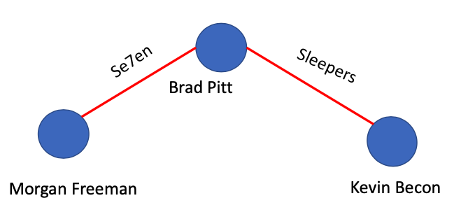
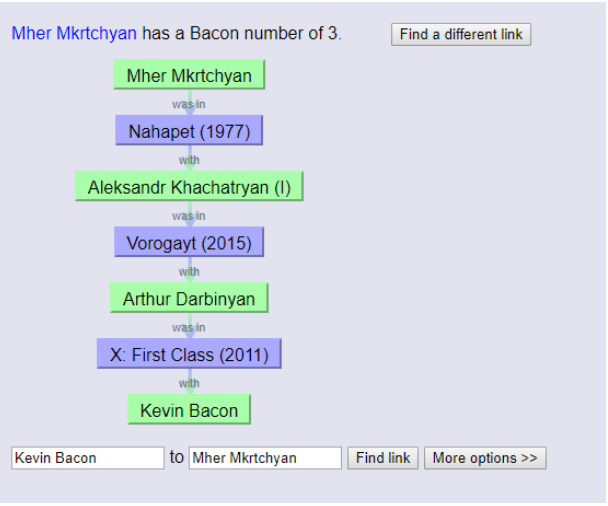
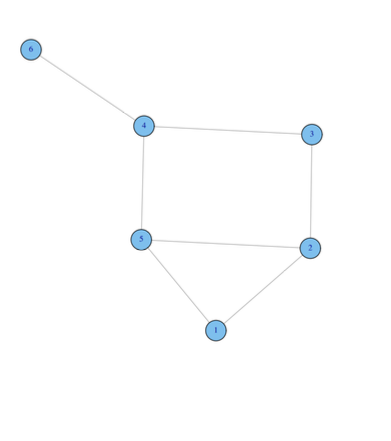
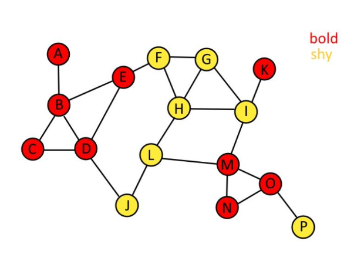
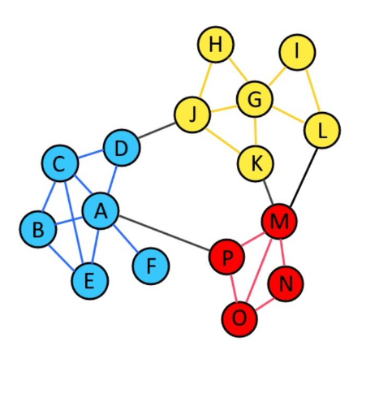
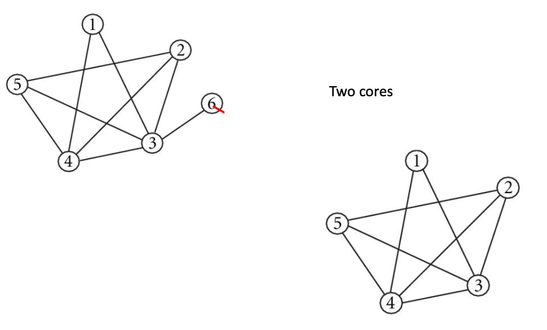
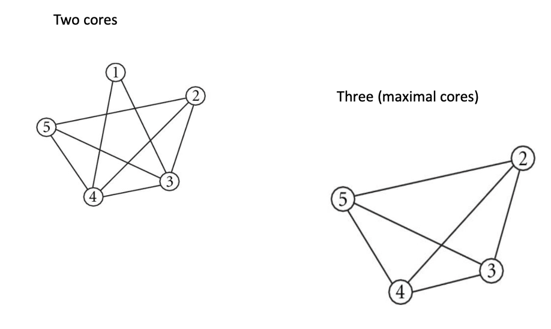

# Types of analysis

* Descriptive Statistics for networks, such as network density
* Descriptive statistics for network elements, nodes
* Cluster analysis, community detection, grouping nodes together
* Mathematical and statistical models for network behavior

# Definition

In network analysis we are going to use **geodesic distance** to measure the distance between two nodes.  

In graph theory the **distance** between two vertices in a graph is the number of edges in a shortest path (also called a **graph geodesic**) connecting them. This is also known as the **geodesic distance.**

# Who is this guy ?

Kevon Bacon, Played in 86 movies

```{r, setup, include = F}
library(UserNetR)
library(network)
library(igraph)ƒ
library(intergraph)
library(ggplot2)
```


\bcenter
```{r, echo=F,out.width="90%", out.height="80%"}

```
\ecenter

[http://www.imdb.com/name/nm0000102/](http://www.imdb.com/name/nm0000102/)

# Bacon Number

Bacon number is a geodesic distance between an Hollywood actor and Kevin Bacon.  

No one in Hollywood has Bacon number greater than 6  

[https://oracleofbacon.org/](Oracle of Bacon) – Social network of movie actors

# Bacon Number

Bacon Number of Morgan Freeman  

```{r, echo=F,out.width="80%", out.height="70%"}

```

The geodesic distance between Morgan Freeman and Kevin Bacon is 2

# Bacon Number

What will be Frunzik’s Bacon number ?

```{r, echo=F,out.width="90%", out.height="80%"}

```

# Mher Mkrtchyan

\bcenter
```{r, echo=F,out.width="90%", out.height="80%"}

```
\ecenter

# Network density

* Density shows how interconnected are the nodes within the network.
* Density is the proportion of observed ties (also called edges, arcs, or relations) in a network to the maximum number of possible ties.
* Thus, density is a ratio that can range from 0 to 1.
* The closer to 1 the density is, the more interconnected is the network.

# Network Density

For non directed network, density is calculated with the following formula

\bcenter
$\frac{2*L}{k(k-1)}$
\ecenter  

For undirected network the total number of ties is equal to

\bcenter
$\frac{k(k-1)}{2}$
\ecenter  

Where  

L is the total number of ties (edges),  

k is the total number of nodes/vertices

# Network Density

For directed network, density is calculated with the following formula  

\bcenter
$\frac{L}{k(k-1)}$
\ecenter

Where  

L is the total number of ties (edges),  

k is the total number of nodes/vertices

# Network size: Un-directed graph

```{r,echo=F,eval=F}
devtools::install_github("DougLuke/UserNetR")
install.packages("network")
install.packages("igraph")
install.packages("intergraph")
```

```{r, eval=F}
library(UserNetR)
library(network)
library(igraph)
library(intergraph)
library(ggplot2)
```


```{r, fig.height=4, fig.align='center'}
set.seed(1)
data(Moreno)
plot(Moreno)
```

# Network density: undirected graph

Size of Network: How many actors/nodes are there
```{r}
network.size(Moreno)
```

Calculate the density

```{r}
# total number of possible edges
33*(33-1)/2
# Density
2*46/(33*(33-1))
```

```{r}
sna::gden(Moreno)
```

# Network’s diameter

Network diameter shows how compact is it, given its size and degree of interconnectness.  

The diameter then for an entire network is the longest of the shortest paths across all pairs of nodes.  

The diameter cannot be calculated if there are separate subgroups or components of the graph  

# Subgroup components

Not for all the nodes we can calculate the shortest path.   

```{r, fig.height=4, fig.align='center'}
set.seed(1)
plot(Moreno)
```

# Network diameter

Calculate the diameter for the largest component

```{r}
lgc <- sna::component.largest(Moreno,result="graph")
gd <- sna::geodist(lgc)
max(gd$gdist)
```

# Average path-length

* In a network, the mean path length is the average shortest path between two nodes.  
Let $d_{ij}$ be the length of the shortest path between nodes i and j.
* In a network, the length of a path is the number of edges that the path contains. The shortest path between two points is called geodesic.
* The mean path length is the average of the shortest path length, averaged over all pairs of nodes. For an undirected graph of N nodes, the mean path length is

\bcenter
$l = \frac{2}{N(N-1)} \sum_{\text{i $\neq$ j}}d_{ij}$
\ecenter

For directed graph

\bcenter
$l = \frac{1}{N(N-1)} \sum_{\text{i $\neq$ j}}d_{ij}$
\ecenter

If two nodes are disconnected, meaning there is no path between them, then the path length between them is infinite. As a consequence, if a network contains disconnected components (collections of nodes that have no paths between them), then the mean path length l also diverges to infinity. One way to avoid this problem is to calculate l only from nodes in the largest connected component, or just ignore unconnected nodes.

# Relationships in networks

Create both network and igraph objects

```{r}
mat <- rbind(c(0,1,1,0,0),c(0,0,1,1,0),c(0,1,0,0,0),
              c(0,0,0,0,0),c(0,0,1,0,0))
rownames(mat) <- c("A","B","C","D","E")
colnames(mat) <- c("A","B","C","D","E")
net <- network(mat, matrix.type="adjacency")
net_i <- graph_from_adjacency_matrix(mat)
```

# Relationships in networks

Calculating average path length

```{r}
d <- shortest.paths(net_i, v=V(net_i), to=V(net_i))
d
sum(d[upper.tri(d)])
```


```{r}
16*2/(5*(5-1))
```

# For Moreno dataset


```{r}
Moreno_i <- asIgraph(Moreno)
edge_density(Moreno_i)
mean_distance(Moreno_i, directed=F)
```

# Is the graph random ?

## Is the graph random ?

# Is the graph random ?

**Random graphs**

Generating random graphs is an important method for investigating how likely or unlikely other network metrics are likely to occur given certain properties of the original graph. The simplest random graph is one that has the same number of vertices as your original graph and approximately the same density as the original graph.

We will create an ***Erdos-Renyi Random Graph Model***

# Is the graph random ?

Creating a random graph with the same number of nodes and edge density as our Moreno network.  

We want to find if the average path length of the Moreno graph is random  


```{r}
# Number of Nodes
gorder(Moreno_i)
# Edge density
edge_density(Moreno_i)
```

# Is the graph random ?

* Generate a random graph using the function erdos.renyi.game().
* The first argument n should be the number of nodes of the graph g which can be
calculated using gorder(),
* The second argument p.or.m can be either the density or the number of edges.
* The final argument is set as type='gnp' to tell the function that you are using the density of the graph to generate a random graph.

```{r, tidy=F}
i_random <- erdos.renyi.game(n = gorder(Moreno_i), 
                p.or.m = edge_density(Moreno_i), 
                type = "gnp")
```

# Is the graph random ?

```{r. fig.height = 6}
plot(i_random)
```


# Is the graph random ?

Now lets generate 1,000 random graphs and calculate average path length for each of them

```{r}
i_list <- list()
  
for(i in 1:1000){
  i_list[[i]] <- erdos.renyi.game(n = gorder(Moreno_i), 
                      p.or.m = edge_density(Moreno_i), 
                      type = "gnp")
}
```


```{r}
avg_pl <- unlist(lapply(i_list, mean_distance, directed = FALSE))
```

# Is the graph random ?

```{r, fig.height=5}
ggplot()+geom_histogram(aes(x=avg_pl))+
  geom_vline(xintercept = mean_distance(Moreno_i, directed=F),
            size=1.2, color="red")
```

# Is the graph random ?

Probabiltiy that in a random graph with the given parameters you would have average path length less than for Moreno graph is:

```{r}
mean(avg_pl < mean_distance(Moreno_i, directed=F))
```

It is random !!!

# Relationships between vertices

## Relationships between vertices

# Relationships in networks


```{r, fig.height=4}
plot(net_i)
```

# Relationships in networks

* Subset each vertex from which each edge originates by using head_of().
* This function takes two arguments, the first being the graph object and the
second the edges to examine. For all edges you can use E(g).

```{r}
E(net_i)
```

# Relationships in networks

```{r}
head_of(net_i, E(net_i))
```

```{r}
table(head_of(net_i, E(net_i)))
```

# Relationships in networks

tail_of() is going to show the beginning node of each edge

```{r}
tail_of(net_i, E(net_i))
```


```{r}
table(tail_of(net_i, E(net_i)))
```


# Relationships in networks

We might be also interested if two vertices are connected with each other

Is there an edge between 
* A and B
* B and C and so on

```{r}
net_i['A','B']
```

```{r}
net_i['B','C']
```

```{r}
net_i['E','B']
```

Is there an edge between A and B, A and C

```{r}
net_i['A',c('B', 'C')]
```


# Relationships in networks

We can use function incident() to identify those edges that go in to the given vertex, or go out from the given vertex, or both

```{r}
incident(net_i, "A", mode = c("out"))
```


```{r}
incident(net_i, "A", mode = c("in"))
```


# Relationships in networks

Often in network analysis it is important to explore the patterning of connections that exist between vertices. One way is to identify neighboring vertices of each vertex. You can then determine which neighboring vertices are shared even by unconnected vertices indicating how two vertices may have an indirect relationship through others.

# Relationships in networks

* Identify neighbors for vertex A That are receiving an edge from A
* Identify vertices that are sending edges to C

```{r}
neighbors(net_i, 'A', mode = c('all'))
```

```{r}
neighbors(net_i, 'C', mode = c('in'))
```

# Relationships in networks

Identify any verteces that receive edge from vertex C and direct an edge to vertex B

```{r}
A <- neighbors(net_i, 'A', mode = c('out'))
D <- neighbors(net_i, 'D', mode = c('in'))
intersection(A,D)
```

# Relationships in networks

* The inter-connectivity of a network can be assessed by examining the number and length of paths between vertices.
* A path is simply the chain of connections between vertices. The number of intervening edges between two vertices represents the geodesic distance between vertices.
* Vertices that are connected to each other have a geodesic distance of 1.
* Those that share a neighbor in common but are not connected to each
other have a geodesic distance of 2 and so on. In directed networks, the direction of edges can be taken into account.

# Relationships in networks

```{r}
farthest_vertices(net_i)
```

# Relationships in networks

Identify the longest path

```{r}
get_diameter(net_i)
```

# Relationships in networks

Identify vertices that are reachable within two connections from vertex A

```{r}
ego(net_i, 2, 'A', mode = c('out'))
```

Identify any vertices that can reach vertex D within two connections

```{r}
ego(net_i, 2, 'D', mode = c('in'))
```

# Node’s prominence/importance

## Node’s prominence/importance


# Node’s prominence/importance

* We will examine the location of each node to understand how important it is for the network.
* We analyze the prominence of the nodes/actors. An actor is prominent if the ties of the actor make that actor visible to the other members in the network.
* We will look at the node centrality measures for non-directed networks, and node prominence measure called prestige for directed networks.
* Prestige and centrality will be used to calculate network-level centralization measures.

# Degree Centrality

* The simplest measure of centrality by far is based on the notion that a node that has more direct ties is more prominent than nodes with fewer or no ties.
* Degree centrality thus, is simply the degree of each node.
* The degree of a node is the number of ties it has with other nodes.

# Degree centrality

Use Package sna


```{r}
net %v% "vertex.names"
```

# Degree centrality

```{r, fig.align="center", fig.height=4}
sna::degree(net)
plot(net, displaylabels=T)
```

# Indegree centrality

Measures number of the edges that come to the given node.  

within function degree, specify cmode=“indegree”  

To get the number of the edges that goes from the node, use cmode=“outdegree”

```{r}
sna::degree(net, cmode="indegree")
net %v% "vertex.names"
```


```{r}
sna::degree(net, cmode="outdegree")
net %v% "vertex.names"
```

# Indegree centrality

* The farness/peripherality of a node v is defined as the sum of its distances to all other nodes
* The closeness is defined as the inverse of the farness.
* For comparison purpose, we can standardize the closeness by dividing by the
maximum possible value 1/(n - 1)
* If there is no (directed) path between vertex j and i then the total number of vertices is used in the formula instead of the path length.
* The more central a node is, the lower its total distance to all other nodes
* Higher the value, more important is the node

# Closeness Centrality

Instead of examining only the direct connections of the nodes, we can focus on how close each node is to everyone else.  

Nodes are more prominent/important to the extent they are close to all other nodes in the network

\bcenter
$C_c(n_i) = [\sum_{\text{j=1}}^g d(n_i,n_j)]^{-1}$
\ecenter

Where $d(n_i,n_j)$ is the geodesic distance between nodes.  

Closeness centrality, then, is the inverse of the sum of all the distances between node i and all the other nodes in the network.

# Closeness Centrality

Commonly normalized version of the Closeness centrality is measured, so the CC is adjusted by the number of the nodes in the graph

\bcenter
$C_c(n_i) = \frac{N-1}{\sum_{\text{j=1}}^g d(n_i,n_j)}$
\ecenter

Where N is the number of the nodes in the graph

# Closeness Centrality

You can calculate Closeness Centrality using sna package: need to assume that the graph is undirected


```{r}
sna::closeness(net, gmode="graph")
```

```{r, fig.height=4}
plot(net, displaylabels=T)
```

# Use igraph

Specify the following arguments normalized=T, to normalize the measure mode=“all” for directed graph

```{r}
net_i<-intergraph::asIgraph(net)
```


```{r}
igraph::closeness(net_i,  mode="all", normalized = T)
```

# Betweenness for the weighted graph

In igraph package, weights for the edges are considered as being “costs” rather than strengths. So if your weight variable is actually showing the strength, than you can take the inverse of it.

```{r}
igraph::betweenness(net_i)

sna::betweenness(net)
```

Calculate closeness of the weighted graph with igraph package

```{r}
library(intergraph)
network::set.edge.attribute(net, "weight", c(30,10,5,2,6))
igraph::closeness(asIgraph(net), normalized=T)
```

```{r}
network::set.edge.attribute(net, "weight", 1/c(30,10,5,2,6))
igraph::closeness(asIgraph(net), normalized = T)
```

# Betweenness centrality
Betweenness centrality measures the extent that a node sits ‘between’ pairs of other nodes in the network, such that a path between the other nodes has to go through that node.  

A node with high betweenness is prominent, because that node is in a position to observe or control the flow of information in the network.  

The equation for betweenness centrality is

\bcenter
$C_b(n_i) = \sum{g_{jk}(n_i)/g_{jk}}$
\ecenter

$g_{jk}(n_i)$ is the number of geodesic shortest paths between j and k nodes that contains node i  
$g_{jk}$ is the number of shortest geodesic paths between j and k.

# Betweenness centrality

Betweenness centrality can be normalized by dividing the measure by the maximum possible value of it,  

(n-1)(n-2) for directed graph (n-1)(n-2)/2 for non-directed graph

# Betweenness centrality
Find the betweenness centrality for Node 2  

It is an undirected graph, so total number of possible node pairs to compare:
(n-1)*(n-2)/2
\bcenter
```{r, echo=F,out.width="90%", out.height="80%"}

```
\ecenter

# Betweenness centrality

For example for node 2, the (n-1)(n-2)/2 = 5(5-1)/2 = 10  
terms in the summation in the order of 13,14,15,16,34,35,36,45,46,56 are  

1 + 0/1 + 0/1 + 0/1 + 0/1 + 0/1 + 1/2 + 0/1 + 0/1 + 0/1 + 0/1 = 1.5

# Betweenness centrality

Betwenness 

```{r}
igraph::betweenness(net_i)

sna::betweenness(net)
```

# Closeness for weighted graph

* The best option to calculate closeness for the weighted network, is igraph package.
* If the edge in the igraph object has a “weight” attribute than it is used as a weight
vector, otherwise need to specify in igraph::closeness function
* However: in igraph the weight of the edge is considered as being a cost rather than strength, example: weight is the time needed to get from one node to another
* Thus you can use the inverse (1/w) of the actual weights to get the closeness

# Eigenvector centrality

* Eigenvector centrality takes into account not only the connectiveness of the vertex, but also to other vertices that are highly connected to others (prominent nodes)
* Higher value for a eigenvector centrality is showing higher connectiveness of the node

```{r}
eigen_centrality(net_i)$vector
```

# Betweenness centrality

```{r}
igraph::betweenness(asIgraph(net), normalized=F)
```

eigenvector centrality

# PageRank centrality

* PageRank (PR) is an algorithm used by Google Search to rank websites in their search engine results. PageRank was named after Larry Page, one of the founders of Google.
* PageRank is a way of measuring the importance of website pages.
* PageRank works by counting the number and quality of links to a page to determine a rough estimate of how important the website is. The underlying assumption is that more important websites are likely to receive more links from other websites
* If we consider a node as being a webpage and a edge as a hyperlink from one webpage to another, we can use PageRank a s anode importance metric.

# PageRank centrality

```{r}
page_rank(net_i)$vector
```

# Special relations in networks

## Special relations in networks

# Special relations in networks

**Assortativity**, is a preference for a network's nodes to attach to others that are similar in some way.
Or, how likely is that two networks sharing same attribute together, will be connected

\bcenter
```{r, echo=F,out.width="90%", out.height="80%"}

```
\ecenter

# Special relations in networks

```{r, fig.width=9, fig.height=5, fig.align='center'}
set.seed(1)
plot(Moreno_i, vertex.color = V(Moreno_i)$gender,
     vertex.label=V(Moreno_i)$gender)
```

# Special relations in networks

Assortativity coefficient is a value between -1 and 1.  

It is positive if nodes with the same attributes tend to be connected to each other (**homophily**).  

The opposite is when nodes with different characteristic tends to be connected to each other (**heterophily**)
 
```{r}
assortativity(Moreno_i, V(Moreno_i)$gender)
```

We have very strong homophilic network

# Special relations in networks

Can we have such an high assortativity by chance?  

Lets calculate graphs assortavitiy by randomizing the node attribute gender

```{r}
actual <- assortativity(Moreno_i, V(Moreno_i)$gender)

results <- vector(length=1000)
for(i in 1:1000){
  results[i] <- assortativity(Moreno_i,
      sample(V(Moreno_i)$gender))
}
```

# Special relations in networks

```{r, fig.height=4}
ggplot()+geom_histogram(aes(x=results))+
  geom_vline(xintercept = actual,
            size=1.2, color="red")
```

```{r}
sum(results>actual)
```

# Special relations in networks

Degree assortativity is the tendency for nodes of high degree (low degree) in a graph to be connected to high degree nodes (low degree).

```{r}
assortativity.degree(Moreno_i, directed=F)
```

Negative value indicates that highly connected nodes don’t connect to other highly connected nodes

# Special relations in networks

In network science, **reciprocity** is a measure of the likelihood of vertices in a directed network to be mutually linked.


\bcenter
$r = \frac{L^{<->}}{L}$
\ecenter

Where L is the total number of edges and $L^{<->}$ is the number of edges pointing in both directions.  

r = 0, for a purely undirectional network, while r = 1, for a purely directional network.


# Special relations in networks

```{r, fig.height=5}
plot(net_i, displayLabels=T)
```

# Special relations in networks

Calculate reciprocity

```{r}
reciprocity(net_i)
```

# Community detection

If the network has a community structure, then it is possible to assign vertices to unique sets, called communities, groups, clusters.
Within each community, edge density is higher, thus nodes are more connected.

\bcenter
```{r, echo=F,out.width="90%", out.height="80%"}

```
\ecenter

# Community 

Community detection:

* Find vertices that are more connected to each other than the others.
* Community detection can be very computing incentive especially for large networks.

# Community detection

Community detection with Fast greedy algorithm

```{r}
com <- fastgreedy.community(Moreno_i) 
sizes(com)
```

```{r}
membership(com)
```

# Community detection

```{r, fig.width=11, fig.height=10}
plot(com, Moreno_i)
```

# Community detection

Edge-betweenness community detection

```{r}
edge_b <- edge.betweenness.community(Moreno_i)
sizes(edge_b)
```

# Community detection
\tiny
```{r, fig.width=7, fig.height=5}
plot(edge_b, Moreno_i)
```

# Community detection

```{r}
par(mfrow = c(1, 2)) 
plot(com, Moreno_i, main="Fast greedy")
plot(edge_b, Moreno_i, main="Edge Betweenness")
```

# Community detection

A k-core is a maximal subgraph where each vertex is connected to at least k other vertices in the subgraph. k-cores have a number of advantages: they are nested (every member of a 4-core is also a member of a 3-core, and so on), they do not overlap, and they are easy to identify.  

To identify the k-core structure in the network, the coreness function
is used. It returns a vector listing the highest core that each vertex belongs to in the network.

```{r}
coreness(Moreno_i)
```

# K-cores

A k-core of a graph is a maximal subgraph such that each node in the subgraph has at least degree k

\bcenter
```{r, echo=F,out.width="90%", out.height="80%"}

```
\ecenter

# K-cores

A k-core of a graph is a maximal subgraph such that each node in the subgraph has at least degree k

\bcenter
```{r, echo=F,out.width="90%", out.height="80%"}

```
\ecenter

# US air flights network

## US air flights network


# US air flights network

* Network and igraph objects
* Describing USA air flights network
* edge attribute weight is showing the number of flights

```{r}
load("./data/usa.rda")
load("./data/usa_i.rda")
network::list.vertex.attributes(usa)
network::list.edge.attributes(usa)
```

```{r, setup_networks, include = FALSE}
usa_i <- asIgraph(usa)
V(usa_i)$name <- V(usa_i)$vertex.names
usa_i <- delete_vertex_attr(usa_i, "vertex.names")
```

# US air flights network

```{r, fig.width=8, fig.height=5, fig.align='center'}
plot(usa)
```

# US air flights network

Calculating network statistics  

diameter
```{r}
get_diameter(usa_i)
```

edge density
```{r}
edge_density(usa_i)
```

mean distance (average path length)
```{r}
mean_distance(usa_i, directed = T)
```

# Assortativity
To calculate assortativity, first transform the node attribute into numeric vectore


```{r}
list.vertex.attributes(usa_i)
table(V(usa_i)$type)
```


```{r}
type_num <- as.numeric(as.factor(V(usa_i)$type))
assortativity(usa_i, type_num)
```

# Assortativity and Reciprocity

```{r}
assortativity.degree(usa_i, directed=T)
```


```{r}
reciprocity(usa_i)
```

# US air flights network

How many airports can you reach from Ney York’s JFK directly ?

```{r}
ego(usa_i,1, "JFK", mode=c("out"))
```

# US air flights network

How many airports can you reach from Ney York’s JFK directly ?

```{r}
ego(usa_i,2, "JFK", mode=c("out"))
```


```{r}
ego_size(usa_i,2, "JFK", mode=c("out"))
```

# US air flights network

What are the airports that have direct flights TO JFK

```{r}
neighbors(usa_i, "JFK", mode="in")
```

# US air flights network

Find the degree centrality


```{r}
d_out <- igraph::degree(usa_i, mode = "out", normalized = T)
which.max(d_out)
d_out[41]
```

ATL- Atlanta has the highest number of outgoing connections  

You can reach 153 airports from Atlanta


# US air flights network

```{r, fig.width=10, fig.height=5}
ggplot()+geom_histogram(aes(x=d_out))+
  labs(x="Outgoing Flights", 
       title="Histogram of outgoing flights")
```

# Us air flights network

Normalized version of degree centrality

```{r}
d_in <- igraph::degree(usa_i, mode = "in", normalized = T)
which.max(d_in)
d_in[41]
```


# US air flights network

How many flights?
* As an edge weight, the edge attribute “weight” is used
* In order for igraph to recognize the weights, the attribute needs to be named
exactly “weight

```{r, fig.width=10, fig.height=4}
f_in <- strength(usa_i, mode = "in")
which.max(f_in)
f_in[41]
```

# US air flights network

```{r, fig.width=10, fig.height=6}
ggplot()+geom_histogram(aes(x=f_in))+
  labs(x="Flights", title="Distribution of incoming flights")
```

# US air flights network

Closeness:  
weight is considered as a cost, so we take its inverse.


```{r}
close <- igraph::closeness(usa_i,weights = 1/E(usa_i)$weight,
                           normalize=T, mode="all")
df_c <- data.frame(airports=names(close),closeness=close)
df_c <- df_c[order(df_c$closeness, decreasing=T),]
head(df_c)
```

# US air flights network

Betweenness

```{r}
bet <- igraph::betweenness(usa_i, weights = 1/E(usa_i)$weight,
                           normalize=T)
sort(bet, decreasing = T)[1:5]
```

# US air flights network

For page rank calculations, weight is considered as a strength

```{r}
p_rank <- page_rank(usa_i)$vector
sort(p_rank, decreasing = T)
```

# US air flights network

* Community detection, using fastgreedy algorithm
* You need to transform the graph into undirected first

```{r}
usa_i1 <- as.undirected(usa_i, mode = "collapse")
com <- fastgreedy.community(usa_i1) 
sizes(com)
```

# US air flights network
\tiny
```{r, fig.width=17, fig.height=11, fig.align = 'center' ,out.height="70%", out.width="100%"}
plot(com, usa_i1)
```


# NBA passing

## NBA passing


# NBA passing

Load n_pass, Golden State Warriors passing network


```{r}
load("./data/n_pass.rda")
i_pass <- asIgraph(n_pass)
igraph::list.edge.attributes(i_pass)
igraph::list.vertex.attributes(i_pass)
```

# NBA passing

* Set edge attribute (weight)
* Set vertex attribute (name)

```{r}
i_pass <- set.edge.attribute(i_pass, "weight", value = E(i_pass)$passes)
i_pass <- set.vertex.attribute(i_pass, "name", value=V(i_pass)$vertex.names)
```

# NBA passing

```{r}
edge_density(i_pass)
```

```{r}
mean_distance(i_pass, directed=T)
```

# NBA passing

```{r}
pos_num <- as.numeric(as.factor(V(i_pass)$position))
assortativity(i_pass, pos_num)
```


# NBA passing

```{r}
actual <- assortativity(i_pass, pos_num)

results <- vector(length=1000)
for(i in 1:1000){
  results[i] <- assortativity(i_pass,sample(pos_num))
}
```

# NBA passing

```{r, fig.height=5}
ggplot()+geom_histogram(aes(x=results))+
  geom_vline(xintercept = actual,
            size=1.2, color="red")
```

# NBA passing

Degree assortativity

```{r}
assortativity.degree(i_pass)
```

# NBA passing

For sure we are going to have high reciprocity value

```{r}
reciprocity(i_pass)
```

# NBA passing

Now calculate node level statistics Passes recieved  
Passes received  


```{r}
recieved <- strength(i_pass, mode="in")
recieved
```

# NBA passing

passes given

```{r}
gave <- strength(i_pass, mode="out")
gave
```

# NBA passing
\tiny
```{r, fig.height=4}
df_p <- data.frame(gave, recieved, players=names(recieved))
ggplot(df_p, aes(recieved, gave, label=players))+
  geom_point()+geom_label()+
  ggtitle("Given and recieved passes")
```

# NBA passing

Degree centrality

```{r}
degree(i_pass)
```

# NBA passing

Closeness: weighted graph, weights as cost, take inverse

```{r}
pass_close <- igraph::closeness(i_pass, weights = 1/E(i_pass)$weight,
                normalized = T, mode="all")
sort(pass_close, decreasing = T)
```

# NBA passing

Betweenness

```{r}
pass_bet <- igraph::betweenness(i_pass, weights = 1/E(i_pass)$weight,
                normalized = T)
sort(pass_bet, decreasing=T)
```

# NBA passing

```{r}
p_rank <- page_rank(i_pass)$vector
sort(p_rank, decreasing = T)
```

# NBA passing

```{r, fig.width=11, fig.height=5}
plot(n_pass, vertex.cex=10*pass_bet, displaylabels=T)
```

# NBA passing

```{r, fig.width=11, fig.height=5}
x <- (pass_close-mean(pass_close))/sd(pass_close)
plot(n_pass, vertex.cex=x, displaylabels=T)
```

# NBA passing

```{r, fig.width=11, fig.height=5}

plot(n_pass, vertex.cex=10*p_rank, displaylabels=T)
```


