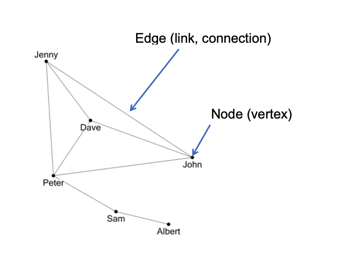
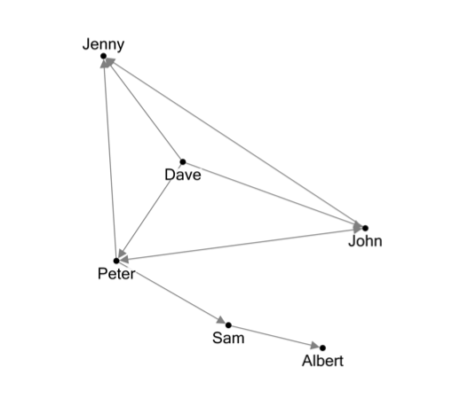
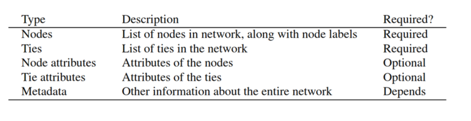
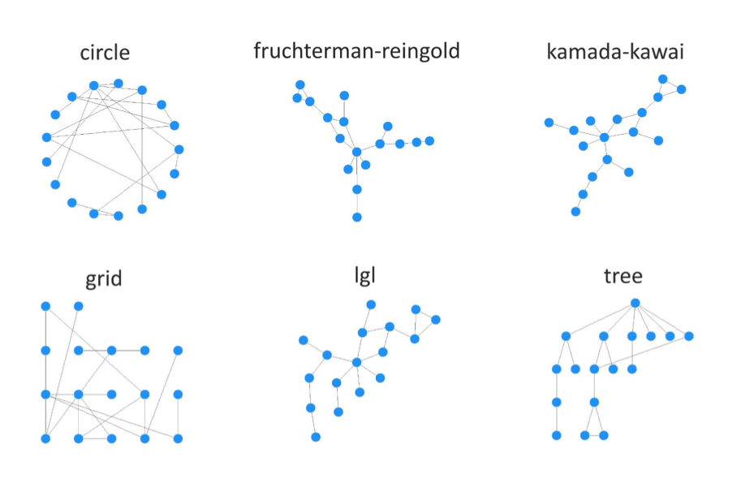
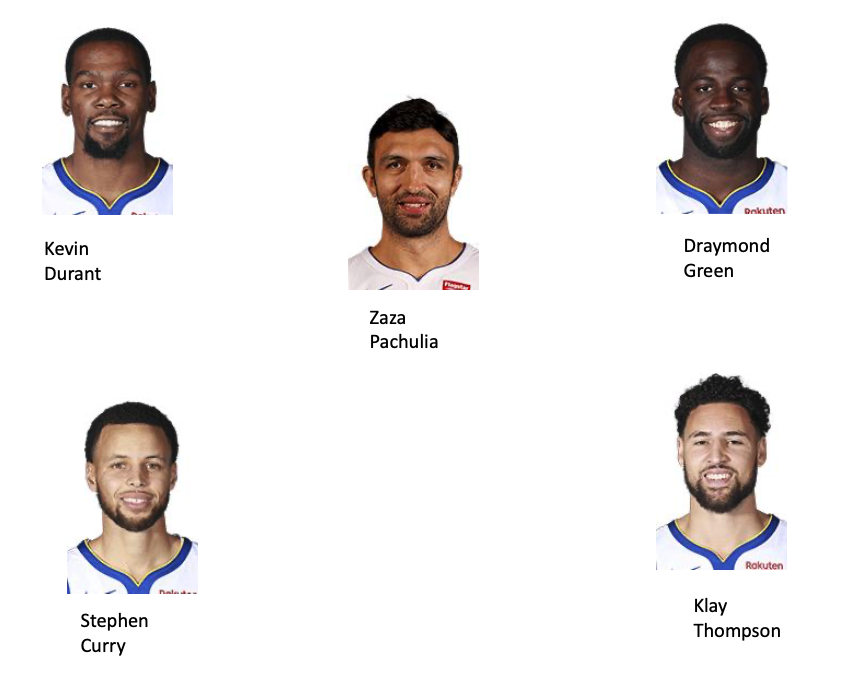

# Introduction

Networks are basically entities (peoples, players, clubs, magazines, countries, etc) and the connections among them.  

The basic elements of the networks are:  

* Nodes (also called vertices or vertexes)
* Edges (connections or links between them)

# Example: social network

Facebook: undirected network

\bcenter
```{r, echo=F,out.width="90%", out.height="80%"}

```
\ecenter

# Example: social network

Twitter: Directed network

\bcenter
```{r, echo=F,out.width="90%", out.height="80%"}

```
\ecenter

# Installing necessary packages

We will use 3 main packages for the network analsysis for creating and manipulating graph objects  

* igraph
* network  

For changing the class of objects from network to igraph and vice versa  

* intergraph  


```{r,eval=F}
install.packages("igraph")
install.packages("network")
install.packages("intergraph")
```

# Tools for social network analysis

* sna - A range of tools for social network analysis
* statnet: metapackage statnet: installs everything you need 
* statnetweb: r shiny application for network analysis

```{r, eval = F}
install.packages("sna") 
install.packages("statnet") 
install.packages("statnetWeb")
```

```{r, setup, include=FALSE, echo=F}
library(igraph)
library(intergraph)
library(network)
library(sna) 
library(statnet) 
library(statnetWeb)
```

# Types of data stored in the network data object


\bcenter
```{r, echo=F,out.width="90%", out.height="80%"}

```
\ecenter

# Input data

There are two main types of data structures that are used for network analysis.  

* Adjacency matrix (sociomatrix)
* Edge list

# Adjacency matrix

An adjacency matrix is a square matrix where a 1 indicates a tie between two nodes, and a 0 indicates no tie.  

The convention is that rows indicate the starting node, and columns indicate the receiving node


```{r}
mat <- rbind(c(0,1,1,0,0),c(0,0,1,1,0),c(0,1,0,0,0),
              c(0,0,0,0,0),c(0,0,1,0,0))
rownames(mat) <- c("A","B","C","D","E")
colnames(mat) <- c("A","B","C","D","E")
mat
```

# Adjacency matrix

\tiny
```{r}
net<-network(mat, matrix.type="adjacency")
summary(net)
```

# Plotting

```{r, fig.height=4, fig.align='center'}
plot(net, main="Network example", displaylabels=T)
```

# Plotting

Add the vertex labels with ***label=network.vertex.names()***

```{r, fig.height=4, fig.align='center'}
plot(net, main="Network example", label=network.vertex.names(net))
```

# Plotting

You can increase the vertex size by the parameter ***vertex.cex***

```{r, fig.height=4, fig.align='center'}
plot(net, main="Network example", label=network.vertex.names(net), vertex.cex=2.5)
```

# Plotting

Increase the labels size with ***label.cex***

```{r, fig.height=4, fig.align='center'}
plot(net, main="Network example", 
     label=network.vertex.names(net), vertex.cex=2.5, label.cex=1.5)
```

# Plotting

Increase the edge size with ***edge.lwd***
\tiny
```{r, fig.height=4, fig.align='center', out.height="80%"}
plot(net, main="Network example", 
     label=network.vertex.names(net), vertex.cex=2.5, label.cex=1.5, edge.lwd=10)
```

# Edge list

Edge list is a form of representing the network data, where each node is a tie/edge, with two columns specifying the FROM and TO nodes  

Edge list for the previous example

```{r}
mat1<-cbind(FROM=c("A", "A", "B", "B", "C", "E"),
            TO=c("B", "C", "C", "D", "B", "C"))
mat1
```

# Edge list


Specify ***matrix.type="edgelist"***

```{r}
net1<-network(mat1, matrix.type="edgelist")
```
\tiny
```{r, fig.height=4, fig.align='center', out.height="60%"}
plot(net1, main="Network example", 
     label=network.vertex.names(net), vertex.cex=2.5, label.cex=1.5, edge.lwd=10)
```

# With igraph

We can also get the edge list from the network object

```{r}
net_ed<-as.matrix(net,matrix.type = "edgelist")
net_ed
```

# Using igraph

```{r, fig.height=4, fig.align='center', out.height="80%"}
net3<-igraph::graph_from_edgelist(net_ed)
plot(net3)
```


# With igraph
Create graph using adjacency matrix with igraph

```{r, fig.height=4, fig.align='center', out.height="70%"}
net4<-graph_from_adjacency_matrix(mat)
plot(net4)
```

# Vizualizing with gplot

```{r, fig.height=4, fig.align='center', out.height="80%"}
sna::gplot(net1, displaylabels = T)
```

# Converting from igraph to network and vice versa

```{r}
net_i<-intergraph::asIgraph(net1)
class(net_i)
```

vice versa

```{r}
net_n<-intergraph::asNetwork(net_i)
class(net_n)
```


# Adding vertex attributes with network package
\tiny
```{r}
# object from network package
network::set.vertex.attribute(net1, "gender", c("F", "F", "M", "F", "M"))
summary(net1)
```


# Adding vertex attributes with network package

```{r}
network::get.vertex.attribute(net1, "gender")
# The same
net1 %v% "gender"

```

# Vertex attributes

Plot by coloring with network attribute

```{r, fig.height=4, out.height="70%"}
plot(net1,label=network.vertex.names(net1), 
     vertex.cex=2.5, label.cex=1.5,
     main="Sample graph with node attributes",
     vertex.col="gender")
```

# Adding edge attribute

```{r}
network::set.edge.attribute(net1, "edge.size", c(3,0,5,2,6))
# Check if added
network::get.edge.attribute(net1, "edge.size")
# the same
net1 %e% "edge.size"
```

# Looking what is inside: List node and edge attributes

```{r}
network::list.vertex.attributes(net1)
network::list.edge.attributes(net1)
```


# Plotting Edge Attributes

Edge attribute as an edge label, ***edge.label=“edge.size”***

```{r page_28, fig.height=4, out.height = "60%"}
plot(net1,label=network.vertex.names(net1), 
     vertex.cex=2.5, label.cex=1.5,
     main="Sample graph with node attributes",
     vertex.col="gender", edge.label="edge.size")
```


# Plotting Edge attribute

Edge attribute is used to set edge size, with ***edge.lwd=“edge.size”***

```{r, page_29, fig.height=4, out.height = "60%"}
plot(net1,label=network.vertex.names(net1), 
     vertex.cex=2.5, label.cex=1.5, 
     main="Sample graph with node attributes",
     vertex.col="gender")
```


# Graph layout

* The graph layout (the nodes coordinates) are drawn randomly
* So every time you make the same graph, you are going to get different picture Solutions (if it is a problem at all)
* use set.seed() to get the same graph
* Save the coordinates
* Use predefined layouts

<!-- page_31 -->

# Graph layout
use set.seed(<the same integer here>) when running the plot command
```{r}
set.seed(1)
plot(net1,label=network.vertex.names(net1))
```

<!-- page_32 -->
# Graph layout
Make the coordinates matrix

```{r}
set.seed(1)
my_coord<-plot(net1,displaylabels=T)
my_coord
```

<!-- page_33 -->
# Graph layout
Use argument coord
```{r}
plot(net1,label=network.vertex.names(net1), coord=my_coord)
```

<!-- page_34 -->
# Graph layout

You can use also predefined layouts, such as 

* Circle
* Fruchterman Reingold 
* Kamada-Kawai
* Random

<!-- page_35 -->
# Graph layout

\bcenter
```{r, echo=F,out.width="90%", out.height="80%"}

```
\ecenter

<!-- page_36 -->
# Graph layout: network package 

Set argument ***mode=“circle"***

```{r, fig.height=4, out.height="70%"}
plot(net1,label=network.vertex.names(net1), 
     mode="circle", main="Circle Layout")
```

<!-- page_37 -->
# Graph layout

```{r, fig.height=4,out.height="70%"}
plot(net1,label=network.vertex.names(net1), 
     mode="fruchtermanreingold", 
     main="Fruchterman - Reingold: The default layout")
```

<!-- page_38 -->
# Graph layout

```{r, fig.height=4, out.height="70%"}
plot(net1,label=network.vertex.names(net1), 
     mode="kamadakawai", main="Kamada-kawai")
```

<!-- page_39 -->
# Graph layout: igraph

With igraph package

```{r}
net5<-asIgraph(net1)
coords<-layout_in_circle(net5)
coords
```

Note: Coordinates are generated randomly, so if you don’t specify set.seed() you are going to have different results every time

<!-- page 40 -->
# Graph layout

```{r}
plot(net5, layout=coords, main="Circle Layout")
```

<!-- page 41 -->
# Graph layout

```{r}
plot(net5, layout=layout_with_fr(net5), main="Fruchterman - Reingold")
```

<!-- page 42 -->
# Graph layout

```{r}
plot(net5, layout=layout_on_grid(net5), main="Grid layout")
```

<!-- page 43 -->
# Graph layout

```{r}
plot(net5, layout=layout_nicely(net5), main="Nice layout")
```

<!-- page 44 -->

# Graphing with coordinates

Altering the coordinates

```{r, fig.height=4, fig.width = 6, out.height="70%"}
set.seed(1)
coord1<-plot(net1,displaylabels=T, mode="circle", main="Circle Layout", suppress.axes=F)
```

<!-- page 45 -->

# Altering the coordinates

Lets say you want to bring Node C to the center

```{r, fig.height=4, out.height="70%"}
#C is the third node, set coordinates to zero
coord1[3,]<-0
plot(net1,displaylabels=T, mode="circle", main="Circle Layout", coord=coord1)
```

<!-- page 46 -->

# Sub setting the graph: by vertex attribute

```{r, fig.height=4, out.height="60%"}
# library network
net1 %v% "gender"
net_f<-get.inducedSubgraph(net1, v=which(net1 %v% "gender" == "F"))
plot(net_f, label=network.vertex.names(net_f))
```

<!-- page 47 -->

# Sub setting the graph: by edge attribute

```{r, fig.height=4, out.height="70%"}
net1 %e% "edge.size"
# get the edges for which the edge.size is >= 3
net_e<-get.inducedSubgraph(net1, eid=which(net1 %e% "edge.size" >=3))
plot(net_e, label=network.vertex.names(net_e))
```

<!-- page 48 -->


# Accessing network information with igraph
For vertex attributes

```{r}
class(net4)
net4<-set_vertex_attr(net4,"gender", value=c("F", "F", "M",
"F", "M"))
# Accesing the vertex attribute
V(net4)$gender
V(net4)$name
```

<!-- page 49 -->

# Altering vertex attributes with igraph

Setting edge attributes

```{r}
# altering the values of attributes
# change the first element of the gender attribute to M
V(net4)$gender[1]<-"M"
V(net4)$gender
```

<!-- page 50 -->

# Marvel Network

## Marvel Network

<!-- page 51 -->


# Marvel network

\bcenter
```{r, echo=F,out.width="90%", out.height="80%"}

```
\ecenter

<!-- page 52 -->

# Marvel network

Number of common characters in the movies
row 1: Ant Man and Avengers Age of Ultron have 2 common characters


```{r}
marvel <- read.csv("./data/marvel.csv")
head(marvel)
```

<!-- page 53 -->

# Marvel network

* We will create a network where movies are going to be the vertices and the edges are going to show if two movies have common characters.
* First create a network/igraph object

```{r}
m_igraph <- igraph::graph_from_edgelist(as.matrix(marvel[,1:2]), directed = F)
m_igraph <- set_edge_attr(m_igraph, "characters", value = marvel[,3])
class(m_igraph)
```

<!-- page 54 -->

# Marvel network

```{r, fig.width=13, fig.height=12}
plot(m_igraph, layout = layout_in_circle(m_igraph))
```

<!-- page 55 -->

# Marvel network

Convert to network object

```{r}
m_net <- intergraph::asNetwork(m_igraph)
plot(m_net)
```

<!-- page 56 -->

# Marvel network

```{r, fig.width=13, fig.height=12}

plot(m_net, mode="circle", displaylabels=T, label.pos=6)
```

<!-- page 57 -->


# Marvel network

Lets add some attributes to vertices

```{r}
movies <- read.csv("./data/marvel_movies.csv", stringsAsFactors = F)
head(movies)
```

<!-- page 58 -->

# Marvel network

If both variables are in the same order, than you can just simple add the variable to the network object

```{r}
m_net %v% "vertex.names"
```

```{r}
identical(movies$Movie.title, m_net %v% "vertex.names")
```

<!-- page 59 -->

# Marvel network

Lets add to both ***network*** and ***igraph*** objects the variable BoxOffice

```{r}
set.vertex.attribute(m_net, attrname = "BoxOffice", movies$World_gross)
get.vertex.attribute(m_net, "BoxOffice")
```

```{r}
m_igraph <- set_vertex_attr(m_igraph, name = "BoxOffice", value = movies$World_gross)
V(m_igraph)$BoxOffice
```

<!-- page 60 -->

# Marvel network

Plot the network with the common characters as edge label

```{r, fig.width=13, fig.height=12}
plot(m_net, mode="circle", displaylabels=T, 
     label.pos=6, edge.label="characters")
```

<!-- page 61 -->

# Marvel network

Set the size of the edge as a

```{r, fig.width=13, fig.height=12}
plot(m_net, mode="circle", displaylabels=T, 
     label.pos=6, edge.lwd="characters",  label.cex=1.1)
```

<!-- page 62 -->

# Marvel network

Number of characters as an edge color

```{r, fig.width=13, fig.height=12}
plot(m_net, mode="circle", displaylabels=T, 
     label.pos=6, edge.col="characters")
```

<!-- page 63 -->

# Marvel network

* We want to assign BoxOffice variable to the size of the vertex.
* The conventional method will not work, need to transform the variable BoxOffice


```{r}
plot(m_net, mode="circle", displaylabels=T, 
     label.pos=6, edge.lwd="characters", 
     vertex.cex = m_net %v% "BoxOffice")
```

<!-- page 64 -->


# Marvel network

Instead of the variable BoxOffice, use its z-score

```{r}
x <- m_net %v% "BoxOffice"
z <- (x-mean(x))/sd(x)
```

<!-- page 65 -->


# Marvel network

```{r fig.width=13, fig.height=12}
plot(m_net, mode="circle", displaylabels=T, 
     label.pos=6, edge.lwd="characters", 
     vertex.cex = z)
```

<!-- page 66 -->

# Marvel network

```{r}
as_m <- as.matrix(m_net, matrix.type = "adjacency", attrname = "characters")
dim(as_m)
as_m[upper.tri(as_m)] <- 0 
```

<!-- page 67 -->

# Marvel network

```{r, fig.width=11, fig.height=12}
library(circlize)
chordDiagram(as_m)
```

<!-- page 68 -->

# Marvel network

Lets get rid of the connections, edges, where the edge value = 1

```{r, fig.width=11, fig.height=12}
as_m[as_m==1] <- 0
chordDiagram(as_m)
```

<!-- page 69 -->

# Marvel network

Lets induce the graph
* Keep only edges where the number of characters >= 2
* Keep only vertices where box office is more than 600 mln

<!-- page 70 -->

# Marvel network

Now we will look at the case where
* each vertex is a character from the movie
* each edge shows if the two vertexes were in the same movie
* edge attribute weight shows in how many movies do they appear together

```{r}
load("./data/marvel_roles.rda")
list.edge.attributes(marvel_roles)
```

<!-- page 71 -->

# Marvel network

```{r fig.width=11, fig.height=12, eval=F}
set.seed(1)
plot(marvel_roles, main="Marvel characters network")
```

<!-- page 72 -->

# Marvel network

Lets do subsetting and keep only those edges where weight >1, so two characters appeared together in more than 1 movie

```{r }
marvel_roles1 <- get.inducedSubgraph(marvel_roles, 
                                     eid=which(marvel_roles %e% "weight">1))
```

<!-- page 73 -->

# Marvel network

```{r fig.width=11, fig.height=12}
set.seed(1)
plot(marvel_roles1, main="Marvel characters network")
```

<!-- page 74 -->

# Marvel network

```{r fig.width=11, fig.height=12}
set.seed(1)
plot(marvel_roles1, main="Marvel characters network, weighted", 
     edge.col = "weight")
legend("topleft",fill = unique(marvel_roles1 %e% "weight"),
     legend=unique(marvel_roles1 %e% "weight"))
```

<!-- page 75 -->

# Marvel network

```{r fig.width=11, fig.height=12}
set.seed(1)
marvel_roles2 <- get.inducedSubgraph(marvel_roles, eid=which(marvel_roles %e% "weight"==3))

plot(marvel_roles2, main="Marvel characters network",
     displaylabels=T, mode="circle")

```

<!-- page 76 -->

# NBA passing network

## NBA passing network

<!-- page 77 -->

# NBA passing network

* NBA passing data can be obtained from NBA official api
* You will need to provide player ID (as specified by nba api)

<!-- page 78 -->

# NBA: passing network

* First we can get the roster
* If it doesn’t work now, get it from roster.rda

```{r, echo = T, eval = F}
library(SportsAnalytics270)
roster <- getPlayerID(2018)
head(roster)
```


```{r, echo = F}
library(SportsAnalytics270)
load("./data/roster.rda")
head(roster)
```

<!-- page 79 -->

# NBA: passing network

Or you can get the roster for a given team by supplying teamID and the year
This will give the roster for Golden State Warriors

```{r, echo=T, eval = F}
gsw <- getTeamRoster(2018,1610612744)
head(gsw,5)
```


```{r}
load("./data/gsw.rda")
```

<!-- page 80 -->

# NBA: passing network

Make a vector with playerids

```{r}
x <- gsw$PLAYER_ID
x[1:10]
```

A loop to get the passing network, using function getPassing

```{r, eval=F}
passing <- c()
for (i in x){
  try({
    p<-getPassing(2018, i, "Regular")
  passing<-rbind(passing,p)})
}
save(passing, file = "passing.rda")
```

<!-- page 81 -->


# NBA: passing network

```{r}
load("./data/passing.rda")
head(passing)
```


<!-- page 82 -->


# NBA: passing network

* Look at the variable PASS_TYPE
* It has two values made and received
* We will need a dataframe with made values only
* And with the players that were on the roster

```{r}
passing <- passing[passing$PASS_TYPE=="made",]
passing <- passing[passing$PASS_TEAMMATE_PLAYER_ID %in% x,]
```

<!-- page 83 -->


# NBA: passing network


Create an igraph object from edgelist

```{r, fig.width=12, fig.height=12}
library(igraph)
i_pass <- graph_from_edgelist(
  as.matrix(passing[,c("PLAYER_NAME", 
                       "PASS_TEAMMATE_PLAYER_NAME")]), directed = T)
```


<!-- page 84 -->


# NBA: passing network


```{r}
plot(i_pass)
```

<!-- page 85 -->

# Nba passing

Remove loops and plot

```{r}
passing <- passing[passing$PLAYER_NAME !=passing$PASS_TEAMMATE_PLAYER_NAME,]
```

<!-- page 86 -->


# NBA: passing network

```{r, fig.width=12, fig.height=12}
i_pass <- graph_from_edgelist(
  as.matrix(passing[,c("PLAYER_NAME", 
                       "PASS_TEAMMATE_PLAYER_NAME")]), directed = T)
plot(i_pass)
```

<!-- page 87 -->


# NBA: passing network

Transform to network object

```{r, fig.width=12, fig.height=12}
library(intergraph)
n_pass <- asNetwork(i_pass)
plot(n_pass)
```

<!-- page 88 -->

# NBA: passing network

Lets add some attributes  

start with vertex attributes   
currently we have vertex name only

```{r}
p <- n_pass %v% "vertex.names"
p
```

<!-- page 89 -->

# NBA: passing network

* We want to get the player position as a network attribute
* First need to be sure that they have the same order

```{r}
gsw <- gsw[order(match(gsw$PLAYER,p)),]
gsw$PLAYER
```

<!-- page 90 -->

# NBA: passing network


```{r}
network::set.vertex.attribute(n_pass, "position", gsw$POSITION)
n_pass %v% "position"
```

<!-- page 91 -->

# NBA: passing network

Get the number of games played (variable G)

```{r}
ngames <- unique(passing[,c("PLAYER_NAME", "G")])
ngames
```

<!-- page 92 -->


# NBA: passing network


```{r}
ngames <- ngames[order(match(ngames$PLAYER_NAME,p)),]
ngames
```

<!-- page 93 -->


# NBA: passing network

Set the vertex attribute

```{r}
network::set.vertex.attribute(n_pass, "ngames", ngames$G)
n_pass %v% "ngames"
```

<!-- page 94 -->


# NBA: passing network

* Lets look at the edge attributes
* Start with number of passes as n edge attribute


```{r}
network::set.edge.attribute(n_pass, "passes", passing$PASS)
n_pass %e% "passes"
```

<!-- page 95 -->


# NBA: passing network

```{r setup_1, include=FALSE}
library(ggplot2)
```

Lets look at two more variables for edge attributes  
Field Goals made

```{r}
ggplot(passing, aes(x=FGM))+geom_histogram()+
  labs(x="Field Goals ", title = "FG")
```


<!-- page 96 -->


# NBA: passing network

Field goal percentage

```{r}
ggplot(passing, aes(x=FG_PCT))+geom_histogram()+
  labs(x="Field Goal Percentage", title = "FGP")
```

<!-- page 97 -->


# NBA: passing network

```{r}
network::set.edge.attribute(n_pass, "FGP", passing$FG_PCT)
n_pass %e% "FGP"
```


<!-- page 98 -->

# NBA: passing network

Lets look at the distribution of the passes

```{r}
summary(n_pass %e% "passes")
```

```{r}
ggplot(passing, aes(x=PASS))+geom_histogram()+
  labs(x="Passes", title = "Distribution of passes")
```

<!-- page 99 -->

# NBA: passing network

```{r, fig.width=12, fig.height=12}
n_pass1<-get.inducedSubgraph(n_pass, 
                           eid=which(n_pass %e% "passes" > 30))
plot(n_pass1, displaylabels=T, mode="circle")
```


<!-- page 99 -->

# NBA: passing network

```{r, fig.width=12, fig.height=12}
mat <- as.matrix(n_pass1, matrix.type = "adjacency",
                 attrname="passes")
library(circlize)
chordDiagram(mat)
```

<!-- page 100 -->

# NBA: passing network

Lets plot the network with number of games played as vertex size

```{r}
x <- n_pass1 %v% "ngames"
z <- 2*(x - min(x))/(max(x)-min(x))
z
```

<!-- page 101 -->

# NBA: passing network

```{r, fig.width=12, fig.height=12}
plot(n_pass1, displaylabels=T, mode="circle",
     vertex.cex = z)
```

<!-- page 102 -->

# NBA: passing network

Colorize by player position

```{r, fig.width=12, fig.height=12}
plot(n_pass1, displaylabels=T, mode="circle",
     vertex.cex = z, vertex.col = "position")

```


<!-- page 103 -->

# NBA: passing network

```{r, fig.width=12, fig.height=12}
plot(n_pass1, displaylabels=T, mode="circle",
     vertex.cex = z, vertex.col = "position",
     label = n_pass1 %v% "position")
```


<!-- page 103 -->

# NBA: passing network
 
\bcenter
```{r, echo=F,out.width="90%", out.height="80%"}

```
\ecenter

<!-- page 104 -->

# NBA: passing network
```{r}
lineup <- c("Kevin Durant", "Zaza Pachulia", 
            "Draymond Green", "Stephen Curry",
            "Klay Thompson")
n_pass2 <- get.inducedSubgraph(n_pass1, 
            v=which(n_pass1 %v% "vertex.names"  %in% lineup))
```

<!-- page 105 -->

# NBA: passing network


```{r, fig.width=12, fig.height=12}
plot(n_pass2, displaylabels=T, 
      usecurve=T, edge.curve=0.025)
```

<!-- page 106 -->

# NBA: passing network


```{r, fig.width=12, fig.height=12}
coords <- plot(n_pass2, displaylabels=T, 
      suppress.axes = F)
```

<!-- page 107 -->

# NBA: passing network

We can try to change the coordinates

```{r}
coords
n_pass2 %v% "vertex.names"
```


<!-- page 108 -->

# NBA: passing network

```{r}
# "Draymond Green"
coords[1,] <- c(-2, -3)
# "Klay Thompson"
coords[2,] <- c(-2, -4.2)
# "Stephen Curry"
coords[3,] <- c(-3.5, -4.5)
# "Kevin Durant"
coords[4,] <- c(-3.6, -3)
# "Zaza Pachulia"
coords[5,] <- c(-2.7, -3.2)
```


<!-- page 109 -->

# NBA: passing network

```{r, fig.width=12, fig.height=12}
plot(n_pass2, displaylabels=T, coord = coords,
     usecurve=T, edge.curve=0.015)
```


<!-- page 110 -->

# NBA: passing network

Number of passes as edge attribute

```{r, fig.width=12, fig.height=12}

x <- n_pass2 %e% "passes"
z <- 10*(x - min(x))/(max(x)-min(x))
plot(n_pass2, displaylabels=T, coord = coords,
     usecurve=T, edge.curve=0.015, 
     edge.lwd = z)
```

<!-- page 111 -->

# NBA: passing network

Field goal percentage in each edge

```{r fig.width=12, fig.height=12}
plot(n_pass2, displaylabels=T, coord = coords,
     usecurve=T, edge.curve=0.015, 
     edge.label = n_pass2 %e% "FGP")
```

<!-- page 112 -->

# NBA: passing network

```{r, fig.width=12, fig.height=12}
i_pass2 <- intergraph::asIgraph(n_pass2)
plot(i_pass2, vertex.label = V(i_pass2)$vertex.names)
```

<!-- page 113 -->

# NBA: passing network

```{r, fig.width=12, fig.height=12}
plot(i_pass2, vertex.label = V(i_pass2)$vertex.names,
     layout=coords)
```


<!-- page 114 -->

# NBA: passing network

```{r, fig.width=12, fig.height=12}
x <- E(i_pass2)$passes
z <- 10*(x - min(x))/(max(x)-min(x))

plot(i_pass2, vertex.label = V(i_pass2)$vertex.names,
     layout=coords, edge.width = z, edge.curved=0.2)
```


# Nba passing

```{r, fig.width=12, fig.height=12}
plot(i_pass2, vertex.label = V(i_pass2)$vertex.names,
     layout=coords, edge.width = z, edge.curved=0.2)
```


# Nba passing

```{r fig.width=12, fig.height=12}
plot(n_pass2, displaylabels=T, coord = coords,
     usecurve=T, edge.curve=0.015, 
     edge.label = n_pass2 %e% "FGP")
```


# Nba passing

```{r fig.width=12, fig.height=12}
plot(n_pass2, displaylabels=T, coord = coords,
     usecurve=T, edge.curve=0.015, 
     edge.label = n_pass2 %e% "FGP")
```


# Nba passing

```{r fig.width=12, fig.height=12}
x <- n_pass2 %e% "FGP"
z <- 5*(x - min(x))/(max(x)-min(x))

plot(n_pass2, displaylabels=T, coord = coords,
     usecurve=T, edge.curve=0.015, 
     edge.lwd = z)
```

# Passing in football

## Passing in football


# Passing in football

```{r}
data("wc_14_final")
names(wc_14_final)
```


```{r}
head(wc_14_final$argentina_team)
```

```{r}
dim(wc_14_final$argentina_passing)
```

# Passing in football

```{r, tidy=F}
i_arg <- igraph::graph.adjacency(as.matrix(wc_14_final$argentina_passing),
                               mode="directed",weighted=TRUE,diag=FALSE)
net_arg <- intergraph::asNetwork(i_arg)
```


```{r}
list.edge.attributes(net_arg)
list.vertex.attributes(net_arg)
```

ading vertex attributes

```{r, tidy=F}
network::set.vertex.attribute(net_arg, "player.name",
          wc_14_final$argentina_team$Player_name)
get.vertex.attribute(net_arg, "player.name")

network::set.vertex.attribute(net_arg, "player.position",
        as.character(wc_14_final$argentina_team$Position))
get.vertex.attribute(net_arg, "player.position")
```

# Passing in football

```{r, tidy=F}
network::set.vertex.attribute(net_arg, "passes.completed",
                wc_14_final$argentina_team$Pass_completed)
```


```{r, tidy=FALSE}
wc_14_final$argentina_team$Completion <- wc_14_final$argentina_team$Pass_completed/
  wc_14_final$argentina_team$Pass_attempted
```


```{r, tidy=F}
network::set.vertex.attribute(net_arg, "completion",
                wc_14_final$argentina_team$Completion)
get.vertex.attribute(net_arg, "completion")
```


# Passing in football

I will make another object with only starting 11 players

```{r}
net_st <- get.inducedSubgraph(net_arg, v=1:11)
get.vertex.attribute(net_st, "player.name")
```

# Passing in football

plotting

```{r}
set.seed(1)
coords <- plot(net_st, suppress.axes=F)
```

# Passing in football

```{r}
# The goalkeeper
coords[1,] <- c(7,2)
# Garay
coords[2,] <- c(8, 3.5)
# Demichelis
coords[9,] <- c(8, 0.5)
# Zabaleta
coords[3,] <- c(9,4.5)
# Rojo
coords[10,] <- c(9, -1)
# Biglia
coords[4,] <- c(10.5, 3.5)
# Mascherano
coords[8,] <- c(10.5, 0.5)
# Perez
coords[5,] <- c(11.5, -1)
# Lavezzi
coords[11,] <- c(11.5,4.5)
#Messi
coords[7,] <- c(13.5, 0.5)
# Higuain
coords[6,] <- c(14.5, 3.5)
```

# Passing in football

```{r, fig.width=11, fig.height=12}
plot(net_st, coord=coords, suppress.axes=F, 
     label = net_st %v% "player.name")
```


# Passing in football

```{r, fig.width=11, fig.height=12}
plot(net_st, vertex.col="player.position", edge.lwd="weight",
     coord=coords)
```

# Passing in football


```{r, fig.width=11, fig.height=12}
plot(net_st, vertex.col="player.position",
     coord=coords, vertex.cex = 2*(net_st %v% "completion"),
     label = net_st %v% "player.name")
```

# Passing in football

```{r}
st_mat <- as.matrix(net_st, matrix.type = "adjacency", attrname = "weight")
colnames(st_mat) <- net_st %v% "player.name"
rownames(st_mat) <- colnames(st_mat)
```

# Passing in football

```{r, fig.width=12, fig.height=12}
chordDiagram(st_mat, directional = T)
```


